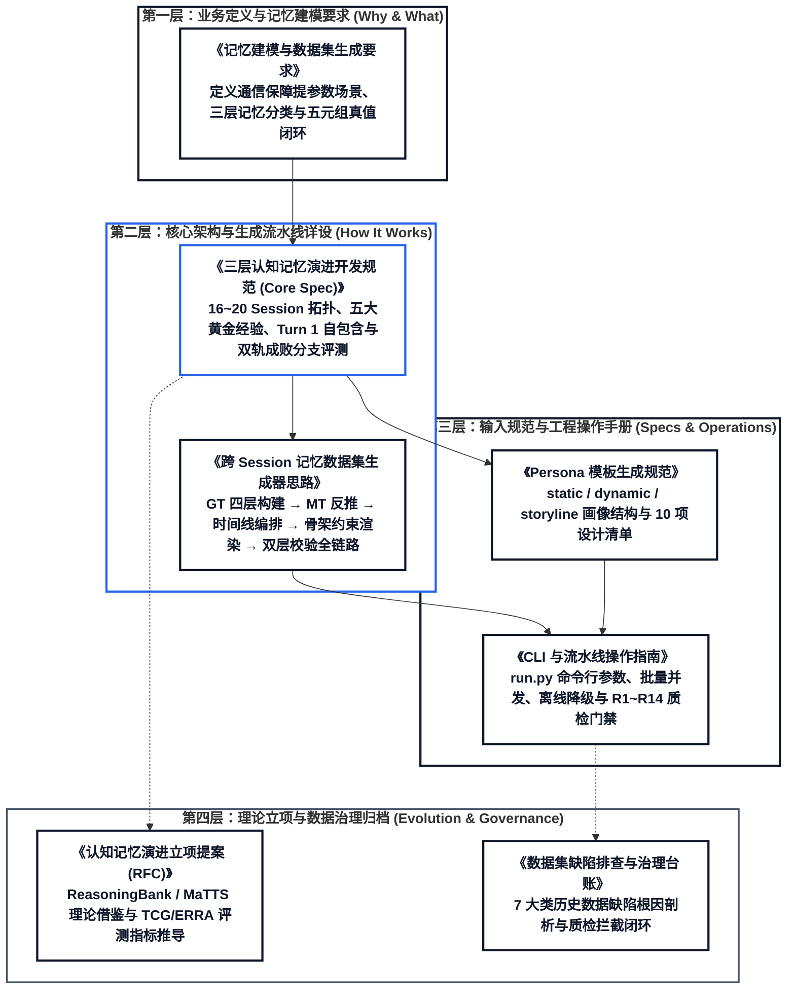
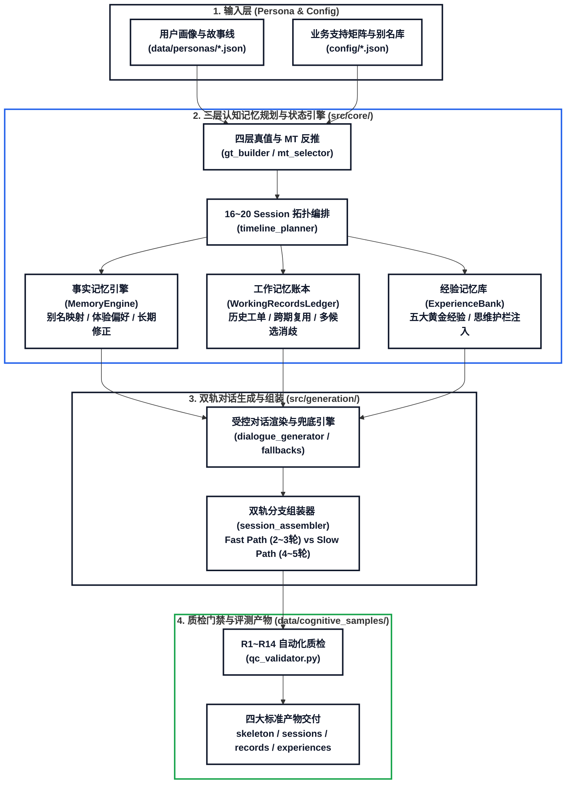

# “联接”Agent 跨会话三层认知记忆数据集文档中心

本目录汇集了 **通信网络保障“联接”Agent 跨会话认知记忆数据集（Cross-Session Cognitive Memory Dataset）** 的完整技术文档体系。为了便于理解系统全貌，文档按 **“业务要求 $\to$ 核心架构 $\to$ 工程规范 $\to$ 演进归档”** 四层逻辑递进组织。

---

## 一、 核心架构与文档阅读路线图

如果你是首次接触本项目，建议按照以下 **四层递进路线** 阅读文档：



---

## 二、 文档体系全景导航表

| 逻辑分层 | 文档名称 | 核心定位与解决的问题 | 对应代码模块 |
| :--- | :--- | :--- | :--- |
| **第一层：业务与建模要求** | [**《记忆建模与数据集生成要求》**](记忆建模与数据集生成要求.md) | 为什么要构建跨会话记忆？定义**事实记忆、工作记忆、经验记忆**三大维度、五元组真值映射、六类标准动作集与跨会话时间线硬约束 | 全局规范 |
| **第二层：核心架构与流水线** | [**《三层认知记忆演进开发规范》**](specs/cognitive_memory_dev_spec.md) | **【核心总纲】** 16~20 Session 怎么编排？详解三大正交记忆引擎、五大黄金经验策略、**Turn 1 基础参数自包含原则**与 **双轨成败分支测试（Fast/Slow Branch Evaluation）** | `timeline_planner.py`<br/>`working_records_ledger.py`<br/>`experience_bank.py`<br/>`session_assembler.py` |
| **第二层：核心架构与流水线** | [**《跨 Session 记忆数据集生成器思路》**](跨%20Session%20记忆数据集生成器思路.md) | 单个样本如何从画像变成多轮对话？详解 **四层 GT 构建 $\to$ MT/MF 反推 $\to$ 16 种模板骨架约束 $\to$ 槽位表达计划 $\to$ 四元 `source_type` 标注** | `gt_builder.py`<br/>`mt_selector.py`<br/>`dialogue_generator.py`<br/>`preference_maps.py` |
| **第三层：输入规范与操作** | [**《Persona 模板生成规范》**](specs/persona_spec.md) | 输入画像长什么样？规定 `static_profile`、`dynamic_profile` 与 `storyline` 的 JSON Schema、编写原则及 10 项质量检查清单 | `persona_StoryExtractor.py`<br/>`data/personas/` |
| **第三层：输入规范与操作** | [**《CLI 与流水线操作指南》**](guides/cli_usage.md) | 怎么运行代码与验收数据？提供 `run.py` 命令行参数详解、单画像/批量生成指令、产物目录结构说明及 **R1~R14 自动化质检**指南 | `run.py`<br/>`batch_pipeline.py`<br/>`qc_validator.py` |
| **第四层：理论与治理归档** | [**《认知记忆演进立项提案 (RFC)》**](archive/memory_evolution_proposal.md) | 经验记忆与双轨评测的学术依据是什么？阐述 ReasoningBank 与 MaTTS 理论迁移、TCG 轮次压缩增益公式与四阶段演进路线 | 架构立项参考 |
| **第四层：理论与治理归档** | [**《数据集缺陷排查与治理台账》**](archive/defect_triage_log.md) | 历史版本踩过哪些坑？归档 7 大类早期样本缺陷（断链、重复确认、冷启动抢答、内部枚举泄漏等）的根因定位与修复闭环 | `qc_validator.py`<br/>`dialogue_prompts.py` |

---

## 三、 “联接”Agent 三层认知记忆架构一图流

“联接”Agent 专精于通信网络保障的**意图参数提取（提参数）**与精准闭环受理。系统通过 **“规则定骨架与真值、LLM 负责口语化渲染、验证器强门禁拦截”** 的混合架构，在单个用户的 16~20 个跨会话生命周期中完整演练三层认知记忆：



---

## 四、 文档与代码仓目录结构

```text
docs/
├── README.md                              # 文档中心总入口与四层阅读路线图（本文档）
├── 记忆建模与数据集生成要求.md               # 第一层：业务背景、三层记忆分类与五元组真值要求
├── 跨 Session 记忆数据集生成器思路.md        # 第二层：端到端生成流水线、GT→MT→Timeline→Session 详设
├── specs/                                 # 核心架构与输入规范 (Specifications)
│   ├── cognitive_memory_dev_spec.md       # 第二层：【核心总纲】三层认知记忆与双轨成败分支测试规范
│   └── persona_spec.md                    # 第三层：Persona 画像与故事线输入 JSON 规范
├── guides/                                # 工程运行与操作指南 (Operational Guides)
│   └── cli_usage.md                       # 第三层：run.py 命令行使用、产物说明与质检操作手册
├── archive/                               # 演进提案与治理归档 (Historical & Governance Archive)
│   ├── memory_evolution_proposal.md       # 第四层：三层认知记忆演进立项提案 (RFC)
│   └── defect_triage_log.md               # 第四层：历史数据集缺陷根因剖析与治理台账
└── render_html.py                         # 文档可视化渲染引擎（一键生成全套高保真 HTML 文档）
```

---

## 五、 快速上手命令（基于当前代码仓 `run.py`）

```bash
# 1. 单画像端到端生成与 R1~R14 质检验证（推荐开发调试使用）
python run.py --input data/personas --output data/cognitive_samples --start 0 --count 1 --verify --force

# 2. 离线确定性生成模式（不依赖外部 LLM API，使用高质量内置模板瞬间生成并质检）
python run.py --input data/personas --output data/cognitive_samples --start 0 --count 5 --offline --verify --force

# 3. 批量生成移动核心网 5 个标杆画像全量认知记忆样本
python run.py --input data/personas --output data/cognitive_samples --start 0 --count 5 --verify --force

# 4. 重新渲染 docs/ 下所有 Markdown 为可视化 HTML 网页
python docs/render_html.py
```

---

## 五、 全局编写与制图硬性准则（源自 `GEMINI.md`）

1. **智能体统一称谓**：本项目的核心智能体统一命名为 **“联接”Agent**，专精于通信网络保障的**意图参数提取（提参数）**与精准闭环受理。
2. **正规评测专业命名**：架构图、时序图、技术文档及代码注释中，统一采用 **“动态多分支模拟评测”**、**“双轨成败分支测试（Fast/Slow Branch Evaluation）”** 或 **“树状交互评测”**。
3. **Mermaid 视觉标准**：
   - **纯白底色**：所有图表背景统一采用纯白色（`#FFFFFF`），保持清爽高对比度；
   - **加粗字体**：图中所有节点名称、时序消息、分支标注与说明文字**全量采用粗体（Bold）**；
   - **线条加粗**：连接线与箭头统一加粗（`stroke-width: 2px ~ 2.5px`），确保轮廓清晰锐利。
