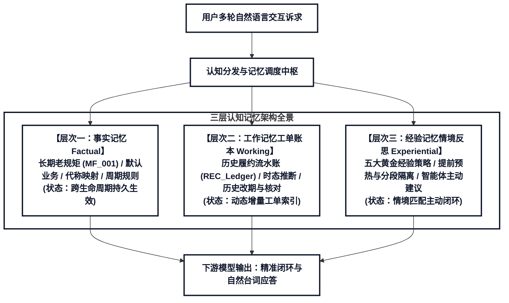
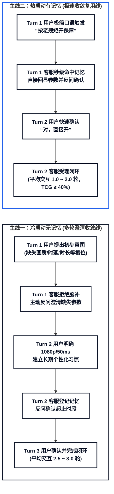
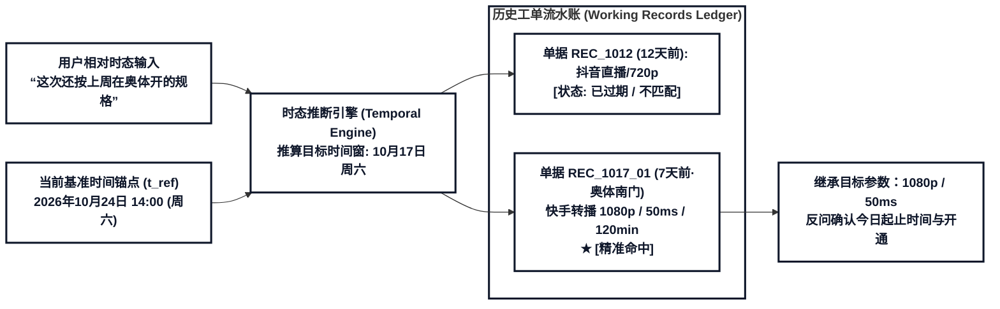
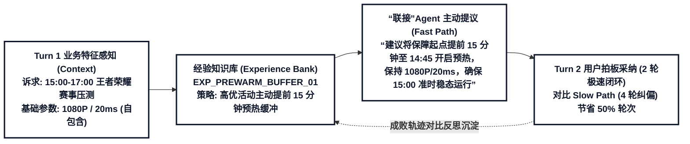

# 跨会话记忆认知架构演进：指标体系、工作记忆检索与经验记忆构造规划

> **文档层级**：第四层 · 架构演进提案与理论归档（Architecture Evolution RFC）  
> **文档定位**：记录三层认知架构演进初期的理论论证、MemoryArena / ReasoningBank 文献启发与 Phase 1~4 敏捷工程路线图。  
> **权威实现规范**：本项目正式生效的实现设计与评测基准，请全量以 [**《“联接”Agent 跨会话三层认知记忆数据集与双轨评测引擎技术规范》**](../specs/cognitive_memory_dev_spec.md) 为准。

---

## 一、核心演进背景与三层记忆架构全景

### 1.1 核心演进背景

当前数据集在完成基础画像的多轮会话基线构造、实现基于“长期偏好与个性化表达”的事实记忆（Factual Profile Memory）闭环后，为了让“联接”Agent 从被动的“偏好记录”迈向具备真实人类协作质感的多层认知体系，并为下游模型提供严密量化的评测基准，系统拓展了工作记忆的独立单据回溯能力，并重点构建基于真实成败轨迹反思与策略迁移的**经验记忆（Experiential Memory）**。

### 1.2 三层认知记忆架构拓扑全景



### 1.3 三层认知记忆职责划分

| 记忆层级             | 核心定位与存储内容                                     | 典型台词触发形式                                   | 解决的核心认知问题                             |
|:-------------------- |:------------------------------------------------------ |:-------------------------------------------------- |:---------------------------------------------- |
| **事实记忆**         | 用户固有习惯、个性化老规矩、默认绑定关系与代称别名     | “按老规矩办”、“开直播保障”、“按那个省心档来”       | 免去常规已知参数盘问，保持长期个性化默契       |
| **工作记忆工单账本** | 历史各次保障工单履约记录、时间戳、地点与网络指标流水账 | “这次去奥体还按上周的来”、“把昨天的改一下”         | 建立时态相对指称索引，支持跨会话参数复用与改期 |
| **经验记忆情境反思** | 基于历史成败对比提炼的五大黄金避坑策略与主动闭环准则   | “赛事压测主动提前15分钟预热”、“双业务独立分段” | 变被动应答为主动提议，在 Fast Path 中 2 轮高效闭环 |

---

## 二、事实记忆演进：冷热启动指标与敏捷度调控

### 2.1 冷热启动交互对照流图



### 2.2 事实记忆核心量化指标：交互轮数压缩增益（TCG）

为避免多重指标膨胀，事实记忆冷热启动评估统一收敛为 **1 个核心量化指标**，并将“零记忆反问澄清”作为前置质检硬门槛（Hard Gate）：

#### 交互轮数压缩增益（Turn Compression Gain, TCG）

定量衡量长程事实记忆机制为用户减少的无谓交互轮次比例：

$$\text{TCG} = \frac{\bar{T}_{\text{cold}} - \bar{T}_{\text{hot}}}{\bar{T}_{\text{cold}}} \times 100\%$$

其中：

- $\bar{T}_{\text{cold}}$ 表示无记忆冷启动会话的平均交互轮数（理论基准：$2.5 \sim 3.0$ 轮）；
- $\bar{T}_{\text{hot}}$ 表示有记忆热启动会话的平均交互轮数（理论基准：$1.0 \sim 2.0$ 轮）；
- **评测达标线**：$\text{TCG} \ge 40\% \sim 50\%$。
- **前置质检硬门槛（Hard Gate）**：冷启动零记忆场景下，参数反问澄清完整率必须达到 **100.0%**，参数提前泄露与擅自脑补率必须为 **0.0%**。未达门槛的样本直接判定为质检不合格，不进入 TCG 评分。

---

### 2.3 生成端总控因子：记忆敏捷度因子（α）

为了将评测指标反哺并精确指导数据生成，在批量生成流水线中首创引入 **1 个全局控制因子 —— 记忆敏捷度因子（Memory Agility Factor, $\alpha \in [0.0, 1.0]$）**，作为控制对话压缩与默契梯度的总控旋钮。

#### 1. 控制目标轮次压缩公式

在时间线规划器（`TimelinePlanner`）中，热启动会话的目标交互轮数由 $\alpha$ 线性调制确定：

$$T_{\text{hot}} = \text{round}\big(T_{\text{cold}} \cdot (1 - \alpha)\big)$$

- **$\alpha = 0.0$（极端保守 / 冷启动基线）**：强制不唤醒事实记忆，客服对所有关键参数逐项盘问澄清，交互轮数保持 $T = 3$ 轮；
- **$\alpha = 0.5$（常规稳健热启动）**：客服从记忆中调取配置向用户反问确认，用户确认后开通，交互轮数稳定在 $T = 2$ 轮；
- **$\alpha = 1.0$（极致敏捷热启动）**：用户极简口语触发（如“按老规矩办”），客服秒级命中并默认直接受理闭环，达成极速 $T = 1$ 轮交互。

#### 2. 控制用户台词口语省略深度（Omission Intensity）

敏捷度因子 $\alpha$ 直接调控 Prompt 中对用户台词槽位省略的严格级别：

- **低敏捷度（$\alpha \le 0.3$）**：用户台词允许保留部分辅助信息（如应用名 + 部分参数），属于弱省略；
- **高敏捷度（$\alpha \ge 0.7$）**：用户台词强制深度省略画质、时延、时长甚至应用名，仅使用极简代称（如“老规矩开保障”），倒逼智能体必须 100% 依赖事实记忆补全所有通信参数。

#### 3. 生成控制到评测指标的因果闭环


在生成画像时，通过配置 $\alpha$ 梯度分布（如 20% 生成 $\alpha=1.0$、60% 生成 $\alpha=0.5$、20% 生成 $\alpha=0.0$），即可系统化构建覆盖从初识到熟客不同默契深度的全阶梯评测基准。

---

## 三、工作记忆演进：独立工单账本与时态相对检索

### 3.1 时态推断引擎与工单检索流程



### 3.2 工作记忆账本与会话流的解耦架构规范（Decoupled Storage Standard）

在数据工程落地上，系统严格落实**关注点分离（Separation of Concerns）**原则：**工作记忆的工单流水账（Working Records Ledger）坚决独立生成并存储为单独的文件，绝不和对话会话（`sessions.jsonl`）混杂在一起！**

| 数据存储文件   | 物理存储路径                                   | 职责定位与存储内容                                                        | 上下文注入与引用机制                                                             |
|:-------------- |:---------------------------------------------- |:------------------------------------------------------------------------- |:-------------------------------------------------------------------------------- |
| **会话对话流** | `data/cognitive_samples/<id>/sessions.jsonl`       | 仅存储用户与客服的多轮对话（turns）、意图标注、以及**轻量级单据引用指针** | 仅记录 `source_type: "WorkingRecord", source_ref: "REC_0001"` |
| **工单流水账** | `data/cognitive_samples/<id>/working_records.jsonl` | 独立全局履约单据流水库，包含所有历史开通记录的完整快照与环境元数据        | 仅当下游评测或“联接”Agent 需要执行时态回溯时，由外部检索器调取匹配单据                |

> **【核心架构收益】工作记忆工单流水独立解耦的三大价值**
>
> 1. **杜绝 Prompt 上下文剧烈爆炸**：若将用户过去数十次工单全量嵌入每轮对话的 session 中，会话文件体积极速膨胀，不仅极大浪费推理 Token，还会引入无关干扰；解耦后保持会话轻盈纯净。
> 2. **真实映射电信生产架构**：在真实运营商核心网中，CRM 客户中心与 OSS/BSS 工单系统是彼此独立的外部数据库。提参 Agent 必须通过“语义提取 $\to$ 构造查询 $\to$ 调用接口”完成取数，解耦能完美模拟真实系统的接口调用。
> 3. **便于外部 Verifier 校验**：自动化质检脚本可独立对 `working_records.jsonl` 进行时间连续性、主键唯一性校验，与会话多轮质检互不干扰。

#### 独立历史工单流水账结构（`working_records.jsonl`）

```json
{
  "record_id": "REC_20261017_01",
  "source_session_id": "S-USER_001-03",
  "user_id": "USER_001",
  "created_at": "2026年10月17日14时00分",
  "application_name": "快手",
  "service_name": "赛事转播",
  "start_timestamp": "2026年10月17日14时00分",
  "end_timestamp": "2026年10月17日16时00分",
  "duration": "120min",
  "resolution": "1080p",
  "rtt_max": "50ms",
  "location": "奥体中心主体育场看台",
  "execution_status": "completed",
  "temporal_reference_aliases": {
    "day_offset_1": "昨天在奥体的赛事转播",
    "day_offset_7": "上周在奥体的转播保障",
    "last_similar": "上次在体育场开的那个"
  }
}
```

#### 会话文件中轻量级指针（`sessions.jsonl`）

```json
{
  "session_id": "S-USER_001-04",
  "current_time": "2026年10月24日14时00分",
  "turns": [
    {
      "turn_id": 1,
      "user": "这次去奥体，还按上周在奥体办的那个规格来。",
      "agent_action": "Retrieve_Working_Record",
      "working_memory_pointer": {
        "target_record_id": "REC_20261017_01",
        "inferred_delta_days": 7,
        "matched_application": "快手",
        "inherited_slots": {"resolution": "1080p", "rtt_max": "50ms"}
      },
      "agent": "已为您找到上周六在奥体的快手转播保障单（1080p、时延≤50ms）。请问今天的保障起止时间是几点到几点？"
    }
  ]
}
```

### 3.3 新增工作记忆会话模板

| 模板编号 | 场景角色         | 用户台词特征                                         | 智能体动作与检索逻辑                                                               | 预期轮数 |
|:-------- |:---------------- |:---------------------------------------------------- |:---------------------------------------------------------------------------------- |:-------- |
| **T2-6** | 历史单据跨期复用 | “**这次**去奥体，还按**上周**在奥体办的那个规格来。” | 计算时差为 7 天，从账本定位单据 `REC_1017_01`，提取 1080p/50ms，反问今日时间区间。 | 2 轮     |
| **T2-7** | 历史单据变更改期 | “把**昨天**预约的那个保障往后推迟一个小时。”         | 计算时差为 1 天，定位昨日预约单据，更新 `start_timestamp` 并通知用户变更成功。     | 2 轮     |
| **T2-8** | 历史记录对账核查 | “帮我查下**这周**总共开了几次保障，一共多长时间？”   | 时间范围遍历本周工单流水账，聚合统计开通次数、累计时长并输出明细清单。             | 1 轮     |

---

## 四、经验记忆构造：MemoryArena 与 ReasoningBank 深度融合

经验记忆是“联接”Agent 面对复杂外场环境、冲突边界与多轮交互时沉淀的元认知策略。针对提参智能体的经验记忆构造，系统全面汲取 **MemoryArena** 与 **ReasoningBank (MaTTS)** 的核心思想，打造从理论启发、双真值链、经验卡片规范到五大黄金落地场景的完整生成体系：

### 4.1 论文理念精要与对经验记忆构造的关键启发

| 理论来源 | 核心学术洞见 | 对“联接”Agent 经验记忆构造的工程启发 |
| :--- | :--- | :--- |
| **ReasoningBank** | 将智能体交互历史中的成功捷径与失败踩坑记录，通过自对比反思（Self-Contrast Reflection）提炼为结构化三元组卡片 `(Title, Description, Content)` | 拒绝将用户的个人静态偏好充当经验；经验卡片专门存储**通用主动服务与避坑策略**（如重大压测提前 15 分钟预热、同日多单优先选取零卡顿优质工单） |
| **MaTTS (Test-Time Scaling)** | 单一正确轨迹无法检验模型是否真正习得策略；必须同时构造**应用经验的高效轨迹（Fast Path）**与**忽略经验的低效纠偏轨迹（Slow Path）** | 在 `sessions.jsonl` 的每个经验会话中内嵌 **双轨成败分支测试（Fast/Slow Branch Evaluation）**，且首轮用户输入保持基础参数自包含，精准量化轮次压缩增益（TCG） |
| **MemoryArena** | 真实长程任务中存在跨会话的多候选干扰与时效状态冲突，智能体必须联合当前条件与历史记录做消歧或裁决 | 设计多业务分段隔离、法定节假日周期豁免、新旧重叠工单温和截断让路等复杂推理场景 |

### 4.2 经验记忆核心机制：首创“双真值链”解耦并行

在数据合成中坚决拒绝把通用经验与个人偏好混为一谈，首创采用**事实链**与**经验链**解耦并行的生成机制：

1. **事实链（Factual Ground-Truth Chain）**：
   - **关注问题**：用户的通信保障参数（画质、时延、应用）在什么时间、什么条件下有效？怎样建立、临时变更和长期更新？
   - **载体支撑**：用户画像配置（Persona Profile）与持久化历史工单流水账（`working_records.jsonl`）。
2. **经验链（Reasoning Ground-Truth Chain）**：
   - **关注问题**：智能体在交互中遇到了什么处理困境（如开场突发拥塞、多候选工单质量参差、节假日排期冲突、新旧单时段重叠、多意图混用参数）？采取了什么应对策略？从中提炼出什么通用的元认知处理方法？
   - **载体支撑**：结构化经验知识库（`experiences.jsonl`）。
3. **汇聚原则（Convergence Principle）**：
   - 两条链在**经验演练会话（Experiential Sessions）**中交汇：用户在 Turn 1 给出自包含的基础保障参数，“联接”Agent 主动应用经验策略给出优化方案；
   - **绝对隔离**：经验策略绝不篡改用户的核心画质/时延规格，而是提供时钟前移预热、双单拆分、节假日顺延等结构化决策增益。

---

### 4.3 经验记忆本体：ReasoningBank 标准经验条目卡片规范

#### 经验反思双环流流程图



#### ReasoningBank 标准经验条目卡片规范

全面对齐 ReasoningBank 论文规范，将经验记忆形式化为标准卡片三元组 `(title, description, content)` 并附带触发模式与槽位求解提示：

```json
{
  "exp_id": "EXP_PREWARM_BUFFER_01",
  "title": "高优活动提前15分钟预热缓冲",
  "description": "当用户申请大型赛事直播、压测或跨国高优会议保障时，准点开通极易遭遇开场瞬时流量冲击导致前几分钟卡顿。",
  "content": "识别到高优直播、赛事压测或核心峰会需求时，即使首轮用户已给出完整的起止时间、画质与时延参数，智能体也应在首轮确认中主动建议将 start_time 提前 15 分钟开启预热缓冲通道，避免开场抖动。",
  "trigger_Pattern": "高优先级直播/压测/峰会 + 整点或准点开始",
  "slot_Resolution_Hint": "start_time = stated_start_time - 15min (proactive suggestion in Turn 1)"
}
```

---

### 4.4 经验记忆驱动的四大提参数据生成升级方案

结合 MemoryArena 的跨 Session 依赖评测理念与 ReasoningBank 的经历提炼迁移机制，针对移动核心网提参智能体打造四个数据升级方案：

#### 方案 1：从“事实召回”升级为“候选记录选择与必要消歧”

- **理论借鉴**：借鉴 MemoryArena 的属性兼容链与多候选干扰机制。使当前轮次无法单凭当前句子得出答案，必须利用跨会话依赖回溯；同时通过成败对照提炼消歧方法。
- **场景序列设定**：
  - **S1 (2026-10-05)**：用户确认腾讯会议：14:00—16:00、720P、时延≤80ms；写入工作工单流水 `REC_1005_01`；
  - **S2 (2026-10-07)**：用户确认虎牙看直播：19:00—21:00、1080P、时延≤50ms；写入工作工单流水 `REC_1007_01`；
  - **S3 (2026-10-14)**：用户输入：“今天下午两点到四点腾讯会议，参数按上周开会那次。”
- **成败轨迹对照**：
  - **失败轨迹**：Agent 简单按“上周”时态就近匹配到 S2，填入 1080P 和 ≤50ms；用户被迫纠错：“我说的是开会那次，不是直播！”；
  - **成功轨迹**：Agent 联合“腾讯会议”应用名与“开会”业务词，结合 7 天时差精准锁定 S1，继承 720P/80ms，并使用今天的新时间段发起确认：“已为您调取上周会议参数（720P/80ms），今日 14:00-16:00 开通，对吗？”；用户确认：“对”。
- **提炼 ReasoningBank 经验卡片**：
  - **Title**：跨期单据复用先校验业务应用与时效范围
  - **Description**：多业务用户使用“上周/上次”指代时，极易因就近原则误判目标单据。
  - **Content**：定位历史工单时，先以应用/业务类型为强约束过滤候选集，再匹配相对时态；当前输入的明确值（如今日时间）优先级最高，仅复用历史体验参数槽位，严禁将历史日期整条照搬。
- **跨用户策略迁移（Transfer）**：
  - 换新用户，该用户开会习惯为 1080P，直播为 720P，提问“直播按上周那次”；智能体复用上述“先筛业务再比时态”的方法，准确提取 720P。复用的是检索方法，而非前一个用户的 720P 数值。
- **边界反例与 Verifier 规则**：
  - **边界反例**：若用户模糊表达：“今天按上周那次来。”且上周存在多次不同业务单据，智能体**严禁脑补盲猜，必须发起 `Request_Disambiguation` 追问**，禁止在隐藏 GT 中指定单据；
  - **Verifier 校验**：`target_record_id` 命中 S1；日期必须来自当前；分辨率与时延来自同一单据；候选不唯一时必须触发消歧动作。

---

#### 方案 2：从“最新值覆盖”升级为“作用域与时效联合判断”

- **理论借鉴**：借鉴跨会话状态机演化机制，从失败轨迹中提炼“临时变更”与“长期更新”的生命周期边界。
- **状态演进时序**：
  - **S1**：“以后会议默认 720P。” $\to$ 建立长期事实记忆：会议=720P；
  - **S2**：“今天会议这次 1080P。” $\to$ 临时变更（Temporary Choice）：当前会议=1080P，长期默认仍保持 720P；
  - **S3**：“明天会议按默认的。” $\to$ 正确提取长期默认 720P（**若按机械最新值将误判为 1080P**）；
  - **S4**：“以后会议默认 1080P。” $\to$ 用户明确指示，长期事实记忆更新为 1080P（Permanent Update）；
  - **S5**：“今天会议照旧。” $\to$ 提取更新后的长期默认 1080P。
- **成败轨迹对照**：
  - **失败轨迹**：Agent 误把 S2 的“这次”当成全局覆盖，导致 S3 错误继承 1080P；
  - **成功轨迹**：精准标记 `scope="session_temporary"` 与 `scope="profile_permanent"`，S3 稳定恢复 720P。
- **提炼 ReasoningBank 经验卡片**：
  - **Title**：参数提取先判断时效作用域与生命周期
  - **Description**：口语中“这次/今天”与“以后/默认”存在截然不同的生效边界。
  - **Content**：参数提取前先识别作用域标志词；“这次/临时/今天”仅作用于当前任务，“以后/默认/改规矩”才触发长期画像更新；冲突消解以同作用域为准，严禁单凭时间戳机械取最新值。
- **边界反例**：“上次那个 720P”仅引用具体历史单据，不自动建立长期默认；“以后都按 720P”才是真正的全局事实更新。

---

#### 方案 3：从“单一正确轨迹”升级为“追问策略三态对照”

- **理论借鉴**：借鉴 ReasoningBank 的 MaTTS 对照思想。仅有单一成功样本无法凸显策略价值，必须构建“失败”、“正确但低效”、“高效闭环”三态对照。
- **任务前提**：当前应用支持 720P 与 1080P 两种画质，用户无历史映射，输入：“明天 14 点到 16 点腾讯会议，要高清一点。”
- **三态轨迹对照**：
  - **轨迹 1（失败 / 冒进脑补）**：Agent 擅自脑补 1080P 并直接受理，用户纠正：“我手机屏幕小，720P 够了，别浪费我流量”；
  - **轨迹 2（正确但低效 / 泛化提问）**：Agent 泛泛追问：“您还有什么其他要求吗？”，用户重复强调后，Agent 再次追问画质，导致无谓交互轮数增加至 4 轮；
  - **轨迹 3（高效精准 / 结构化候选反问）**：Agent 基于配置矩阵精准追问：“已为您准备腾讯会议保障，画质支持 720P 高清与 1080P 超清，请问您倾向哪个规格？”，用户秒级回答：“720P”，2 轮高效闭环。
- **提炼 ReasoningBank 经验卡片**：
  - **Title**：多候选无依据时结构化反问替代泛泛追问
  - **Description**：面对歧义形容词（高清、省心）且无先验记忆时，冒进猜测引发纠错，漫无边际追问增加成本。
  - **Content**：缺乏先验依据时，严格根据支持矩阵（Support Matrix）列出合法候选发起定向反问，精准聚焦缺失槽位。
- **数据标注规范**：严格区分 `Request_Clarification`（无依据定向追问）与 `Confirm_Hypothesis`（有先验证据确认反问），严禁把盲目猜测包装成“确认反问”。

---

#### 方案 4：从“扁平多意图”升级为“逐轮状态传递与局部修正”

- **理论借鉴**：多意图复合会话中的状态演进与同源干扰防护。
- **演练场景**：
  - **T1 用户**：“明天 14 点到 16 点腾讯会议，晚上 19 点到 21 点虎牙看直播，画质都照旧。”
  - **T1 Agent**：“收到！会议为您按 720P、直播按 1080P，两个时段按您说的开启，对吗？”
  - **T2 用户**：“直播不变，会议这次改 1080P。”
  - **T2 Agent**：“明白！明日下午腾讯会议调整为 1080P，晚间虎牙直播保持 1080P，确认开通吗？”
  - **T3 用户**：“对，直接开。”
- **成败轨迹对照**：
  - **失败轨迹 1（跨意图污染）**：Agent 误把直播的画质也改掉，或将会议时间套给直播；
  - **失败轨迹 2（未来值倒灌）**：评测引擎在评估 T1 轮次时，错误将 T2 提供的 1080P 倒灌回 T1 的 Ground Truth；
  - **成功轨迹**：各意图单元拥有独立的 `intent_key`，局部修正仅作用于目标单元，保持其余意图绝对稳定。
- **提炼 ReasoningBank 经验卡片**：
  - **Title**：多意图局部修正严格隔离意图作用域
  - **Description**：长复合会话中用户修正某一个意图时，极易对同会话内的其他意图造成污染。
  - **Content**：参数更新必须先绑定目标意图单元（intent_key）；禁止因位置临近跨意图转移参数；严格保持时序因果性，禁止后续修改倒灌早期轮次。

---

## 五、四阶段工程迭代路线图与验证验收方案

### 5.1 四阶段敏捷迭代路线图

系统按照敏捷演进思路，规划为四个工程落地阶段：

<div class="roadmap-grid">
    <div class="roadmap-card">
        <div class="roadmap-phase">Phase 1 · 1~2 天</div>
        <div class="roadmap-title">指标体系与双真值链规范</div>
        <div class="roadmap-desc">
            确立单一 TCG 压缩增益指标公式与敏捷度因子 α 控制规范；落地 working_records.jsonl 独立解耦标准；定义 ReasoningBank 经验卡片三元组 Schema。
        </div>
    </div>
    <div class="roadmap-card">
        <div class="roadmap-phase">Phase 2 · 2~3 天</div>
        <div class="roadmap-title">独立工单账本与时态检索</div>
        <div class="roadmap-desc">
            落地独立工单生成流水线；实现时态相对推断器；完成方案 1（跨期复用与消歧）与方案 2（作用域隔离）的生成模板。
        </div>
    </div>
    <div class="roadmap-card">
        <div class="roadmap-phase">Phase 3 · 2~3 天</div>
        <div class="roadmap-title">经验提炼与迁移评测</div>
        <div class="roadmap-desc">
            落地方案 3（追问三态对照）与方案 4（多意图局部修正）；构建跨用户迁移测试集，验证思维策略复用性。
        </div>
    </div>
    <div class="roadmap-card">
        <div class="roadmap-phase">Phase 4 · 1~2 天</div>
        <div class="roadmap-title">质检套件与 Benchmark 发布</div>
        <div class="roadmap-desc">
            升级 qc_validator.py 质检规则；硬性校验零未来值倒灌率、消歧反问准确率；发布全量离线评测基准与分析报告。
        </div>
    </div>
</div>

---

### 5.2 自动化流水线测试

```bash
# 1. 运行单画像原型测试（验证独立工单账本与 ReasoningBank 经验提议）
python run.py --start 0 --count 1 --verify

# 2. 运行多层认知记忆全量单元测试（含双真值链一致性校验）
python -m unittest discover tests

# 3. 运行自动化 Benchmark 离线评估脚本，输出 TCG、ERRA 与消歧率报告
python scripts/evaluate_memory_benchmark.py --input data/generated
```

### 5.3 人工抽检与质检验收硬准则

- **工单文件严格解耦**：所有历史工单 100% 独立存储于 `working_records.jsonl`，`sessions.jsonl` 仅保留轻量级索引，无冗余数据嵌套；
- **时态指代严格准确**：台词出现“上周”时，目标单据时间严格落在 3~7 天前的历史工单中，杜绝时间错乱；
- **冷启动零脑补与消歧准则**：无记忆会话首轮未提供参数、或存在多个同类模糊候选时，智能体 100% 发起结构化澄清反问，杜绝擅自盲猜；
- **双真值链无未来倒灌**：时序因果性严格成立，后期轮次的局部修正与新参数绝对不得倒灌至早期历史轮次的 Ground Truth 中。
