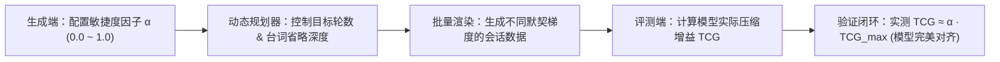

# 跨会话记忆认知架构演进：指标体系、工作记忆检索与经验记忆构造规划

> **文档定位**：系统规划跨会话长程记忆数据集向多层认知架构演进的技术方案。涵盖冷热启动交互对照指标体系（TCG）、基于时态相对指称的工作记忆工单账本检索（Working Records），以及基于情境反思的经验记忆（Experiential Memory）构造机制与分阶段工程实施路线。

---

## 核心演进背景与架构全景

当前数据集已完成 150 个画像共 2100 个多轮会话的基线构造，实现了基于“长期偏好与个性化表达”的语义记忆（Semantic Memory）闭环。为了让智能体从单一被动的“偏好记录”迈向具备真实人类协作质感的多层认知体系，并为下游模型提供严密量化的评测基准，本规划正式引入三大认知维度演进：

- **冷热启动敏捷度体系**：以单一核心指标（TCG）衡量事实记忆交互轮次压缩增益，并首创引入“记忆敏捷度因子 α”作为生成流水线的全局调控旋钮；
- **工作记忆工单账本**：支持“这次”、“上次”、“上周三”、“昨天”等相对时态指代，构建跨会话历史工单流水账的检索与追溯；
- **经验记忆情境反思**：沉淀“场景—困境—避坑方案—成效反思”经验知识库，实现智能体主动经验提议与用户经验回溯。

---

## 记忆认知架构三层拓扑

多层认知记忆体系分为三个各司其职、因果协同的逻辑层次：

### 拓扑结构框图

<!-- 框图 1：三层认知记忆架构拓扑全景图 (支持在此直接修改 SVG 文本、标签或样式，亦可替换为 ```mermaid 代码块) -->
<div class="diagram-container">
                        <!-- SVG 框图 1: 三层认知记忆架构拓扑图 -->
                        <svg viewBox="0 0 880 430" width="100%" height="auto" xmlns="http://www.w3.org/2000/svg">
                            <!-- 背景组 -->
                            <defs>
                                <filter id="shadow" x="-5%" y="-5%" width="110%" height="115%">
                                    <feDropShadow dx="0" dy="3" stdDeviation="4" flood-opacity="0.08"/>
                                </filter>
                                <marker id="arrow" viewBox="0 0 10 10" refX="6" refY="5" markerWidth="6" markerHeight="6" orient="auto-start-reverse">
                                    <path d="M 0 1 L 8 5 L 0 9 z" fill="var(--diagram-arrow)"/>
                                </marker>
                            </defs>

                            <!-- 用户诉求输入框 -->
                            <rect x="280" y="15" width="320" height="46" rx="8" fill="var(--diagram-box-bg)" stroke="var(--accent-primary)" stroke-width="2" filter="url(#shadow)"/>
                            <text x="440" y="44" font-size="14" font-weight="bold" fill="var(--text-primary)" text-anchor="middle">用户多轮自然语言交互诉求</text>

                            <!-- 分发中枢 -->
                            <path d="M 440 61 L 440 92" stroke="var(--diagram-arrow)" stroke-width="2" marker-end="url(#arrow)"/>
                            <rect x="330" y="94" width="220" height="40" rx="6" fill="var(--surface-color)" stroke="var(--diagram-box-border)" stroke-width="1.5"/>
                            <text x="440" y="119" font-size="13" font-weight="600" fill="var(--accent-primary)" text-anchor="middle">认知分发与记忆调度中枢</text>

                            <!-- 三条支线连接线 -->
                            <path d="M 330 114 L 140 114 L 140 162" stroke="var(--diagram-arrow)" stroke-width="1.5" fill="none" marker-end="url(#arrow)"/>
                            <path d="M 440 134 L 440 162" stroke="var(--diagram-arrow)" stroke-width="1.5" fill="none" marker-end="url(#arrow)"/>
                            <path d="M 550 114 L 740 114 L 740 162" stroke="var(--diagram-arrow)" stroke-width="1.5" fill="none" marker-end="url(#arrow)"/>

                            <!-- 层次一：事实记忆 -->
                            <rect x="30" y="165" width="220" height="195" rx="8" fill="var(--diagram-box-bg)" stroke="#709775" stroke-width="2" filter="url(#shadow)"/>
                            <rect x="30" y="165" width="220" height="34" rx="8" fill="#709775"/>
                            <text x="140" y="188" font-size="13" font-weight="bold" fill="#ffffff" text-anchor="middle">层次一：事实记忆</text>
                            <text x="45" y="222" font-size="12" fill="var(--text-primary)">• 长期固有老规矩 (MF_001)</text>
                            <text x="45" y="246" font-size="12" fill="var(--text-primary)">• 业务默认应用 (service_app)</text>
                            <text x="45" y="270" font-size="12" fill="var(--text-primary)">• 个性化表达与代称映射</text>
                            <text x="45" y="294" font-size="12" fill="var(--text-primary)">• 周期触发规则 (daily/weekly)</text>
                            <rect x="42" y="318" width="196" height="26" rx="4" fill="var(--surface-color)"/>
                            <text x="140" y="335" font-size="11" fill="var(--text-muted)" text-anchor="middle">状态：跨生命周期持久生效</text>

                            <!-- 层次二：工作记忆工单流水账 -->
                            <rect x="330" y="165" width="220" height="195" rx="8" fill="var(--diagram-box-bg)" stroke="#5c7cb6" stroke-width="2" filter="url(#shadow)"/>
                            <rect x="330" y="165" width="220" height="34" rx="8" fill="#5c7cb6"/>
                            <text x="440" y="188" font-size="13" font-weight="bold" fill="#ffffff" text-anchor="middle">层次二：工作记忆工单账本</text>
                            <text x="345" y="222" font-size="12" fill="var(--text-primary)">• 历史履约流水账 (REC_Ledger)</text>
                            <text x="345" y="246" font-size="12" fill="var(--text-primary)">• 时态相对推断器 (&Delta;t 映射)</text>
                            <text x="345" y="270" font-size="12" fill="var(--text-primary)">• '这次' / '上周' / '昨天' 索引</text>
                            <text x="345" y="294" font-size="12" fill="var(--text-primary)">• 历史单据变更与状态核对</text>
                            <rect x="342" y="318" width="196" height="26" rx="4" fill="var(--surface-color)"/>
                            <text x="440" y="335" font-size="11" fill="var(--text-muted)" text-anchor="middle">状态：动态增量工单索引</text>

                            <!-- 层次三：经验记忆情境反思 -->
                            <rect x="630" y="165" width="220" height="195" rx="8" fill="var(--diagram-box-bg)" stroke="#c48a37" stroke-width="2" filter="url(#shadow)"/>
                            <rect x="630" y="165" width="220" height="34" rx="8" fill="#c48a37"/>
                            <text x="740" y="188" font-size="13" font-weight="bold" fill="#ffffff" text-anchor="middle">层次三：经验记忆情境反思</text>
                            <text x="645" y="222" font-size="12" fill="var(--text-primary)">• 场景情境特征 (Context)</text>
                            <text x="645" y="246" font-size="12" fill="var(--text-primary)">• 避坑最佳实践 (Rule of Thumb)</text>
                            <text x="645" y="270" font-size="12" fill="var(--text-primary)">• 智能体主动建议 (Proactive)</text>
                            <text x="645" y="294" font-size="12" fill="var(--text-primary)">• 用户经验回溯与验证反思</text>
                            <rect x="642" y="318" width="196" height="26" rx="4" fill="var(--surface-color)"/>
                            <text x="740" y="335" font-size="11" fill="var(--text-muted)" text-anchor="middle">状态：情境匹配条件反射</text>

                            <!-- 汇聚到输出 -->
                            <path d="M 140 360 L 140 385 L 440 385" stroke="var(--diagram-arrow)" stroke-width="1.5" fill="none"/>
                            <path d="M 440 360 L 440 398" stroke="var(--diagram-arrow)" stroke-width="1.5" fill="none" marker-end="url(#arrow)"/>
                            <path d="M 740 360 L 740 385 L 440 385" stroke="var(--diagram-arrow)" stroke-width="1.5" fill="none"/>

                            <rect x="300" y="400" width="280" height="26" rx="6" fill="var(--surface-color)" stroke="var(--border-color)"/>
                            <text x="440" y="418" font-size="12" font-weight="600" fill="var(--accent-primary)" text-anchor="middle">下游模型输出：精准闭环与自然台词应答</text>
                        </svg>
                        <div class="diagram-caption">图 1：跨会话三层认知记忆架构拓扑全景图</div>
                    </div>

### 三层记忆职责划分

| 记忆层级 | 核心定位与存储内容 | 典型台词触发形式 | 解决的核心认知问题 |
| :--- | :--- | :--- | :--- |
| **事实记忆** | 用户固有习惯、个性化老规矩、默认绑定关系与代称别名 | “按老规矩办”、“开直播保障”、“按那个省心档来” | 免去常规已知参数盘问，保持长期个性化默契 |
| **工作记忆工单账本** | 历史各次保障工单履约记录、时间戳、地点与网络指标流水账 | “这次去奥体还按上周的来”、“把昨天的改一下” | 建立时态相对指称索引，支持跨会话参数复用与改期 |
| **经验记忆情境反思** | 基于极端或特殊外场环境沉淀的避坑策略与最佳实践 | “大型漫展人流高密主动降画质提议”、“恶劣天气防丢包” | 变被动应答为主动提议，增强专业履约质感 |

### 事实记忆（Semantic Profile Memory，已有基线）
- **核心定位**：用户的长期固有偏好与个性化表达习惯。
- **代表内容**：长期老规矩配置（如常规时段默认 1080p、50ms 以内）、业务默认绑定的主线应用（如“开直播”默认指抖音）、小记忆点代称别名映射。
- **生命周期**：跨全生命周期持久有效，除非用户明确发起全局修改。

### 工作记忆与工单账本（Working / Episodic Records，本次演进）
- **核心定位**：带时间戳、环境快照与履约状态的历史任务流水账。
- **代表内容**：各历史会话生成的具体保障记录（如 `REC_20261012_01`）、发生地点、起止时间与网络配置。
- **交互特征**：用户高频使用相对时态词（“这次”、“上周”、“昨天办的那个”、“上回在海淀那个”）发起单据复用、变更或历史核对。
- **检索机制**：基于当前会话时间锚点与历史单据账本进行时态相对差推断与参数继承。

### 经验记忆与情境反思（Experiential / Procedural Memory，本次演进）
- **核心定位**：基于历史实战总结提炼出的情境避坑策略与最佳实践（Rule of Thumb）。
- **代表内容**：高密人流场馆防拥塞方案、恶劣天气弱网丢包加固方案、多机位高带宽协同保障策略。
- **交互特征**：智能体在识别到特定现场情境时**主动发起经验建议**（Proactive Suggestion），或用户主动询问“上次那个避坑方案是怎么配的”。

---

## 核心指标体系设计：两条交互线对照

在数据构造与评测体系中，必须建立清晰可量化的评估标尺。系统以“冷启动多轮澄清”与“热启动极速闭环”作为两条对照主线。

### 冷热启动交互对照流图

<!-- 框图 2：冷启动 vs 热启动交互流程对照 (支持在此直接修改 SVG 文本、标签或样式，亦可替换为 ```mermaid 代码块) -->
<div class="diagram-container">
                        <!-- SVG 框图 2: 冷启动 vs 热启动交互流程对照 -->
                        <svg viewBox="0 0 880 340" width="100%" height="auto" xmlns="http://www.w3.org/2000/svg">
                            <!-- 左侧：冷启动无记忆主线 -->
                            <rect x="30" y="15" width="390" height="310" rx="10" fill="var(--diagram-bg)" stroke="var(--callout-warn-border)" stroke-width="1.5"/>
                            <rect x="30" y="15" width="390" height="32" rx="10" fill="var(--callout-warn-border)"/>
                            <text x="225" y="37" font-size="13" font-weight="bold" fill="#ffffff" text-anchor="middle">主线一：冷启动无记忆（多轮澄清收敛线）</text>

                            <!-- 第 1 轮 -->
                            <rect x="50" y="60" width="350" height="42" rx="6" fill="var(--diagram-box-bg)" stroke="var(--border-color)"/>
                            <text x="65" y="86" font-size="12" fill="var(--text-primary)">[User 1] 提出初步意图（缺画质、时延、时长等必要槽位）</text>

                            <path d="M 225 102 L 225 116" stroke="var(--diagram-arrow)" stroke-width="1.5" marker-end="url(#arrow)"/>
                            <rect x="50" y="118" width="350" height="42" rx="6" fill="var(--callout-warn-bg)" stroke="var(--callout-warn-border)"/>
                            <text x="65" y="144" font-size="12" font-weight="600" fill="var(--callout-warn-text)">[Agent 1] 严格拒绝脑补，主动反问澄清缺失的关键参数</text>

                            <!-- 第 2 轮 -->
                            <path d="M 225 160 L 225 174" stroke="var(--diagram-arrow)" stroke-width="1.5" marker-end="url(#arrow)"/>
                            <rect x="50" y="176" width="350" height="42" rx="6" fill="var(--diagram-box-bg)" stroke="var(--border-color)"/>
                            <text x="65" y="202" font-size="12" fill="var(--text-primary)">[User 2] 明确指定 1080p、50ms，并建立长期个性化习惯</text>

                            <path d="M 225 218 L 225 232" stroke="var(--diagram-arrow)" stroke-width="1.5" marker-end="url(#arrow)"/>
                            <rect x="50" y="234" width="350" height="42" rx="6" fill="var(--diagram-box-bg)" stroke="var(--border-color)"/>
                            <text x="65" y="260" font-size="12" fill="var(--text-primary)">[Agent 2] 登记记忆，并反问确认起止时段与开通</text>

                            <!-- 第 3 轮闭环 -->
                            <path d="M 225 276 L 225 288" stroke="var(--diagram-arrow)" stroke-width="1.5" marker-end="url(#arrow)"/>
                            <rect x="70" y="290" width="310" height="26" rx="4" fill="var(--surface-color)"/>
                            <text x="225" y="308" font-size="11" font-weight="bold" fill="var(--callout-warn-text)" text-anchor="middle">平均交互轮数：2.5 ~ 3.0 轮（严禁早泄）</text>

                            <!-- 右侧：热启动有记忆主线 -->
                            <rect x="460" y="15" width="390" height="310" rx="10" fill="var(--diagram-bg)" stroke="var(--callout-note-border)" stroke-width="1.5"/>
                            <rect x="460" y="15" width="390" height="32" rx="10" fill="var(--callout-note-border)"/>
                            <text x="655" y="37" font-size="13" font-weight="bold" fill="#ffffff" text-anchor="middle">主线二：热启动有记忆（极速收敛复用线）</text>

                            <!-- 第 1 轮 -->
                            <rect x="480" y="60" width="350" height="42" rx="6" fill="var(--diagram-box-bg)" stroke="var(--border-color)"/>
                            <text x="495" y="86" font-size="12" fill="var(--text-primary)">[User 1] 极简口语触发：“按老规矩开保障” / “按昨天的来”</text>

                            <path d="M 655 102 L 655 120" stroke="var(--diagram-arrow)" stroke-width="1.5" marker-end="url(#arrow)"/>
                            <rect x="480" y="122" width="350" height="50" rx="6" fill="var(--callout-note-bg)" stroke="var(--callout-note-border)"/>
                            <text x="495" y="144" font-size="12" font-weight="600" fill="var(--callout-note-text)">[Agent 1] 秒级命中记忆，提取 1080p/50ms，</text>
                            <text x="495" y="162" font-size="12" fill="var(--callout-note-text)">结合当前时段直接向用户发起反问确认开通</text>

                            <!-- 第 2 轮 -->
                            <path d="M 655 172 L 655 190" stroke="var(--diagram-arrow)" stroke-width="1.5" marker-end="url(#arrow)"/>
                            <rect x="480" y="192" width="350" height="42" rx="6" fill="var(--diagram-box-bg)" stroke="var(--border-color)"/>
                            <text x="495" y="218" font-size="12" fill="var(--text-primary)">[User 2] 确认开通：“对，直接开”</text>

                            <path d="M 655 234 L 655 252" stroke="var(--diagram-arrow)" stroke-width="1.5" marker-end="url(#arrow)"/>
                            <rect x="480" y="254" width="350" height="30" rx="6" fill="var(--callout-note-bg)" stroke="var(--callout-note-border)"/>
                            <text x="495" y="274" font-size="12" font-weight="bold" fill="var(--callout-note-text)">[Agent 2] 受理完成闭环，输出祝福语收尾</text>

                            <rect x="500" y="292" width="310" height="24" rx="4" fill="var(--surface-color)"/>
                            <text x="655" y="308" font-size="11" font-weight="bold" fill="var(--callout-note-text)" text-anchor="middle">平均交互轮数：1.0 ~ 2.0 轮（轮次压缩率 &ge; 40%）</text>
                        </svg>
                        <div class="diagram-caption">图 2：冷启动多轮澄清 vs 热启动极速压缩交互对照流程</div>
                    </div>

### 交互主线一：冷启动无记忆多轮澄清线

在用户首次发起某项业务、或提出全新无先验记忆的保障需求时，智能体**严禁擅自脑补参数，严禁默认直接开通**。
- **行为规范**：用户仅表达模糊需求（如“帮我开个直播保障”）时，智能体必须发起精准反问（Clarify），要求用户补齐画质、时延、时长等缺失槽位；
- **交互约束**：冷启动会话严格保证交互轮数不少于 2 轮（典型为 2~3 轮），完成“用户发起 $\to$ 客服反问澄清 $\to$ 用户补全并确认 $\to$ 客服受理收尾”的完整链路；
- **防幻觉铁律**：零记忆场景下，参数早泄率与擅自默认率必须为 0.0%。

### 交互主线二：热启动有记忆轮次极速压缩线

在智能体已沉淀相应语义偏好、或用户明确唤醒历史工作工单时，智能体展现出高度默契与专业效率。
- **行为规范**：智能体准确命中记忆槽位，直接调取配置并结合当前时段向用户反问确认；
- **交互约束**：交互轮次从冷启动的 3 轮极速收敛至 1~2 轮，免去繁琐的基础参数盘问；
- **体验收益**：用户仅需极简口语（“按老规矩”、“还是昨天的规格”）即可高效完成保障开通。

### 事实记忆核心量化指标：交互轮数压缩增益（TCG）

为避免多重指标膨胀，事实记忆冷热启动评估统一收敛为 **1 个核心量化指标**，并将“零记忆反问澄清”作为前置质检硬门槛（Hard Gate）：

#### 交互轮数压缩增益（Turn Compression Gain, TCG）
定量衡量长程事实记忆机制为用户减少的无谓交互轮次比例：

$$\text{TCG} = \frac{\bar{T}_{\text{cold}} - \bar{T}_{\text{hot}}}{\bar{T}_{\text{cold}}} \times 100\%$$

其中：
- $\bar{T}_{\text{cold}}$ 表示无记忆冷启动会话的平均交互轮数（理论基准：$2.5 \sim 3.0$ 轮）；
- $\bar{T}_{\text{hot}}$ 表示有记忆热启动会话的平均交互轮数（理论基准：$1.0 \sim 2.0$ 轮）；
- **评测达标线**：$\text{TCG} \ge 40\% \sim 50\%$。
- **前置质检硬门槛（Hard Gate）**：冷启动零记忆场景下，参数反问澄清完整率必须达到 **100.0%**，参数早泄与擅自脑补率必须为 **0.0%**。未达门槛的样本直接判定为质检不合格，不进入 TCG 评分。

---

### 生成端总控因子：记忆敏捷度因子（α）

为了将评测指标反哺并精确指导数据生成，在批量生成流水线中首创引入 **1 个全局控制因子 —— 记忆敏捷度因子（Memory Agility Factor, $\alpha \in [0.0, 1.0]$）**，作为控制对话压缩与默契梯度的总控旋钮。

#### 1. 控制目标轮次压缩公式
在时间线规划器（`TimelinePlanner`）中，热启动会话的目标交互轮数由 $\alpha$ 线性调制确定：

$$T_{\text{hot}} = \text{round}\big(T_{\text{cold}} \cdot (1 - \alpha)\big)$$

- **$\alpha = 0.0$（极端保守 / 冷启动基线）**：强制不唤醒事实记忆，客服对所有关键参数逐项盘问澄清，交互轮数保持 $T = 3$ 轮；
- **$\alpha = 0.5$（常规稳健热启动）**：客服从记忆中调取配置向用户反问确认，用户确认后开通，交互轮数稳定在 $T = 2$ 轮；
- **$\alpha = 1.0$（极致敏捷热启动）**：用户极简口语触发（如“按老规矩办”），客服秒级命中并默认直接受理闭环，达成极速 $T = 1$ 轮交互。

#### 2. 控制用户台词口语省略深度（Omission Intensity）
敏捷度因子 $\alpha$ 直接调控 Prompt 中对用户台词槽位省略的严格级别：
- **低敏捷度（$\alpha \le 0.3$）**：用户台词允许保留部分辅助信息（如应用名 + 部分参数），属于弱省略；
- **高敏捷度（$\alpha \ge 0.7$）**：用户台词强制深度省略画质、时延、时长甚至应用名，仅使用极简代称（如“老规矩开保障”），倒逼智能体必须 100% 依赖事实记忆补全所有通信参数。

#### 3. 生成控制到评测指标的因果闭环



在生成 150 个画像时，通过配置 $\alpha$ 梯度分布（如 20% 生成 $\alpha=1.0$、60% 生成 $\alpha=0.5$、20% 生成 $\alpha=0.0$），即可系统化构建覆盖从初识到熟客不同默契深度的全阶梯评测基准。

#### 工作记忆单据检索准确率（Episodic Record Retrieval Accuracy, ERRA）
衡量用户使用时态相对代词时，模型在历史账本中定位目标单据的准确率：

$$\text{ERRA} = \frac{N_{\text{correct\_record\_retrieved}}}{N_{\text{relative\_time\_sessions}}} \times 100\%$$

- 判定标准：提取的历史单据 ID 与参数值与标注真值严格一致。目标达标线：**100.0%**。

#### 经验记忆情境激活与采纳率（Experiential Memory Trigger & Acceptance Rate, EMTAR）
衡量在特定外场困难情境下，智能体经验建议被合理触发并被用户采纳的比例：

$$\text{EMTAR} = \frac{N_{\text{accepted\_experience\_suggestions}}}{N_{\text{experience\_trigger\_contexts}}} \times 100\%$$

---

## 工作记忆架构与时态检索机制

工作记忆以现实时间流为轴线，解决用户口语中频繁出现的**时态相对代指与工单追溯**。

### 时态推断与检索流程图

<!-- 框图 3：工作记忆时态推断与历史工单检索流程图 (支持在此直接修改 SVG 文本、标签或样式，亦可替换为 ```mermaid 代码块) -->
<div class="diagram-container">
                        <!-- SVG 框图 3: 工作记忆检索流程 -->
                        <svg viewBox="0 0 880 260" width="100%" height="auto" xmlns="http://www.w3.org/2000/svg">
                            <!-- 用户输入 -->
                            <rect x="30" y="30" width="230" height="70" rx="8" fill="var(--diagram-box-bg)" stroke="var(--accent-primary)" stroke-width="1.5"/>
                            <text x="45" y="58" font-size="12" font-weight="bold" fill="var(--accent-primary)">用户相对时态输入</text>
                            <text x="45" y="80" font-size="12" fill="var(--text-primary)">“这次还按上周在奥体开的规格”</text>

                            <!-- 当前时间锚点 -->
                            <rect x="30" y="140" width="230" height="70" rx="8" fill="var(--surface-color)" stroke="var(--border-color)"/>
                            <text x="45" y="168" font-size="12" font-weight="bold" fill="var(--text-secondary)">当前基准时间锚点 (t_ref)</text>
                            <text x="45" y="190" font-size="12" fill="var(--text-primary)">2026年10月24日 14:00 (周六)</text>

                            <!-- 箭头到推断器 -->
                            <path d="M 260 65 L 320 115" stroke="var(--diagram-arrow)" stroke-width="1.5" marker-end="url(#arrow)"/>
                            <path d="M 260 175 L 320 135" stroke="var(--diagram-arrow)" stroke-width="1.5" marker-end="url(#arrow)"/>

                            <!-- 时态推断器引擎 -->
                            <rect x="325" y="90" width="210" height="75" rx="8" fill="var(--callout-imp-bg)" stroke="var(--callout-imp-border)" stroke-width="1.5"/>
                            <text x="430" y="118" font-size="13" font-weight="bold" fill="var(--callout-imp-text)" text-anchor="middle">时态推断器 (Temporal Engine)</text>
                            <text x="430" y="140" font-size="11" fill="var(--callout-imp-text)" text-anchor="middle">推算时间窗：[t_ref - 7d &plusmn; 2d]</text>
                            <text x="430" y="156" font-size="11" fill="var(--callout-imp-text)" text-anchor="middle">目标时间段：10月17日 周六</text>

                            <!-- 箭头到账本匹配 -->
                            <path d="M 535 127 L 590 127" stroke="var(--diagram-arrow)" stroke-width="1.5" marker-end="url(#arrow)"/>

                            <!-- 历史工单流水账 -->
                            <rect x="595" y="30" width="255" height="195" rx="8" fill="var(--diagram-box-bg)" stroke="var(--border-color)" stroke-width="1.5"/>
                            <rect x="595" y="30" width="255" height="28" rx="8" fill="var(--surface-elevated)"/>
                            <text x="722" y="49" font-size="12" font-weight="bold" fill="var(--text-primary)" text-anchor="middle">历史工单流水账 (Records Ledger)</text>

                            <!-- 单据卡片 1 (未命中) -->
                            <rect x="610" y="68" width="225" height="38" rx="4" fill="var(--surface-color)"/>
                            <text x="620" y="86" font-size="11" fill="var(--text-muted)">REC_1012 (12天前): 抖音直播/720p</text>
                            <text x="620" y="100" font-size="10" fill="var(--text-muted)">状态：已过期 &times;</text>

                            <!-- 单据卡片 2 (精确命中) -->
                            <rect x="610" y="114" width="225" height="48" rx="4" fill="var(--callout-note-bg)" stroke="var(--callout-note-border)" stroke-width="1.5"/>
                            <text x="620" y="132" font-size="11" font-weight="bold" fill="var(--callout-note-text)">REC_1017_01 (7天前·奥体南门)</text>
                            <text x="620" y="148" font-size="10" fill="var(--callout-note-text)">快手转播 | 1080p | 50ms | 120min [命中 &radic;]</text>

                            <!-- 提取输出 -->
                            <rect x="610" y="170" width="225" height="46" rx="4" fill="var(--surface-color)"/>
                            <text x="620" y="188" font-size="11" fill="var(--accent-primary)">继承目标参数：1080p / 50ms</text>
                            <text x="620" y="204" font-size="10" fill="var(--text-muted)">反问确认今日起止时间与开通</text>
                        </svg>
                        <div class="diagram-caption">图 3：工作记忆时态推断与历史工单检索流程图</div>
                    </div>

### 时态相对指称计算与检索逻辑

系统根据当前会话的基准时间 `reference_time`，动态计算与历史各单据的时间差 $\Delta t$，并构建合理的口语指代：

- **$\Delta t = 1$ 天**：映射为“昨天”或“昨天的那个保障”；
- **$\Delta t = 2$ 天**：映射为“前天”；
- **$3 \le \Delta t \le 7$ 天**：映射为“上周”或“上周同期的保障”；
- **同类型最近一条记录**：映射为“上次”或“上回在[地点]办的那个”。

### 历史工单流水账结构设计

在每个画像的生命周期中，维护一份全局工作记忆工单流水账（`working_memory_records`），每个会话结束后自动固化一条工单记录：

```json
{
  "record_id": "REC_20261017_01",
  "source_session_id": "S-USER_001-03",
  "created_at": "2026年10月17日14时00分",
  "application_name": "快手",
  "service_name": "赛事转播",
  "start_timestamp": "2026年10月17日14时00分",
  "end_timestamp": "2026年10月17日16时00分",
  "duration": "120min",
  "resolution": "1080p",
  "rtt_max": "50ms",
  "location": "奥体中心主体育场看台",
  "execution_status": "completed",
  "temporal_reference_aliases": {
    "day_offset_1": "昨天在奥体的赛事转播",
    "day_offset_7": "上周在奥体的转播保障",
    "last_similar": "上次在体育场开的那个"
  }
}
```

### 新增工作记忆会话模板

| 模板编号 | 场景角色 | 用户台词特征 | 智能体动作与检索逻辑 | 预期轮数 |
| :--- | :--- | :--- | :--- | :--- |
| **T2-6** | 历史单据跨期复用 | “**这次**去奥体，还按**上周**在奥体办的那个规格来。” | 计算时差为 7 天，定位单据 `REC_1017_01`，提取 1080p/50ms，反问今日时间区间。 | 2 轮 |
| **T2-7** | 历史单据变更改期 | “把**昨天**预约的那个保障往后推迟一个小时。” | 计算时差为 1 天，定位昨日预约单据，更新 `start_timestamp` 并通知用户变更成功。 | 2 轮 |
| **T2-8** | 历史记录对账核查 | “帮我查下**这周**总共开了几次保障，一共多长时间？” | 时间范围遍历本周工单流水账，聚合统计开通次数、累计时长并输出明细清单。 | 1 轮 |

---

## 经验记忆架构与情境主动提议机制

经验记忆是基于环境挑战沉淀的最佳实践规则（Rule of Thumb），形成“情境洞察—避坑提议—采纳执行—反思沉淀”的闭环。

### 经验反思双环流框图

<!-- 框图 4：经验记忆感知、主动提议与反思闭环流图 (支持在此直接修改 SVG 文本、标签或样式，亦可替换为 ```mermaid 代码块) -->
<div class="diagram-container">
                        <!-- SVG 框图 4: 经验记忆主动提议与反思双环流 -->
                        <svg viewBox="0 0 880 270" width="100%" height="auto" xmlns="http://www.w3.org/2000/svg">
                            <!-- 外部情境感知 -->
                            <rect x="30" y="30" width="220" height="85" rx="8" fill="var(--diagram-box-bg)" stroke="var(--callout-warn-border)" stroke-width="1.5"/>
                            <text x="45" y="58" font-size="12" font-weight="bold" fill="var(--callout-warn-text)">外部情境输入 (Context)</text>
                            <text x="45" y="80" font-size="11" fill="var(--text-primary)">• 地点：工体万人演唱会 / 漫展</text>
                            <text x="45" y="98" font-size="11" fill="var(--text-primary)">• 风险：高密人流极端信道拥塞</text>

                            <!-- 箭头到经验库匹配 -->
                            <path d="M 250 72 L 310 72" stroke="var(--diagram-arrow)" stroke-width="1.5" marker-end="url(#arrow)"/>

                            <!-- 经验知识库 -->
                            <rect x="315" y="30" width="250" height="85" rx="8" fill="var(--surface-color)" stroke="var(--border-color)" stroke-width="1.5"/>
                            <text x="330" y="58" font-size="12" font-weight="bold" fill="var(--accent-primary)">经验知识库 (Experience Bank)</text>
                            <text x="330" y="80" font-size="11" fill="var(--text-primary)">EXP_01: 高密场馆人流防拥塞策略</text>
                            <text x="330" y="98" font-size="11" fill="var(--text-muted)">规则：主动降至 720p + 30ms 极低延时</text>

                            <!-- 箭头到智能体决策 -->
                            <path d="M 565 72 L 625 72" stroke="var(--diagram-arrow)" stroke-width="1.5" marker-end="url(#arrow)"/>

                            <!-- 智能体主动建议 -->
                            <rect x="630" y="30" width="220" height="85" rx="8" fill="var(--callout-note-bg)" stroke="var(--callout-note-border)" stroke-width="1.5"/>
                            <text x="645" y="58" font-size="12" font-weight="bold" fill="var(--callout-note-text)">智能体主动提议 (Proactive)</text>
                            <text x="645" y="78" font-size="11" fill="var(--callout-note-text)">“根据此前漫展拥塞避坑经验，</text>
                            <text x="645" y="96" font-size="11" fill="var(--callout-note-text)">建议使用 720p/30ms 避开卡顿”</text>

                            <!-- 反馈与反思环 -->
                            <path d="M 740 115 L 740 180 L 140 180 L 140 115" stroke="var(--diagram-arrow)" stroke-width="1.5" fill="none" stroke-dasharray="5 5" marker-end="url(#arrow)"/>
                            <rect x="340" y="165" width="200" height="30" rx="4" fill="var(--surface-elevated)" stroke="var(--border-color)"/>
                            <text x="440" y="185" font-size="11" fill="var(--text-secondary)" text-anchor="middle">用户采纳并履约 &rarr; 经验反思固化</text>
                        </svg>
                        <div class="diagram-caption">图 4：经验记忆感知、主动提议与反思闭环流图</div>
                    </div>

### 经验记忆本体定义

经验记忆不是固定的槽位配置，而是**结构化的情境决策知识库**，形式化定义为四元组：

$$\text{Experience} = \langle \text{Trigger Context}, \text{Identified Problem}, \text{Empirical Solution}, \text{Outcome Reflection} \rangle$$

```json
{
  "experience_id": "EXP_STADIUM_CONGESTION_01",
  "domain": "大型场馆高密人流保障",
  "trigger_context": {
    "location_keywords": ["体育场", "漫展", "演唱会", "会展中心"],
    "crowd_density": "极度密集",
    "risk_factors": ["上行空口资源争抢", "突发丢包卡顿"]
  },
  "past_problem": "在万人演唱会现场，开 1080p 容易因基站上行带宽争抢而频繁掉帧。",
  "empirical_solution": {
    "resolution": "720p",
    "rtt_max": "30ms",
    "strategy": "主动降分辨率保帧率，压低时延防止推流阻塞",
    "priority": "稳定性优先"
  },
  "outcome_reflection": "实测降至 720p/30ms 后推流平稳度达 99.8%，无任何断流，方案经过验证有效。",
  "confidence_level": "high"
}
```

### 两种交互通路设计

#### 通路 A：智能体主动经验提议（Proactive Suggestion，T2-9）
- **触发条件**：用户提出了特定现场任务，但未主动意识到潜在环境风险；
- **台词范例**：
  - 用户：“今晚要去奥体中心看台做赛事转播，帮我开个保障。”
  - 客服：“已为您准备赛事转播保障。根据此前大型场馆人流高密的避坑经验，当时将画质调整为 720p、时延锁定在 30ms 以内有效避免了拥塞卡顿。今晚是否直接采纳这一经验配置？”
  - 用户：“采纳，就按这个避坑方案开吧，稳妥第一。”
  - 客服：“已为您开启 720p/30ms 经验保障，预祝转播顺利！”

#### 通路 B：用户主动调取经验（Empirical Recall，T2-10）
- **触发条件**：用户再次身处类似逆境，主动唤醒历史应对策略；
- **台词范例**：
  - 用户：“今天山上又是大暴雨，上次你在恶劣天气帮我怎么调的来着？直接按上次那套方案来。”
  - 客服：“上次暴雨现场为您采用了增强抗丢包方案（720p 高清、30ms 极低时延）。已为您调取该经验方案，时间从 15:00 到 17:00，确认开启吗？”
  - 用户：“对，直接开。”
  - 客服：“抗恶劣天气经验保障已生效！”

---

## 四阶段工程迭代路线图

系统按照敏捷演进思路，规划为四个工程落地阶段：

<div class="roadmap-grid">
    <div class="roadmap-card">
        <div class="roadmap-phase">Phase 1 · 1~2 天</div>
        <div class="roadmap-title">指标体系与规范设计</div>
        <div class="roadmap-desc">
            确立单一 TCG 压缩增益指标公式与敏捷度因子 α 控制规范；定义工作记忆账本与经验知识库的 JSON Schema 标准规范。
        </div>
    </div>
    <div class="roadmap-card">
        <div class="roadmap-phase">Phase 2 · 2~3 天</div>
        <div class="roadmap-title">工作记忆工单流水落地</div>
        <div class="roadmap-desc">
            升级 MemoryTracker 记录工单；实现时态推断器；落地 T2-6/T2-7/T2-8 模板，验证 20 个画像原型。
        </div>
    </div>
    <div class="roadmap-card">
        <div class="roadmap-phase">Phase 3 · 2~3 天</div>
        <div class="roadmap-title">经验记忆主动提议落地</div>
        <div class="roadmap-desc">
            结合职业扩充外场避坑经验池；落地 T2-9 主动提议与 T2-10 经验回溯；优化自然语言台词质感。
        </div>
    </div>
    <div class="roadmap-card">
        <div class="roadmap-phase">Phase 4 · 1~2 天</div>
        <div class="roadmap-title">质检套件与 Benchmark</div>
        <div class="roadmap-desc">
            扩展 qc_validator.py 质检规则；发布离线评测评估工具；输出全量 TCG 效率增益分析与评测报告。
        </div>
    </div>
</div>

---

## 验证与验收方案

### 1. 自动化流水线测试

```bash
# 1. 运行单画像原型测试（验证工作记忆工单账本与经验提议）
python run.py --start 0 --count 1 --verify

# 2. 运行多层认知记忆全量单元测试
python -m unittest discover tests

# 3. 运行自动化 Benchmark 离线评估脚本，输出 TCG 与澄清率报告
python scripts/evaluate_memory_benchmark.py --input data/generated
```

### 2. 人工抽检验收准则

- **时态指代严格准确**：台词出现“上周”时，目标单据时间严格落在 3~7 天前的历史会话中，杜绝时间错乱；
- **冷启动零脑补**：无记忆会话首轮未提供参数时，智能体 100% 发起反问，无擅自开通；
- **经验建议自然专业**：智能体主动提议符合现场作业逻辑，台词自然诚恳，无生硬 AI 腔调。
