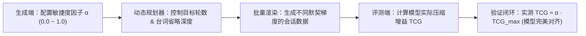

# 跨会话记忆认知架构演进：指标体系、工作记忆检索与经验记忆构造规划

> **文档定位**：系统规划跨会话长程记忆数据集向多层认知架构演进的技术方案。深度融合 **MemoryArena**（跨会话显式依赖与记忆功用性验证）与 **ReasoningBank**（从成败经历中提炼思维策略与跨用户迁移），构建覆盖单一冷热启动量化指标（TCG）、敏捷度调控因子（α）、独立解耦的工作记忆工单账本（Working Records Ledger）以及结构化经验知识库（Experience Bank）的完整多层认知工程闭环。

---

## 核心演进背景与架构全景

当前数据集已完成 150 个画像共 2100 个多轮会话的基线构造，实现了基于“长期偏好与个性化表达”的语义记忆（Semantic Memory）闭环。为了让智能体从单一被动的“偏好记录”迈向具备真实人类协作质感的多层认知体系，并为下游模型提供严密量化的评测基准，本规划正式引入三大认知维度演进：

- **冷热启动敏捷度体系**：以单一核心指标（TCG）衡量事实记忆交互轮次压缩增益，并首创引入“记忆敏捷度因子 α”作为生成流水线的全局调控旋钮；
- **工作记忆工单账本与文件独立解耦**：支持“这次”、“上次”、“上周三”、“昨天”等相对时态指代，将历史履约流水账独立解耦为 `working_records.jsonl`，实现跨会话单据追溯与参数复用；
- **经验记忆情境反思与策略迁移**：借鉴 ReasoningBank 机制沉淀“场景—困境—避坑方案—反思验证”经验知识库，实现智能体主动经验提议与跨用户/跨业务的思维策略迁移。

---

## 理论支柱与“双真值链”机制

在融入 MemoryArena 与 ReasoningBank 的核心理念时，本系统严格确立了学术工作与工程落地的边界，并确立了**“双真值链”**的核心架构机制：

> [!IMPORTANT]
> **学术理论与工程落地边界规范**：
> - **论文工作**：MemoryArena（多 Session 任务强依赖、评测记忆是否真正帮助行动）与 ReasoningBank（从成功与失败轨迹中提炼 title/description/content 经验卡片并在新任务中检索注入）。论文原生基准为网页购物（WebShop）、团体旅行（TravelPlanner）或软件代码（SWE-Bench）。
> - **项目建议**：将上述思想系统迁移至**移动核心网提参智能体（Parameter Extraction Agent）**——专注于多轮交互中的**意图与槽位抽取、相对时态与历史工单解析、多轮局部修正、以及追问/消歧决策**。
> - **业务边界**：本系统范围严格限定在提参 Agent 数据生成与评测，**不涉及核心网底层策略下发与物理网络执行**。

### 核心设计范式：分开生成两条“双真值链”

本系统在数据合成中坚决拒绝把通用经验与个人偏好混为一谈，首创采用**事实链**与**经验链**解耦并行的生成机制：

1. **事实链（Factual Ground-Truth Chain）**：
   - **关注问题**：用户的通信保障参数（画质、时延、应用）在什么时间、什么条件下有效？怎样建立、临时变更和长期更新？
   - **载体支撑**：用户画像配置（Persona Profile）与持久化历史工单流水账（`working_records.jsonl`）。
2. **经验链（Reasoning Ground-Truth Chain）**：
   - **关注问题**：智能体在交互中遇到了什么处理困境（如指代模糊、多候选干扰、时效越界、多意图混淆）？采取了什么应对策略？结果如何？从中提炼出什么通用的元认知处理方法？
   - **载体支撑**：结构化经验知识库（`experience_cards`）。
3. **汇聚原则（Convergence Principle）**：
   - 两条链在**迁移测试会话（Transfer Tasks）**中交汇：经验策略指导智能体如何排查记录范围、何时发起消歧追问；
   - **绝对隔离**：经验策略绝不能凭空捏造新用户的通信参数，新用户的最终分辨率与时延真值必须严格由该用户自身的事实证据决定。

---

## 记忆认知架构三层拓扑

多层认知记忆体系分为三个各司其职、因果协同的逻辑层次：

### 拓扑结构框图

<!-- 框图 1：三层认知记忆架构拓扑全景图 (支持在此直接修改 SVG 文本、标签或样式，亦可替换为 ```mermaid 代码块) -->

<div class="diagram-container">
                        <!-- SVG 框图 1: 三层认知记忆架构拓扑图 -->
                        <svg viewBox="0 0 880 430" width="100%" height="auto" xmlns="http://www.w3.org/2000/svg">
                            <!-- 背景组 -->
                            <defs>
                                <filter id="shadow" x="-5%" y="-5%" width="110%" height="115%">
                                    <feDropShadow dx="0" dy="3" stdDeviation="4" flood-opacity="0.08"/>
                                </filter>
                                <marker id="arrow" viewBox="0 0 10 10" refX="6" refY="5" markerWidth="6" markerHeight="6" orient="auto-start-reverse">
                                    <path d="M 0 1 L 8 5 L 0 9 z" fill="var(--diagram-arrow)"/>
                                </marker>
                            </defs>

                            <!-- 用户诉求输入框 -->
                            <rect x="280" y="15" width="320" height="46" rx="8" fill="var(--diagram-box-bg)" stroke="var(--accent-primary)" stroke-width="2" filter="url(#shadow)"/>
                            <text x="440" y="44" font-size="14" font-weight="bold" fill="var(--text-primary)" text-anchor="middle">用户多轮自然语言交互诉求</text>
    
                            <!-- 分发中枢 -->
                            <path d="M 440 61 L 440 92" stroke="var(--diagram-arrow)" stroke-width="2" marker-end="url(#arrow)"/>
                            <rect x="330" y="94" width="220" height="40" rx="6" fill="var(--surface-color)" stroke="var(--diagram-box-border)" stroke-width="1.5"/>
                            <text x="440" y="119" font-size="13" font-weight="600" fill="var(--accent-primary)" text-anchor="middle">认知分发与记忆调度中枢</text>
    
                            <!-- 三条支线连接线 -->
                            <path d="M 330 114 L 140 114 L 140 162" stroke="var(--diagram-arrow)" stroke-width="1.5" fill="none" marker-end="url(#arrow)"/>
                            <path d="M 440 134 L 440 162" stroke="var(--diagram-arrow)" stroke-width="1.5" fill="none" marker-end="url(#arrow)"/>
                            <path d="M 550 114 L 740 114 L 740 162" stroke="var(--diagram-arrow)" stroke-width="1.5" fill="none" marker-end="url(#arrow)"/>
    
                            <!-- 层次一：事实记忆 -->
                            <rect x="30" y="165" width="220" height="195" rx="8" fill="var(--diagram-box-bg)" stroke="#709775" stroke-width="2" filter="url(#shadow)"/>
                            <rect x="30" y="165" width="220" height="34" rx="8" fill="#709775"/>
                            <text x="140" y="188" font-size="13" font-weight="bold" fill="#ffffff" text-anchor="middle">层次一：事实记忆</text>
                            <text x="45" y="222" font-size="12" fill="var(--text-primary)">• 长期固有老规矩 (MF_001)</text>
                            <text x="45" y="246" font-size="12" fill="var(--text-primary)">• 业务默认应用 (service_app)</text>
                            <text x="45" y="270" font-size="12" fill="var(--text-primary)">• 个性化表达与代称映射</text>
                            <text x="45" y="294" font-size="12" fill="var(--text-primary)">• 周期触发规则 (daily/weekly)</text>
                            <rect x="42" y="318" width="196" height="26" rx="4" fill="var(--surface-color)"/>
                            <text x="140" y="335" font-size="11" fill="var(--text-muted)" text-anchor="middle">状态：跨生命周期持久生效</text>
    
                            <!-- 层次二：工作记忆工单流水账 -->
                            <rect x="330" y="165" width="220" height="195" rx="8" fill="var(--diagram-box-bg)" stroke="#5c7cb6" stroke-width="2" filter="url(#shadow)"/>
                            <rect x="330" y="165" width="220" height="34" rx="8" fill="#5c7cb6"/>
                            <text x="440" y="188" font-size="13" font-weight="bold" fill="#ffffff" text-anchor="middle">层次二：工作记忆工单账本</text>
                            <text x="345" y="222" font-size="12" fill="var(--text-primary)">• 历史履约流水账 (REC_Ledger)</text>
                            <text x="345" y="246" font-size="12" fill="var(--text-primary)">• 时态相对推断器 (&Delta;t 映射)</text>
                            <text x="345" y="270" font-size="12" fill="var(--text-primary)">• '这次' / '上周' / '昨天' 索引</text>
                            <text x="345" y="294" font-size="12" fill="var(--text-primary)">• 历史单据变更与状态核对</text>
                            <rect x="342" y="318" width="196" height="26" rx="4" fill="var(--surface-color)"/>
                            <text x="440" y="335" font-size="11" fill="var(--text-muted)" text-anchor="middle">状态：动态增量工单索引</text>
    
                            <!-- 层次三：经验记忆情境反思 -->
                            <rect x="630" y="165" width="220" height="195" rx="8" fill="var(--diagram-box-bg)" stroke="#c48a37" stroke-width="2" filter="url(#shadow)"/>
                            <rect x="630" y="165" width="220" height="34" rx="8" fill="#c48a37"/>
                            <text x="740" y="188" font-size="13" font-weight="bold" fill="#ffffff" text-anchor="middle">层次三：经验记忆情境反思</text>
                            <text x="645" y="222" font-size="12" fill="var(--text-primary)">• 场景情境特征 (Context)</text>
                            <text x="645" y="246" font-size="12" fill="var(--text-primary)">• 避坑最佳实践 (Rule of Thumb)</text>
                            <text x="645" y="270" font-size="12" fill="var(--text-primary)">• 智能体主动建议 (Proactive)</text>
                            <text x="645" y="294" font-size="12" fill="var(--text-primary)">• 用户经验回溯与验证反思</text>
                            <rect x="642" y="318" width="196" height="26" rx="4" fill="var(--surface-color)"/>
                            <text x="740" y="335" font-size="11" fill="var(--text-muted)" text-anchor="middle">状态：情境匹配条件反射</text>
    
                            <!-- 汇聚到输出 -->
                            <path d="M 140 360 L 140 385 L 440 385" stroke="var(--diagram-arrow)" stroke-width="1.5" fill="none"/>
                            <path d="M 440 360 L 440 398" stroke="var(--diagram-arrow)" stroke-width="1.5" fill="none" marker-end="url(#arrow)"/>
                            <path d="M 740 360 L 740 385 L 440 385" stroke="var(--diagram-arrow)" stroke-width="1.5" fill="none"/>
    
                            <rect x="300" y="400" width="280" height="26" rx="6" fill="var(--surface-color)" stroke="var(--border-color)"/>
                            <text x="440" y="418" font-size="12" font-weight="600" fill="var(--accent-primary)" text-anchor="middle">下游模型输出：精准闭环与自然台词应答</text>
                        </svg>
                        <div class="diagram-caption">图 1：跨会话三层认知记忆架构拓扑全景图</div>
                    </div>

### 三层记忆职责划分

| 记忆层级 | 核心定位与存储内容 | 典型台词触发形式 | 解决的核心认知问题 |
|:---|:---|:---|:---|
| **事实记忆** | 用户固有习惯、个性化老规矩、默认绑定关系与代称别名 | “按老规矩办”、“开直播保障”、“按那个省心档来” | 免去常规已知参数盘问，保持长期个性化默契 |
| **工作记忆工单账本** | 历史各次保障工单履约记录、时间戳、地点与网络指标流水账 | “这次去奥体还按上周的来”、“把昨天的改一下” | 建立时态相对指称索引，支持跨会话参数复用与改期 |
| **经验记忆情境反思** | 基于极端或特殊外场环境沉淀的避坑策略与最佳实践 | “大型漫展人流高密主动降画质提议”、“恶劣天气防丢包” | 变被动应答为主动提议，增强专业履约质感 |

---

## 核心指标体系设计：两条交互线对照

在数据构造与评测体系中，必须建立清晰可量化的评估标尺。系统以“冷启动多轮澄清”与“热启动极速闭环”作为两条对照主线。

### 冷热启动交互对照流图

<!-- 框图 2：冷启动 vs 热启动交互流程对照 (支持在此直接修改 SVG 文本、标签或样式，亦可替换为 ```mermaid 代码块) -->

<div class="diagram-container">
                        <!-- SVG 框图 2: 冷启动 vs 热启动交互流程对照 -->
                        <svg viewBox="0 0 880 340" width="100%" height="auto" xmlns="http://www.w3.org/2000/svg">
                            <!-- 左侧：冷启动无记忆主线 -->
                            <rect x="30" y="15" width="390" height="310" rx="10" fill="var(--diagram-bg)" stroke="var(--callout-warn-border)" stroke-width="1.5"/>
                            <rect x="30" y="15" width="390" height="32" rx="10" fill="var(--callout-warn-border)"/>
                            <text x="225" y="37" font-size="13" font-weight="bold" fill="#ffffff" text-anchor="middle">主线一：冷启动无记忆（多轮澄清收敛线）</text>

                            <!-- 第 1 轮 -->
                            <rect x="50" y="60" width="350" height="42" rx="6" fill="var(--diagram-box-bg)" stroke="var(--border-color)"/>
                            <text x="65" y="86" font-size="12" fill="var(--text-primary)">[User 1] 提出初步意图（缺画质、时延、时长等必要槽位）</text>
    
                            <path d="M 225 102 L 225 116" stroke="var(--diagram-arrow)" stroke-width="1.5" marker-end="url(#arrow)"/>
                            <rect x="50" y="118" width="350" height="42" rx="6" fill="var(--callout-warn-bg)" stroke="var(--callout-warn-border)"/>
                            <text x="65" y="144" font-size="12" font-weight="600" fill="var(--callout-warn-text)">[Agent 1] 严格拒绝脑补，主动反问澄清缺失的关键参数</text>
    
                            <!-- 第 2 轮 -->
                            <path d="M 225 160 L 225 174" stroke="var(--diagram-arrow)" stroke-width="1.5" marker-end="url(#arrow)"/>
                            <rect x="50" y="176" width="350" height="42" rx="6" fill="var(--diagram-box-bg)" stroke="var(--border-color)"/>
                            <text x="65" y="202" font-size="12" fill="var(--text-primary)">[User 2] 明确指定 1080p、50ms，并建立长期个性化习惯</text>
    
                            <path d="M 225 218 L 225 232" stroke="var(--diagram-arrow)" stroke-width="1.5" marker-end="url(#arrow)"/>
                            <rect x="50" y="234" width="350" height="42" rx="6" fill="var(--diagram-box-bg)" stroke="var(--border-color)"/>
                            <text x="65" y="260" font-size="12" fill="var(--text-primary)">[Agent 2] 登记记忆，并反问确认起止时段与开通</text>
    
                            <!-- 第 3 轮闭环 -->
                            <path d="M 225 276 L 225 288" stroke="var(--diagram-arrow)" stroke-width="1.5" marker-end="url(#arrow)"/>
                            <rect x="70" y="290" width="310" height="26" rx="4" fill="var(--surface-color)"/>
                            <text x="225" y="308" font-size="11" font-weight="bold" fill="var(--callout-warn-text)" text-anchor="middle">平均交互轮数：2.5 ~ 3.0 轮（严禁提前泄露）</text>
    
                            <!-- 右侧：热启动有记忆主线 -->
                            <rect x="460" y="15" width="390" height="310" rx="10" fill="var(--diagram-bg)" stroke="var(--callout-note-border)" stroke-width="1.5"/>
                            <rect x="460" y="15" width="390" height="32" rx="10" fill="var(--callout-note-border)"/>
                            <text x="655" y="37" font-size="13" font-weight="bold" fill="#ffffff" text-anchor="middle">主线二：热启动有记忆（极速收敛复用线）</text>
    
                            <!-- 第 1 轮 -->
                            <rect x="480" y="60" width="350" height="42" rx="6" fill="var(--diagram-box-bg)" stroke="var(--border-color)"/>
                            <text x="495" y="86" font-size="12" fill="var(--text-primary)">[User 1] 极简口语触发：“按老规矩开保障” / “按昨天的来”</text>
    
                            <path d="M 655 102 L 655 120" stroke="var(--diagram-arrow)" stroke-width="1.5" marker-end="url(#arrow)"/>
                            <rect x="480" y="122" width="350" height="50" rx="6" fill="var(--callout-note-bg)" stroke="var(--callout-note-border)"/>
                            <text x="495" y="144" font-size="12" font-weight="600" fill="var(--callout-note-text)">[Agent 1] 秒级命中记忆，提取 1080p/50ms，</text>
                            <text x="495" y="162" font-size="12" fill="var(--callout-note-text)">结合当前时段直接向用户发起反问确认开通</text>
    
                            <!-- 第 2 轮 -->
                            <path d="M 655 172 L 655 190" stroke="var(--diagram-arrow)" stroke-width="1.5" marker-end="url(#arrow)"/>
                            <rect x="480" y="192" width="350" height="42" rx="6" fill="var(--diagram-box-bg)" stroke="var(--border-color)"/>
                            <text x="495" y="218" font-size="12" fill="var(--text-primary)">[User 2] 确认开通：“对，直接开”</text>
    
                            <path d="M 655 234 L 655 252" stroke="var(--diagram-arrow)" stroke-width="1.5" marker-end="url(#arrow)"/>
                            <rect x="480" y="254" width="350" height="30" rx="6" fill="var(--callout-note-bg)" stroke="var(--callout-note-border)"/>
                            <text x="495" y="274" font-size="12" font-weight="bold" fill="var(--callout-note-text)">[Agent 2] 受理完成闭环，输出祝福语收尾</text>
    
                            <rect x="500" y="292" width="310" height="24" rx="4" fill="var(--surface-color)"/>
                            <text x="655" y="308" font-size="11" font-weight="bold" fill="var(--callout-note-text)" text-anchor="middle">平均交互轮数：1.0 ~ 2.0 轮（轮次压缩率 &ge; 40%）</text>
                        </svg>
                        <div class="diagram-caption">图 2：冷启动多轮澄清 vs 热启动极速压缩交互对照流程</div>
                    </div>

### 事实记忆核心量化指标：交互轮数压缩增益（TCG）

为避免多重指标膨胀，事实记忆冷热启动评估统一收敛为 **1 个核心量化指标**，并将“零记忆反问澄清”作为前置质检硬门槛（Hard Gate）：

#### 交互轮数压缩增益（Turn Compression Gain, TCG）

定量衡量长程事实记忆机制为用户减少的无谓交互轮次比例：

$$	ext{TCG} = rac{ar{T}_{	ext{cold}} - ar{T}_{	ext{hot}}}{ar{T}_{	ext{cold}}} 	imes 100\%$$

其中：

- $ar{T}_{	ext{cold}}$ 表示无记忆冷启动会话的平均交互轮数（理论基准：$2.5 \sim 3.0$ 轮）；
- $ar{T}_{	ext{hot}}$ 表示有记忆热启动会话的平均交互轮数（理论基准：$1.0 \sim 2.0$ 轮）；
- **评测达标线**：$	ext{TCG} \ge 40\% \sim 50\%$。
- **前置质检硬门槛（Hard Gate）**：冷启动零记忆场景下，参数反问澄清完整率必须达到 **100.0%**，参数提前泄露与擅自脑补率必须为 **0.0%**。未达门槛的样本直接判定为质检不合格，不进入 TCG 评分。

---

### 生成端总控因子：记忆敏捷度因子（α）

为了将评测指标反哺并精确指导数据生成，在批量生成流水线中首创引入 **1 个全局控制因子 —— 记忆敏捷度因子（Memory Agility Factor, $lpha \in [0.0, 1.0]$）**，作为控制对话压缩与默契梯度的总控旋钮。

#### 1. 控制目标轮次压缩公式

在时间线规划器（`TimelinePlanner`）中，热启动会话的目标交互轮数由 $lpha$ 线性调制确定：

$$T_{	ext{hot}} = 	ext{round}ig(T_{	ext{cold}} \cdot (1 - lpha)ig)$$

- **$lpha = 0.0$（极端保守 / 冷启动基线）**：强制不唤醒事实记忆，客服对所有关键参数逐项盘问澄清，交互轮数保持 $T = 3$ 轮；
- **$lpha = 0.5$（常规稳健热启动）**：客服从记忆中调取配置向用户反问确认，用户确认后开通，交互轮数稳定在 $T = 2$ 轮；
- **$lpha = 1.0$（极致敏捷热启动）**：用户极简口语触发（如“按老规矩办”），客服秒级命中并默认直接受理闭环，达成极速 $T = 1$ 轮交互。

#### 2. 控制用户台词口语省略深度（Omission Intensity）

敏捷度因子 $lpha$ 直接调控 Prompt 中对用户台词槽位省略的严格级别：

- **低敏捷度（$lpha \le 0.3$）**：用户台词允许保留部分辅助信息（如应用名 + 部分参数），属于弱省略；
- **高敏捷度（$lpha \ge 0.7$）**：用户台词强制深度省略画质、时延、时长甚至应用名，仅使用极简代称（如“老规矩开保障”），倒逼智能体必须 100% 依赖事实记忆补全所有通信参数。

#### 3. 生成控制到评测指标的因果闭环



在生成 150 个画像时，通过配置 $lpha$ 梯度分布（如 20% 生成 $lpha=1.0$、60% 生成 $lpha=0.5$、20% 生成 $lpha=0.0$），即可系统化构建覆盖从初识到熟客不同默契深度的全阶梯评测基准。

---

## 工作记忆架构与时态检索机制

工作记忆以现实时间流为轴线，解决用户口语中频繁出现的**时态相对代指与工单追溯**。

### 时态推断与检索流程图

<!-- 框图 3：工作记忆时态推断与历史工单检索流程图 (支持在此直接修改 SVG 文本、标签或样式，亦可替换为 ```mermaid 代码块) -->

<div class="diagram-container">
                        <!-- SVG 框图 3: 工作记忆检索流程 -->
                        <svg viewBox="0 0 880 260" width="100%" height="auto" xmlns="http://www.w3.org/2000/svg">
                            <!-- 用户输入 -->
                            <rect x="30" y="30" width="230" height="70" rx="8" fill="var(--diagram-box-bg)" stroke="var(--accent-primary)" stroke-width="1.5"/>
                            <text x="45" y="58" font-size="12" font-weight="bold" fill="var(--accent-primary)">用户相对时态输入</text>
                            <text x="45" y="80" font-size="12" fill="var(--text-primary)">“这次还按上周在奥体开的规格”</text>

                            <!-- 当前时间锚点 -->
                            <rect x="30" y="140" width="230" height="70" rx="8" fill="var(--surface-color)" stroke="var(--border-color)"/>
                            <text x="45" y="168" font-size="12" font-weight="bold" fill="var(--text-secondary)">当前基准时间锚点 (t_ref)</text>
                            <text x="45" y="190" font-size="12" fill="var(--text-primary)">2026年10月24日 14:00 (周六)</text>
    
                            <!-- 箭头到推断器 -->
                            <path d="M 260 65 L 320 115" stroke="var(--diagram-arrow)" stroke-width="1.5" marker-end="url(#arrow)"/>
                            <path d="M 260 175 L 320 135" stroke="var(--diagram-arrow)" stroke-width="1.5" marker-end="url(#arrow)"/>
    
                            <!-- 时态推断器引擎 -->
                            <rect x="325" y="90" width="210" height="75" rx="8" fill="var(--callout-imp-bg)" stroke="var(--callout-imp-border)" stroke-width="1.5"/>
                            <text x="430" y="118" font-size="13" font-weight="bold" fill="var(--callout-imp-text)" text-anchor="middle">时态推断器 (Temporal Engine)</text>
                            <text x="430" y="140" font-size="11" fill="var(--callout-imp-text)" text-anchor="middle">推算时间窗：[t_ref - 7d &plusmn; 2d]</text>
                            <text x="430" y="156" font-size="11" fill="var(--callout-imp-text)" text-anchor="middle">目标时间段：10月17日 周六</text>
    
                            <!-- 箭头到账本匹配 -->
                            <path d="M 535 127 L 590 127" stroke="var(--diagram-arrow)" stroke-width="1.5" marker-end="url(#arrow)"/>
    
                            <!-- 历史工单流水账 -->
                            <rect x="595" y="30" width="255" height="195" rx="8" fill="var(--diagram-box-bg)" stroke="var(--border-color)" stroke-width="1.5"/>
                            <rect x="595" y="30" width="255" height="28" rx="8" fill="var(--surface-elevated)"/>
                            <text x="722" y="49" font-size="12" font-weight="bold" fill="var(--text-primary)" text-anchor="middle">历史工单流水账 (Records Ledger)</text>
    
                            <!-- 单据卡片 1 (未命中) -->
                            <rect x="610" y="68" width="225" height="38" rx="4" fill="var(--surface-color)"/>
                            <text x="620" y="86" font-size="11" fill="var(--text-muted)">REC_1012 (12天前): 抖音直播/720p</text>
                            <text x="620" y="100" font-size="10" fill="var(--text-muted)">状态：已过期 &times;</text>
    
                            <!-- 单据卡片 2 (精确命中) -->
                            <rect x="610" y="114" width="225" height="48" rx="4" fill="var(--callout-note-bg)" stroke="var(--callout-note-border)" stroke-width="1.5"/>
                            <text x="620" y="132" font-size="11" font-weight="bold" fill="var(--callout-note-text)">REC_1017_01 (7天前·奥体南门)</text>
                            <text x="620" y="148" font-size="10" fill="var(--callout-note-text)">快手转播 | 1080p | 50ms | 120min [命中 &radic;]</text>
    
                            <!-- 提取输出 -->
                            <rect x="610" y="170" width="225" height="46" rx="4" fill="var(--surface-color)"/>
                            <text x="620" y="188" font-size="11" fill="var(--accent-primary)">继承目标参数：1080p / 50ms</text>
                            <text x="620" y="204" font-size="10" fill="var(--text-muted)">反问确认今日起止时间与开通</text>
                        </svg>
                        <div class="diagram-caption">图 3：工作记忆时态推断与历史工单检索流程图</div>
                    </div>

### 工作记忆账本与会话流的解耦架构规范（Decoupled Storage Standard）

在数据工程落地上，系统严格落实**关注点分离（Separation of Concerns）**原则：**工作记忆的工单流水账（Working Records Ledger）坚决独立生成并存储为单独的文件，绝不和对话会话（`sessions.jsonl`）混杂在一起！**

| 数据存储文件 | 物理存储路径 | 职责定位与存储内容 | 上下文注入与引用机制 |
|:---|:---|:---|:---|
| **会话对话流** | `data/generated/sessions/sessions.jsonl` | 仅存储用户与客服的多轮对话（turns）、意图标注、以及**轻量级单据引用指针** | 仅记录 `retrieval_target: {"record_id": "REC_1017_01", "temporal_delta": "-7d"}` |
| **工单流水账** | `data/generated/records/working_records.jsonl` | 独立全局履约单据流水库，包含所有历史开通记录的完整快照与环境元数据 | 仅当下游评测或 Agent 需要执行时态回溯时，由外部检索器调取匹配单据 |

> [!TIP]
> **文件解耦的三大核心工程收益**：
> 1. **杜绝 Prompt 上下文剧烈爆炸**：若将用户过去数十次工单全量嵌入每轮对话的 session 中，会话文件体积极速膨胀，不仅极大浪费推理 Token，还会引入无关干扰；解耦后保持会话轻盈纯净。
> 2. **真实映射电信生产架构**：在真实运营商核心网中，CRM 客户中心与 OSS/BSS 工单系统是彼此独立的外部数据库。提参 Agent 必须通过“语义提取 $	o$ 构造查询 $	o$ 调用接口”完成取数，解耦能完美模拟真实系统的接口调用。
> 3. **便于外部 Verifier 校验**：自动化质检脚本可独立对 `working_records.jsonl` 进行时间连续性、主键唯一性校验，与会话多轮质检互不干扰。

#### 独立历史工单流水账结构（`working_records.jsonl`）

```json
{
  "record_id": "REC_20261017_01",
  "source_session_id": "S-USER_001-03",
  "user_id": "USER_001",
  "created_at": "2026年10月17日14时00分",
  "application_name": "快手",
  "service_name": "赛事转播",
  "start_timestamp": "2026年10月17日14时00分",
  "end_timestamp": "2026年10月17日16时00分",
  "duration": "120min",
  "resolution": "1080p",
  "rtt_max": "50ms",
  "location": "奥体中心主体育场看台",
  "execution_status": "completed",
  "temporal_reference_aliases": {
    "day_offset_1": "昨天在奥体的赛事转播",
    "day_offset_7": "上周在奥体的转播保障",
    "last_similar": "上次在体育场开的那个"
  }
}
```

#### 会话文件中轻量级指针（`sessions.jsonl`）

```json
{
  "session_id": "S-USER_001-04",
  "current_time": "2026年10月24日14时00分",
  "turns": [
    {
      "turn_id": 1,
      "user": "这次去奥体，还按上周在奥体办的那个规格来。",
      "agent_action": "Retrieve_Working_Record",
      "working_memory_pointer": {
        "target_record_id": "REC_20261017_01",
        "inferred_delta_days": 7,
        "matched_application": "快手",
        "inherited_slots": {"resolution": "1080p", "rtt_max": "50ms"}
      },
      "agent": "已为您找到上周六在奥体的快手转播保障单（1080p、时延≤50ms）。请问今天的保障起止时间是几点到几点？"
    }
  ]
}
```

### 新增工作记忆会话模板

| 模板编号 | 场景角色 | 用户台词特征 | 智能体动作与检索逻辑 | 预期轮数 |
|:---|:---|:---|:---|:---|
| **T2-6** | 历史单据跨期复用 | “**这次**去奥体，还按**上周**在奥体办的那个规格来。” | 计算时差为 7 天，从账本定位单据 `REC_1017_01`，提取 1080p/50ms，反问今日时间区间。 | 2 轮 |
| **T2-7** | 历史单据变更改期 | “把**昨天**预约的那个保障往后推迟一个小时。” | 计算时差为 1 天，定位昨日预约单据，更新 `start_timestamp` 并通知用户变更成功。 | 2 轮 |
| **T2-8** | 历史记录对账核查 | “帮我查下**这周**总共开了几次保障，一共多长时间？” | 时间范围遍历本周工单流水账，聚合统计开通次数、累计时长并输出明细清单。 | 1 轮 |

---

## 经验记忆架构与情境主动提议机制

经验记忆是基于环境挑战沉淀的最佳实践规则（Rule of Thumb），形成“情境洞察—避坑提议—采纳执行—反思沉淀”的闭环。

### 经验反思双环流框图

<!-- 框图 4：经验记忆感知、主动提议与反思闭环流图 (支持在此直接修改 SVG 文本、标签或样式，亦可替换为 ```mermaid 代码块) -->

<div class="diagram-container">
                        <!-- SVG 框图 4: 经验记忆主动提议与反思双环流 -->
                        <svg viewBox="0 0 880 270" width="100%" height="auto" xmlns="http://www.w3.org/2000/svg">
                            <!-- 外部情境感知 -->
                            <rect x="30" y="30" width="220" height="85" rx="8" fill="var(--diagram-box-bg)" stroke="var(--callout-warn-border)" stroke-width="1.5"/>
                            <text x="45" y="58" font-size="12" font-weight="bold" fill="var(--callout-warn-text)">外部情境输入 (Context)</text>
                            <text x="45" y="80" font-size="11" fill="var(--text-primary)">• 地点：工体万人演唱会 / 漫展</text>
                            <text x="45" y="98" font-size="11" fill="var(--text-primary)">• 风险：高密人流极端信道拥塞</text>

                            <!-- 箭头到经验库匹配 -->
                            <path d="M 250 72 L 310 72" stroke="var(--diagram-arrow)" stroke-width="1.5" marker-end="url(#arrow)"/>
    
                            <!-- 经验知识库 -->
                            <rect x="315" y="30" width="250" height="85" rx="8" fill="var(--surface-color)" stroke="var(--border-color)" stroke-width="1.5"/>
                            <text x="330" y="58" font-size="12" font-weight="bold" fill="var(--accent-primary)">经验知识库 (Experience Bank)</text>
                            <text x="330" y="80" font-size="11" fill="var(--text-primary)">EXP_01: 高密场馆人流防拥塞策略</text>
                            <text x="330" y="98" font-size="11" fill="var(--text-muted)">规则：主动降至 720p + 30ms 极低延时</text>
    
                            <!-- 箭头到智能体决策 -->
                            <path d="M 565 72 L 625 72" stroke="var(--diagram-arrow)" stroke-width="1.5" marker-end="url(#arrow)"/>
    
                            <!-- 智能体主动建议 -->
                            <rect x="630" y="30" width="220" height="85" rx="8" fill="var(--callout-note-bg)" stroke="var(--callout-note-border)" stroke-width="1.5"/>
                            <text x="645" y="58" font-size="12" font-weight="bold" fill="var(--callout-note-text)">智能体主动提议 (Proactive)</text>
                            <text x="645" y="78" font-size="11" fill="var(--callout-note-text)">“根据此前漫展拥塞避坑经验，</text>
                            <text x="645" y="96" font-size="11" fill="var(--callout-note-text)">建议使用 720p/30ms 避开卡顿”</text>
    
                            <!-- 反馈与反思环 -->
                            <path d="M 740 115 L 740 180 L 140 180 L 140 115" stroke="var(--diagram-arrow)" stroke-width="1.5" fill="none" stroke-dasharray="5 5" marker-end="url(#arrow)"/>
                            <rect x="340" y="165" width="200" height="30" rx="4" fill="var(--surface-elevated)" stroke="var(--border-color)"/>
                            <text x="440" y="185" font-size="11" fill="var(--text-secondary)" text-anchor="middle">用户采纳并履约 &rarr; 经验反思固化</text>
                        </svg>
                        <div class="diagram-caption">图 4：经验记忆感知、主动提议与反思闭环流图</div>
                    </div>

### ReasoningBank 标准经验条目卡片规范

全面对齐 ReasoningBank 论文规范，将经验记忆形式化为标准卡片三元组 `(title, description, content)` 并扩充情境条件与反例边界约束：

```json
{
  "experience_id": "EXP_STADIUM_CONGESTION_01",
  "title": "极值与高密环境主动降画质保抗丢包平稳度",
  "description": "大型体育场馆或展会万人集聚场景下，空口上行信道受限，盲目开高画质易引发频繁丢包卡顿。",
  "content": "识别到会展中心、体育场等高密人流场景时，主动提议将画质从 1080p 降为 720p、并将时延门限收紧至 30ms，以稳定性优先策略确保零掉帧。",
  "trigger_conditions": {
    "location_keywords": ["体育场", "漫展", "演唱会", "会展中心"],
    "crowd_density": "极度密集",
    "risk_factors": ["上行空口资源争抢", "突发丢包卡顿"]
  },
  "recommended_adjustments": {
    "resolution": "720p",
    "rtt_max": "30ms",
    "strategy": "稳定性优先"
  },
  "applicable_boundaries": "仅适用于公众聚集、基站突发过载的外场保障；私有专网或具备专用切片保障的 VIP 场景不适用此降质规则。",
  "negative_counterexamples": "用户明确要求“无论多卡都必须开 4K 原画录像”时，智能体不得强行覆盖，应提示风险后尊重用户指令。"
}
```

---

## MemoryArena 与 ReasoningBank 驱动的四大提参生成升级方案

结合 MemoryArena 的跨 Session 依赖评测理念与 ReasoningBank 的经历提炼迁移机制，针对移动核心网提参智能体打造四个数据升级方案：

### 方案 1：从“事实召回”升级为“候选记录选择与必要消歧”

- **理论借鉴**：借鉴 MemoryArena 的属性兼容链与多候选干扰机制。使当前轮次无法单凭当前句子得出答案，必须利用跨会话依赖回溯；同时通过成败对照提炼消歧方法。
- **场景序列设定**：
  - **S1 (2026-10-05)**：用户确认腾讯会议：14:00—16:00、720P、时延≤80ms；写入工作工单流水 `REC_1005_01`；
  - **S2 (2026-10-07)**：用户确认虎牙看直播：19:00—21:00、1080P、时延≤50ms；写入工作工单流水 `REC_1007_01`；
  - **S3 (2026-10-14)**：用户输入：“今天下午两点到四点腾讯会议，参数按上周开会那次。”
- **成败轨迹对照**：
  - **失败轨迹**：Agent 简单按“上周”时态就近匹配到 S2，填入 1080P 和 ≤50ms；用户被迫纠错：“我说的是开会那次，不是直播！”；
  - **成功轨迹**：Agent 联合“腾讯会议”应用名与“开会”业务词，结合 7 天时差精准锁定 S1，继承 720P/80ms，并使用今天的新时间段发起确认：“已为您调取上周会议参数（720P/80ms），今日 14:00-16:00 开通，对吗？”；用户确认：“对”。
- **提炼 ReasoningBank 经验卡片**：
  - **Title**：跨期单据复用先校验业务应用与时效范围
  - **Description**：多业务用户使用“上周/上次”指代时，极易因就近原则误判目标单据。
  - **Content**：定位历史工单时，先以应用/业务类型为强约束过滤候选集，再匹配相对时态；当前输入的明确值（如今日时间）优先级最高，仅复用历史体验参数槽位，严禁将历史日期整条照搬。
- **跨用户策略迁移（Transfer）**：
  - 换新用户，该用户开会习惯为 1080P，直播为 720P，提问“直播按上周那次”；智能体复用上述“先筛业务再比时态”的方法，准确提取 720P。复用的是检索方法，而非前一个用户的 720P 数值。
- **边界反例与 Verifier 规则**：
  - **边界反例**：若用户模糊表达：“今天按上周那次来。”且上周存在多次不同业务单据，智能体**严禁脑补盲猜，必须发起 `Request_Disambiguation` 追问**，禁止在隐藏 GT 中指定单据；
  - **Verifier 校验**：`target_record_id` 命中 S1；日期必须来自当前；分辨率与时延来自同一单据；候选不唯一时必须触发消歧动作。

---

### 方案 2：从“最新值覆盖”升级为“作用域与时效联合判断”

- **理论借鉴**：借鉴跨会话状态机演化机制，从失败轨迹中提炼“临时变更”与“长期更新”的生命周期边界。
- **状态演进时序**：
  - **S1**：“以后会议默认 720P。” $	o$ 建立长期事实记忆：会议=720P；
  - **S2**：“今天会议这次 1080P。” $	o$ 临时变更（Temporary Choice）：当前会议=1080P，长期默认仍保持 720P；
  - **S3**：“明天会议按默认的。” $	o$ 正确提取长期默认 720P（**若按机械最新值将误判为 1080P**）；
  - **S4**：“以后会议默认 1080P。” $	o$ 用户明确指示，长期事实记忆更新为 1080P（Permanent Update）；
  - **S5**：“今天会议照旧。” $	o$ 提取更新后的长期默认 1080P。
- **成败轨迹对照**：
  - **失败轨迹**：Agent 误把 S2 的“这次”当成全局覆盖，导致 S3 错误继承 1080P；
  - **成功轨迹**：精准标记 `scope="session_temporary"` 与 `scope="profile_permanent"`，S3 稳定恢复 720P。
- **提炼 ReasoningBank 经验卡片**：
  - **Title**：参数提取先判断时效作用域与生命周期
  - **Description**：口语中“这次/今天”与“以后/默认”存在截然不同的生效边界。
  - **Content**：参数提取前先识别作用域标志词；“这次/临时/今天”仅作用于当前任务，“以后/默认/改规矩”才触发长期画像更新；冲突消解以同作用域为准，严禁单凭时间戳机械取最新值。
- **边界反例**：“上次那个 720P”仅引用具体历史单据，不自动建立长期默认；“以后都按 720P”才是真正的全局事实更新。

---

### 方案 3：从“单一正确轨迹”升级为“追问策略三态对照”

- **理论借鉴**：借鉴 ReasoningBank 的 MaTTS 对照思想。仅有单一成功样本无法凸显策略价值，必须构建“失败”、“正确但低效”、“高效闭环”三态对照。
- **任务前提**：当前应用支持 720P 与 1080P 两种画质，用户无历史映射，输入：“明天 14 点到 16 点腾讯会议，要高清一点。”
- **三态轨迹对照**：
  - **轨迹 1（失败 / 冒进脑补）**：Agent 擅自脑补 1080P 并直接受理，用户纠正：“我手机屏幕小，720P 够了，别浪费我流量”；
  - **轨迹 2（正确但低效 / 泛化提问）**：Agent 泛泛追问：“您还有什么其他要求吗？”，用户重复强调后，Agent 再次追问画质，导致无谓交互轮数增加至 4 轮；
  - **轨迹 3（高效精准 / 结构化候选反问）**：Agent 基于配置矩阵精准追问：“已为您准备腾讯会议保障，画质支持 720P 高清与 1080P 超清，请问您倾向哪个规格？”，用户秒级回答：“720P”，2 轮高效闭环。
- **提炼 ReasoningBank 经验卡片**：
  - **Title**：多候选无依据时结构化反问替代泛泛追问
  - **Description**：面对歧义形容词（高清、省心）且无先验记忆时，冒进猜测引发纠错，漫无边际追问增加成本。
  - **Content**：缺乏先验依据时，严格根据支持矩阵（Support Matrix）列出合法候选发起定向反问，精准聚焦缺失槽位。
- **数据标注规范**：严格区分 `Request_Clarification`（无依据定向追问）与 `Confirm_Hypothesis`（有先验证据确认反问），严禁把盲目猜测包装成“确认反问”。

---

### 方案 4：从“扁平多意图”升级为“逐轮状态传递与局部修正”

- **理论借鉴**：多意图复合会话中的状态演进与同源干扰防护。
- **演练场景**：
  - **T1 用户**：“明天 14 点到 16 点腾讯会议，晚上 19 点到 21 点虎牙看直播，画质都照旧。”
  - **T1 Agent**：“收到！会议为您按 720P、直播按 1080P，两个时段按您说的开启，对吗？”
  - **T2 用户**：“直播不变，会议这次改 1080P。”
  - **T2 Agent**：“明白！明日下午腾讯会议调整为 1080P，晚间虎牙直播保持 1080P，确认开通吗？”
  - **T3 用户**：“对，直接开。”
- **成败轨迹对照**：
  - **失败轨迹 1（跨意图污染）**：Agent 误把直播的画质也改掉，或将会议时间套给直播；
  - **失败轨迹 2（未来值倒灌）**：评测引擎在评估 T1 轮次时，错误将 T2 提供的 1080P 倒灌回 T1 的 Ground Truth；
  - **成功轨迹**：各意图单元拥有独立的 `intent_key`，局部修正仅作用于目标单元，保持其余意图绝对稳定。
- **提炼 ReasoningBank 经验卡片**：
  - **Title**：多意图局部修正严格隔离意图作用域
  - **Description**：长复合会话中用户修正某一个意图时，极易对同会话内的其他意图造成污染。
  - **Content**：参数更新必须先绑定目标意图单元（intent_key）；禁止因位置临近跨意图转移参数；严格保持时序因果性，禁止后续修改倒灌早期轮次。

---

## 四阶段工程迭代路线图

系统按照敏捷演进思路，规划为四个工程落地阶段：

<div class="roadmap-grid">
    <div class="roadmap-card">
        <div class="roadmap-phase">Phase 1 · 1~2 天</div>
        <div class="roadmap-title">指标体系与双真值链规范</div>
        <div class="roadmap-desc">
            确立单一 TCG 压缩增益指标公式与敏捷度因子 α 控制规范；落地 working_records.jsonl 独立解耦标准；定义 ReasoningBank 经验卡片三元组 Schema。
        </div>
    </div>
    <div class="roadmap-card">
        <div class="roadmap-phase">Phase 2 · 2~3 天</div>
        <div class="roadmap-title">独立工单账本与时态检索</div>
        <div class="roadmap-desc">
            落地独立工单生成流水线；实现时态相对推断器；完成方案 1（跨期复用与消歧）与方案 2（作用域隔离）的生成模板。
        </div>
    </div>
    <div class="roadmap-card">
        <div class="roadmap-phase">Phase 3 · 2~3 天</div>
        <div class="roadmap-title">经验提炼与迁移评测</div>
        <div class="roadmap-desc">
            落地方案 3（追问三态对照）与方案 4（多意图局部修正）；构建跨用户迁移测试集，验证思维策略复用性。
        </div>
    </div>
    <div class="roadmap-card">
        <div class="roadmap-phase">Phase 4 · 1~2 天</div>
        <div class="roadmap-title">质检套件与 Benchmark 发布</div>
        <div class="roadmap-desc">
            升级 qc_validator.py 质检规则；硬性校验零未来值倒灌率、消歧反问准确率；发布全量离线评测基准与分析报告。
        </div>
    </div>
</div>

---

## 验证与验收方案

### 1. 自动化流水线测试

```bash
# 1. 运行单画像原型测试（验证独立工单账本与 ReasoningBank 经验提议）
python run.py --start 0 --count 1 --verify

# 2. 运行多层认知记忆全量单元测试（含双真值链一致性校验）
python -m unittest discover tests

# 3. 运行自动化 Benchmark 离线评估脚本，输出 TCG、ERRA 与消歧率报告
python scripts/evaluate_memory_benchmark.py --input data/generated
```

### 2. 人工抽检与质检验收硬准则

- **工单文件严格解耦**：所有历史工单 100% 独立存储于 `working_records.jsonl`，`sessions.jsonl` 仅保留轻量级索引，无冗余数据嵌套；
- **时态指代严格准确**：台词出现“上周”时，目标单据时间严格落在 3~7 天前的历史工单中，杜绝时间错乱；
- **冷启动零脑补与消歧准则**：无记忆会话首轮未提供参数、或存在多个同类模糊候选时，智能体 100% 发起结构化澄清反问，杜绝擅自盲猜；
- **双真值链无未来倒灌**：时序因果性严格成立，后期轮次的局部修正与新参数绝对不得倒灌至早期历史轮次的 Ground Truth 中。
