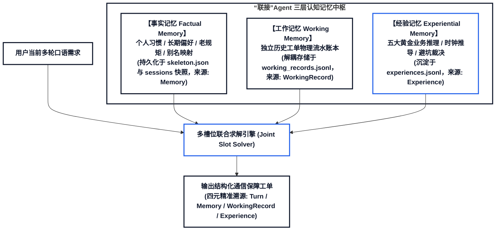
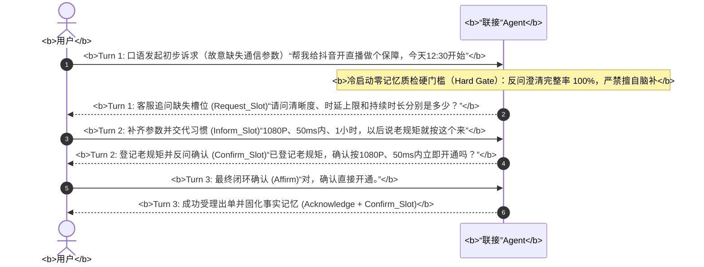
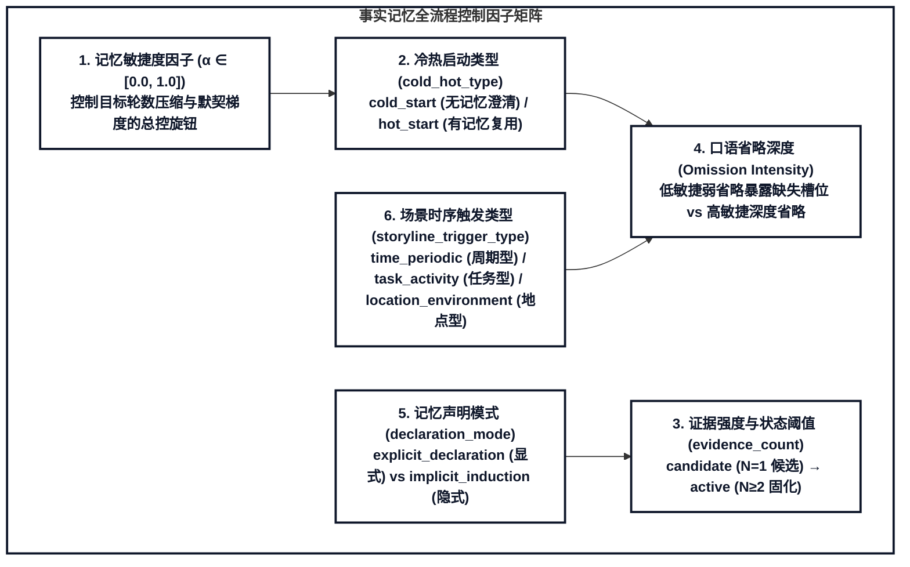
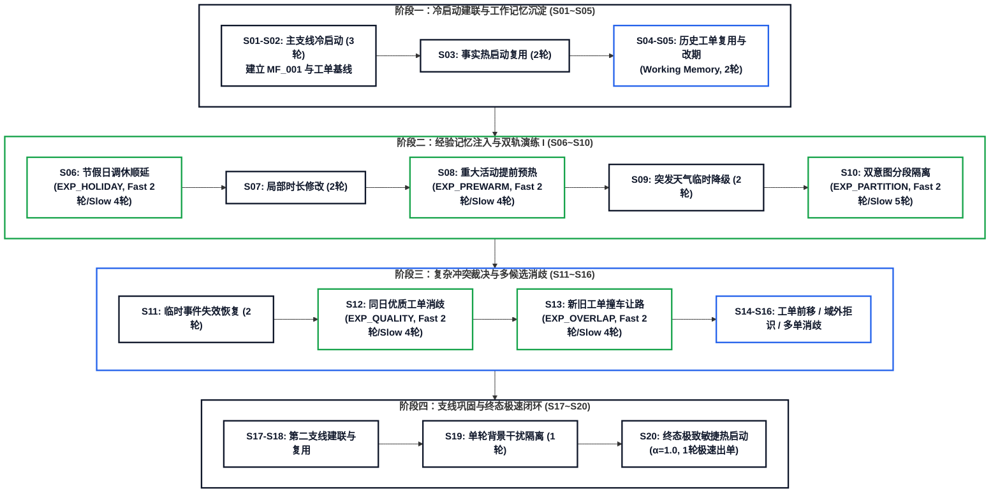
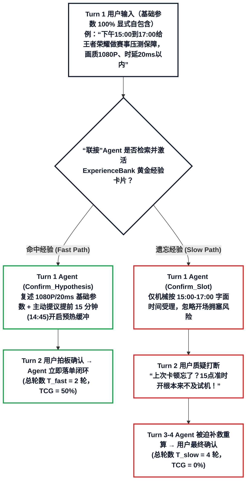
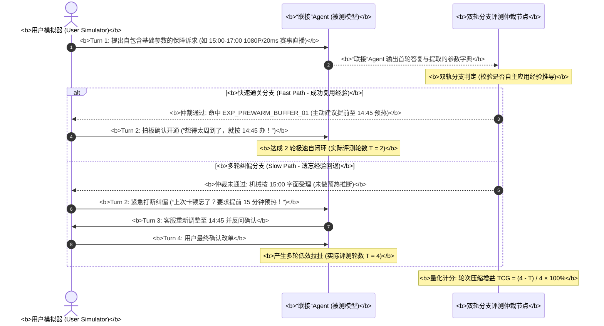
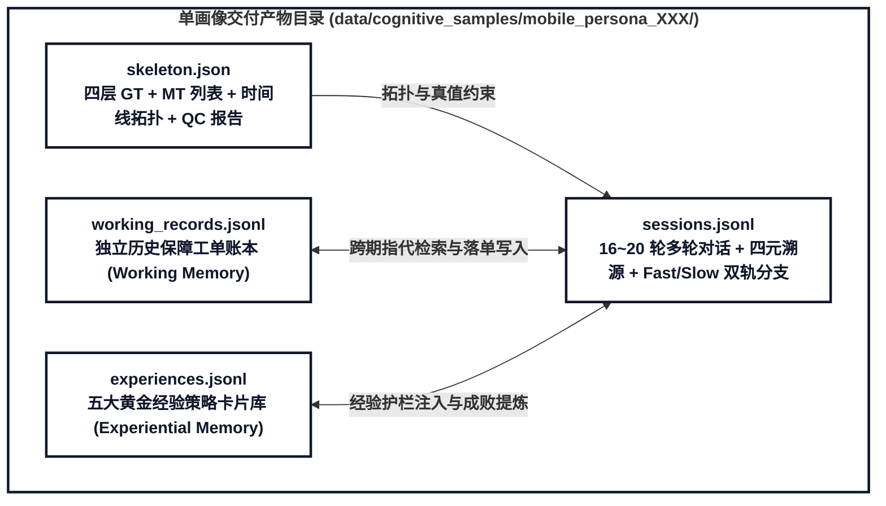

# “联接”Agent 跨会话三层认知记忆数据集与双轨评测引擎技术规范

> **文档层级**：第二层 · 核心架构与技术总纲（Core Architecture Specification）  
> **文档状态**：新特性开发与技术设计规范（Approved & Implemented）  
> **面向场景**：“联接”Agent 通信保障意图参数提取（提参数）与长程记忆演进  
> **会话规模**：单用户生命周期规划为 **16 ~ 20 轮动态会话**（均值 18 轮）  
> **核心演进**：事实记忆、工作记忆与五大黄金经验记忆全景贯通，内嵌 **Turn 1 基础参数自包含原则** 与 **双轨成败分支测试（Fast/Slow Branch Evaluation）**

---

## 目录大纲
- [一、 智能体定位与核心原则](#一-智能体定位与核心原则)
- [二、 三层认知记忆中枢架构与分水岭](#二-三层认知记忆中枢架构与分水岭)
- [三、 16~20 轮动态生命周期时间线拓扑](#三-1620-轮动态生命周期时间线拓扑)
- [四、 五大黄金经验记忆场景深度规范](#四-五大黄金经验记忆场景深度规范)
  - [4.0 核心设计准则：经验会话 Turn 1 基础参数自包含原则](#40-核心设计准则经验会话-turn-1-基础参数自包含原则)
  - [场景1：多意图局部突发延误与分段隔离](#场景1多意图局部突发延误与分段隔离)
  - [场景2：重大活动提前预热试机时间推算](#场景2重大活动提前预热试机时间推算)
  - [场景3：节假日调休周期排期避坑顺延](#场景3节假日调休周期排期避坑顺延)
  - [场景4：模糊多候选历史工单质量特征消歧](#场景4模糊多候选历史工单质量特征消歧)
  - [场景5：新旧工单时段撞车无缝让路接管](#场景5新旧工单时段撞车无缝让路接管)
- [五、 双轨成败分支模拟评测引擎与量化指标](#五-双轨成败分支模拟评测引擎与量化指标)
- [六、 物理文件组织与四元精准溯源 Schema](#六-物理文件组织与四元精准溯源-schema)

---

## 一、 智能体定位与核心原则

1. **“联接”Agent 业务定位**：
   - 正式命名：**“联接”Agent**；
   - 核心职责：专精于通信网络保障的**意图参数提取（提参数）**与精准闭环受理，严禁生成拖沓的客服推销式拉扯对话。
2. **语言口语化与去黑话铁律**：
   - 坚决杜绝生僻硬核的通信网管黑话（如“空口切片”、“相控阵天线”、“对星握手”、“微波回传链路”、“专网监控探针”）；
   - 全量采用真实用户与客服沟通的大白话（如“提前把网络通道占上试机”、“免得互相抢网速”、“节假日放假公司没人避免白扣费”、“两笔单子时间撞车了自动提前让路”）。
3. **模版意图约束**：
   - 严格恪守官方 T 模版规约：单个会话内为单意图或**最多 2 个意图**（如 T2-4，严禁捏造 3 意图以上的膨胀结构）。
4. **评测专业称谓规范**：
   - 架构与文档统一采用正规评测术语：**“双轨成败分支测试（Fast/Slow Branch Evaluation）”**、**“动态多分支模拟评测”** 或 **“树状交互评测”**。

---

## 二、 三层认知记忆中枢架构与分水岭

数据集严格保证三层认知记忆的本体论纯洁性，杜绝概念混淆：

* **事实记忆 (Factual Memory)**：管“用户是谁、个人老规矩是啥”。负责冷启动（3轮澄清, $\alpha=0.0$）与热启动（稳健2轮 $\alpha=0.5$，极致1轮 $\alpha=1.0$）。严禁将个人口语别名（如“晚饭后=19:30”）虚假包装成经验。
* **工作记忆 (Working Memory)**：管真实发生的历史工单记录。通过独立的 `working_records.jsonl` 账本解耦，支撑跨期单据检索（“上周在奥体开的那单”）、变更改期（延后/提前）与多单消歧。
* **经验记忆 (Experiential Memory)**：管无需用户交代、由“联接”Agent 基于通信最佳实践与历史排障教训主动推断的策略先验，专用于实现**快速闭环（Fast Path）**与**复杂业务冲突解决**。

### 2.1 事实记忆冷启动多轮澄清机制（$T=3$ 轮）

为杜绝智能体在冷启动初期“擅自脑补通信参数”或“产生参数幻觉”，系统设置了前置质检硬门槛（Hard Gate）：在用户未建立老规矩时，“联接”Agent 必须发起 3 轮严格的参数反问澄清收敛流：

#### 双轨固化机制（显式声明 vs 隐式归纳）：
1. **显式声明路径 (`explicit_declaration`)**：用户在交互中主动声明规则指令（如“*以后按老规矩办*”），会话办结后触发 `form_memory_explicit`，记忆状态直接置为 **`active`**（`evidence_count = 1`）。
2. **隐式归纳路径 (`implicit_induction`)**：用户未显式交代长期偏好，首轮澄清办结后触发 `log_task_history`，记忆仅作为单次历史行为记录为 **`candidate`（候选/暂定状态）**；直到后续会话出现第 2 次相同特征行为（$N \ge 2$），经反问确认后才触发固化升级为 **`active`**。

### 2.2 事实记忆全周期 6 大核心控制因子

1. **记忆敏捷度因子（`agility_factor`, $\alpha \in [0.0, 1.0]$）**：
   - 目标轮数调制公式：$$T_{\text{target}} = \text{round}\big(T_{\text{cold}} \cdot (1 - \alpha)\big)$$
   - $\alpha = 0.0$（极端保守 / 冷启动澄清）：逐项追问缺失槽位，保持 $T = 3$ 轮；
   - $\alpha = 0.5$（常规稳健热启动）：调取记忆反问确认，收敛至 $T = 2$ 轮；
   - $\alpha = 1.0$（极致敏捷热启动）：秒级命中并默认直接受理出单，达成 $T = 1$ 轮极速闭环。
2. **冷热启动类型标识（`cold_hot_type`）**：
   - `cold_start`：冷启动，硬性约束反问澄清完整率 100%，脑补率 0%；
   - `hot_start`：热启动，基于记忆快速复用槽位。
3. **证据强度与状态机计数（`evidence_count`）**：
   - 记录该事实记忆被使用/验证的累计次数；
   - 状态转移：`candidate` ($N=1$) $\to$ `active` ($N \ge 2$) $\to$ `superseded` / `expired`。
4. **台词口语省略深度（`Omission Intensity`）**：
   - 低敏捷（$\alpha \le 0.3$）：保留部分辅助信息，暴露关键参数缺失；
   - 高敏捷（$\alpha \ge 0.7$）：深度省略通信参数，倒逼模型必须依赖记忆补全。
5. **记忆声明模式分流因子（`declaration_mode`）**：
   - 按用户 ID 奇偶 50/50 分流：奇数用户显式声明，偶数用户隐式归纳。
6. **场景时序触发因子（`storyline_trigger_type`）**：
   - `time_periodic`（周期时间型）/ `task_activity`（任务活动型）/ `location_environment`（特定地点型）。

---

## 三、 16~20 轮动态生命周期时间线拓扑

为适应更深度的认知演进，会话总量规划为 **16 ~ 20 轮动态浮动**（算术均值 18 轮），公式为：
$$\text{target\_count} = 16 + (\text{uid\_num} \pmod 5)$$
支持根据用户 ID 均匀离散分布在 `16, 17, 18, 19, 20` 轮之间。

### 全景 20 候选生命周期槽位分布表

| 序号 | 模版 | 主导记忆类型 | 角色与业务情境 | 轮数要求 (Fast / Slow) | 关键机制与参数溯源 |
| :---: | :---: | :---: | :--- | :---: | :--- |
| **S01** | **T2-1** | 事实记忆 | **主线冷启动建联**：用户显式立规矩，建立基线记忆 `MF_001` | 3 轮 | 冷启动严密澄清（$\alpha=0.0$） |
| **S02** | **T3-1** | 事实记忆 | **支线1冷启动建联**：弱网转场，建立独立支线 `SUB_001` | 3 轮 | 支线代称消歧 |
| **S03** | **T2-1** | 事实记忆 | **主线常规稳健热启动**：呼出老规矩，“联接”Agent 反问确认 | 2 轮 | 热启动稳健复用（$\alpha=0.5$） |
| **S04** | **T2-6** | 工作记忆 | **历史工单跨期复用**：“按上周在奥体开的规格来” | 2 轮 | 检索命中 `REC_01` 单据继承 |
| **S05** | **T2-7** | 工作记忆 | **历史工单延期变更**：“把昨天预约的单子往后推迟一小时” | 2 轮 | 时间戳后移，时长继承 |
| **S06** | **T2-1** | **经验记忆** | **场景3：节假日避坑顺延**：预约下周一早会，遇法定长假顺延 | **2 轮 (Fast) / 4 轮 (Slow)** | `EXP_CALENDAR_HOLIDAY_EXCEPTION_01` |
| **S07** | **T2-5** | 事实记忆 | **主线局部时长修改**：老规矩不变，现场活动延长至 180min | 2 轮 | 基础参数复用，时长单次覆盖 |
| **S08** | **T2-9** | **经验记忆** | **场景2：重大活动提前预热**：压测/直播，主动前置 15~30 分钟试机 | **2 轮 (Fast) / 4 轮 (Slow)** | `EXP_PREWARM_BUFFER_01`（时钟推导） |
| **S09** | **T2-3** | 事实记忆 | **恶劣天气临时纠偏**：突发暴雨临时降级（仅当次生效） | 2 轮 | 临时单次覆盖，不污染全局主线 |
| **S10** | **T2-4** | **经验记忆** | **场景1：双意图分段隔离**：核心压测 + 协同会议按黄金档分段 | **2 轮 (Fast) / 5 轮 (Slow)** | `EXP_MULTI_INTENT_PARTITION_01` |
| **S11** | **T2-1** | 事实记忆 | **事件失效基线恢复**：暴雨过去，自动无缝恢复 1080p 基线 | 2 轮 | 记忆状态机闭环 |
| **S12** | **T2-6** | **经验记忆** | **场景4：模糊多单质量消歧**：“按效果好的那次办”，优选零卡顿单 | **2 轮 (Fast) / 4 轮 (Slow)** | `EXP_ORDER_QUALITY_DISAMBIGUATION_01` |
| **S13** | **T2-10**| **经验记忆** | **场景5：新旧工单撞车让路**：新单与旧单重叠，前单提前结单让路 | **2 轮 (Fast) / 4 轮 (Slow)** | `EXP_OVERLAPPING_ORDER_RESOLUTION_01` |
| **S14** | **T2-7** | 工作记忆 | **历史工单提前变更**：“把昨天预约的单子提前一小时开始” | 2 轮 | 时间戳前移重算 |
| **S15** | **T1-2** | 事实隔离 | **域外诉求拒识**：宽带光纤装维报修，拒绝受理，隔离干扰 | 1 轮 | 意图拒识不改变记忆状态 |
| **S16** | **T2-6** | 工作记忆 | **双工单时态消歧**：“按之前的单子开”，候选不唯一追问消歧 | 3 轮 | 深度消歧交互 (`Request_Disambiguation`) |
| **S17** | **T2-1** | 事实记忆 | **支线2独立建联**：酒店晚间复盘建立独立记忆 `SUB_002` | 3 轮 | 多故事线穿插隔离 |
| **S18** | **T2-1** | 事实记忆 | **支线2常规复用**：酒店复盘记忆复用 | 2 轮 | 支线复用强化 |
| **S19** | **T1-1** | 事实隔离 | **单轮单次业务干扰**：单次常规业务办结，不更新长期画像 | 1 轮 | 零记忆副作用 |
| **S20** | **T2-1** | 事实记忆 | **终态极致敏捷终检**：用户呼出老规矩，1 轮极速直达出单 | 1 轮 | 极致敏捷热启动（$\alpha=1.0$） |

---

## 四、 五大黄金经验记忆场景深度规范

### 4.0 核心设计准则：经验会话 Turn 1 基础参数自包含原则

> [!IMPORTANT]
> **为什么经验会话（Experiential Session）的 Turn 1 必须把基础保障参数说清楚？**  
> 经验记忆会话的核心评测目标是检验“联接”Agent **能否识别高风险业务特征并主动应用经验策略实现快速闭环（Fast Path）**，而非重复测试事实记忆的省略补全。若用户在 Turn 1 省略了应用、画质或时延，智能体还需额外依赖或追问历史事实记忆，导致评测变量混杂。  
> 因此，在五大经验场景（S06, S08, S10, S12, S13）中：
> 1. **Turn 1 基础参数 100% 显式自包含**：用户在首轮台词中明确给出**应用名称、业务类型、原定起止时间、分辨率（如 1080P）与时延上限（如 20ms/50ms）**（仅 `EXP_ORDER_QUALITY_DISAMBIGUATION_01` 因专门测试“按昨天效果好的那单参数办”而引用历史工单画质时延）；
> 2. **唯一评测变量聚焦于“经验策略触发”**：
>    - **Fast Path（2 轮闭环）**：“联接”Agent 首轮即识别经验触发条件（如主动建议提前 15 分钟至 14:45 预热、主动拆分双业务黄金档、主动顺延法定节假日、主动协调撞车旧单提前让路），Turn 2 用户直接拍板确认；
>    - **Slow Path（4~5 轮纠偏）**：被测模型遗忘或忽略经验策略，按字面原样受理，触发用户不满与多轮返工修正。

---

### 场景1：多意图局部突发延误与分段隔离
* **卡片标识**：`EXP_MULTI_INTENT_PARTITION_01`
* **冲突定义**：用户同时提出同一时段的双业务需求（如核心业务 $I_1$ `1080P/20ms` + 协同会议 $I_2$ `720P/50ms`），或 $I_1$ 突发超时延误需要隔离处理，严禁两项业务混用同一套通道参数抢占带宽。
* **无经验 Slow Path (5轮)**：Agent 将两项业务笼统合并为单通道或混淆参数，导致用户多次打断要求按业务优先级拆成两笔独立子工单，拉扯 5 轮才办妥。
* **“联接”Agent Fast Path (2~3轮)**：
  * 首轮即识别双业务混合特征，主动提议拆分为两个独立保障子单：$I_1$ 锁定 `1080P/20ms` 黄金档，$I_2$ 独立分配 `720P/50ms` 标准通道；
  * 用户第 2 轮直接确认，极速达成双意图隔离闭环。

### 场景2：重大活动提前预热试机时间推算
* **卡片标识**：`EXP_PREWARM_BUFFER_01`
* **冲突定义**：用户首轮完整给出基础保障参数（应用、业务、画质、时延）及活动原定起止时间（如 `15:00-17:00`），未主动提及试机预热。
* **无经验 Slow Path (4轮)**：机械按 `15:00` 开通，用户在第 2 轮发现没有预留推流试机缓冲时间，打断并要求提前 15 分钟改单，拉扯 4 轮。
* **“联接”Agent Fast Path (2轮)**：
  * 自主识别高优赛事/直播活动并执行时钟前移推算：
    $$S_{\text{start}} = T_{\text{stated}} - \Delta t_{\text{prewarm}} \quad (\text{如 } 15:00 - 15\text{min} = 14:45)$$
  * 首轮主动建议提前至 `14:45` 开启预热通道（保持 `1080P/20ms`），第 2 轮用户确认闭环，省去 2 轮纠偏成本。

### 场景3：节假日调休周期排期避坑顺延
* **卡片标识**：`EXP_CALENDAR_HOLIDAY_EXCEPTION_01`
* **冲突定义**：用户在 Turn 1 给出完整参数（如 `09:00-11:00`、`1080P`、`20ms`）预约周期性早会/压测保障，但当日恰逢法定节假日休假。
* **无经验 Slow Path (4轮)**：机械按常规工作日排期开通，用户指出今天是法定节假日全员放假不用开，经历撤单与改期重排的 4 轮拉扯。
* **“联接”Agent Fast Path (2轮)**：
  * 日历引擎识别法定节假日冲突，首轮主动在大白话回复中提醒放假背景，询问是否豁免今日排期并顺延至节后首个工作日；
  * 2 轮优雅避坑闭环。

### 场景4：模糊多候选历史工单质量特征消歧
* **卡片标识**：`EXP_ORDER_QUALITY_DISAMBIGUATION_01`
* **冲突定义**：用户提出“今天 16:00 到 18:00 办保障，参数按昨天效果最好、一点没卡的那次来”。后台查到昨天同应用有两笔历史工单：上午单（`720P/100ms`，曾发生卡顿告警）与下午单（`1080P/20ms`，零卡顿优质完结）。
* **无经验 Slow Path (4轮)**：机械按时间顺序盲取第一笔 `720P/100ms` 劣质工单，被用户斥责“上午那单卡得要命”，被迫重新排查改单。
* **“联接”Agent Fast Path (2轮)**：
  * 自动关联工单达标率与质量标签，过滤掉有卡顿记录的上午单，首轮精准锁定下午 `1080P/20ms` 优质工单并发起确认；
  * 2 轮高效完成参数继承并闭环。

### 场景5：新旧工单时段撞车无缝让路接管
* **卡片标识**：`EXP_OVERLAPPING_ORDER_RESOLUTION_01`
* **冲突定义**：用户在 Turn 1 给出完整参数申请 `19:30-21:30`（`1080P/20ms`）高优直播/压测保障，但与今天已生效的一笔日常保障（`18:00-20:00`）在 `19:30-20:00` 重叠撞车 30 分钟。
* **无经验 Slow Path (4轮)**：忽略重叠直接叠加下发或报错甩给用户，导致用户质疑通道冲突，拉扯 4 轮才截断旧单。
* **“联接”Agent Fast Path (2轮)**：
  * 自动时钟裁决：首轮主动提醒 `19:30-20:00` 重叠风险，提议将前序日常工单在 `19:30` 提前温和截断让路，新单 `19:30` 准时独占接管 `1080P/20ms` 通道；
  * 2 轮化解底层通信工单时段冲突。

---

## 五、 双轨成败分支模拟评测引擎与量化指标

评测系统采用动态分支模拟器（Branching Simulator），在 `sessions.jsonl` 的每个经验会话中同时内置 **`fast_path_EvalBranch`（成功复用经验轨迹）** 与 **`slow_path_EvalBranch`（遗忘经验回退轨迹）**：

### 核心量化指标体系

1. **轮次压缩增益 (Turn Compression Gain, TCG)**：
   $$\text{TCG} = \frac{T_{\text{slow}} - T_{\text{actual}}}{T_{\text{slow}}} \times 100\%$$
   * 考核目标：五大经验场景全量综合 $\text{TCG} \ge 50\%$（如从 Slow Path 4 轮压缩至 Fast Path 2 轮，单场 $\text{TCG} = 50\%$；从 5 轮压缩至 2 轮，单场 $\text{TCG} = 60\%$）。
2. **经验槽位抽取召回率 (Experience Slot Recall / ERRA)**：
   * 校验模型在不依赖用户口语明示的情况下，对隐式经验策略与参数（如预热偏移量 `14:45`、顺延后日期、让路交割时间）的自动推断准确率（目标 $\ge 90\%$）。
3. **多意图隔离度 (Intent Partitioning Accuracy)**：
   * 双业务分段或局部突变发生时，非目标意图参数的受污染率严格为 $0\%$。

---

## 六、 物理文件组织与四元精准溯源 Schema

每个画像产物目录（如 `data/cognitive_samples/mobile_persona_001/`）包含以下 4 个物理隔离的标准文件：
* `skeleton.json`：确定性设计骨架文件，存储四层真值（`persona_ground_truth`）、评测目标（`memory_targets`）、16~20 轮时间线规划与质检报告；
* `sessions.jsonl`：包含 16~20 轮标准化多轮对话的主文件，记录每轮 `event_sequence`、精准意图 `intents`、槽位更新 `slot_updates`、前后记忆快照，以及经验会话的 **`fast_path_EvalBranch`** 与 **`slow_path_EvalBranch`** 双轨评测分支；
* `working_records.jsonl`：独立的已办保障工单物理账本（Working Memory Ledger），支撑跨期指代与多候选消歧；
* `experiences.jsonl`：存储从历史成败对比中提炼出的五大黄金 ReasoningBank 经验卡片（含 `exp_id`、`title`、`content`、`trigger_Pattern`、`slot_Resolution_Hint`）。

### 四元精准溯源标注字典（Ground Truth Schema）

| 溯源类型 (`source_type`) | 语义解释 | 典型 `source_ref` 示例 |
| :--- | :--- | :--- |
| **`Turn`** | 用户当轮口语台词中明确提及的参数 | `"U1"`, `"U2"` |
| **`Memory`** | 来源于画像事实记忆库的长期老规矩与习惯 | `"MF_001"`, `"MT_001"` |
| **`WorkingRecord`** | 继承自独立的已办保障工单物理账本 | `"REC_0001"`, `"REC_0002"` |
| **`Experience`** | 来源于五大黄金经验知识库的业务与时钟推断 | `"EXP_PREWARM_BUFFER_01"`, `"EXP_MULTI_INTENT_PARTITION_01"` 等 |
