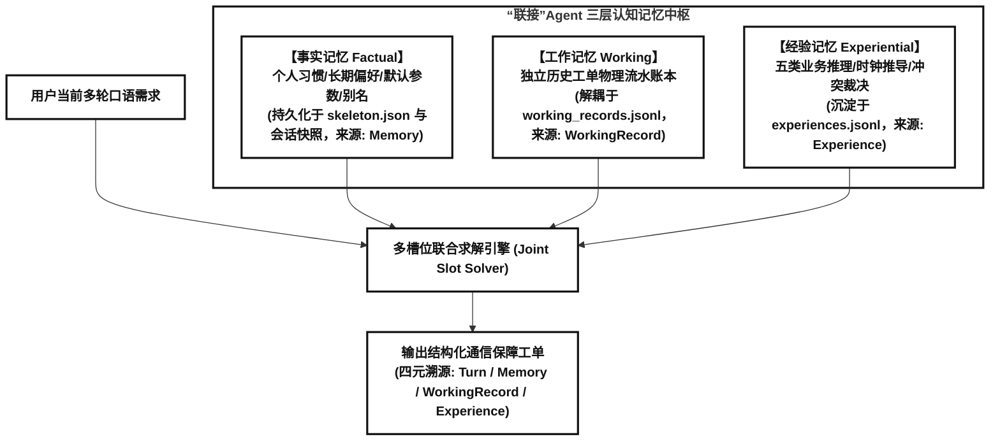
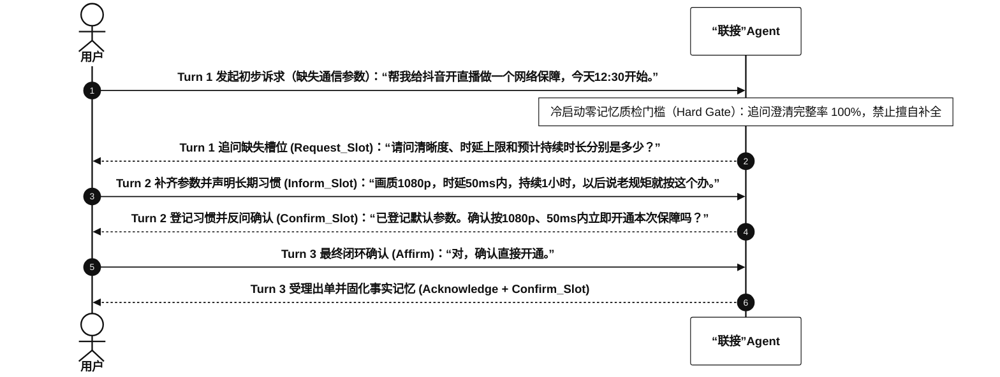
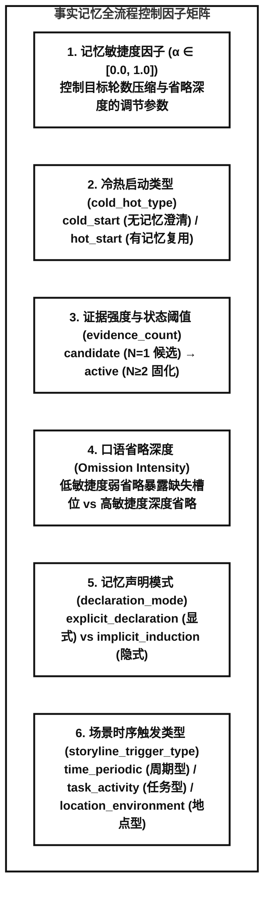
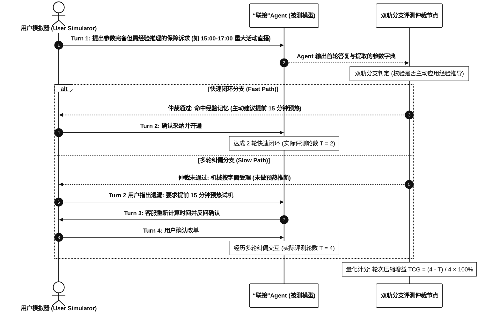

# “联接”Agent 跨会话三层认知记忆数据集与双轨评测技术规范

> **文档状态**：技术设计规范（Approved & Implemented）  
> **面向场景**：“联接”Agent 通信保障意图参数提取（提参数）与长程记忆演进  
> **会话规模**：单用户生命周期规划为 **16 ~ 20 轮动态会话**（算术均值 18 轮）  
> **核心特性**：覆盖事实记忆、工作记忆与五类经验记忆，支持经验会话 Turn 1 参数自包含与双轨成败分支测试（Fast/Slow Branch Evaluation）  

---

## 目录大纲
- [一、 智能体定位与核心原则](#一-智能体定位与核心原则)
- [二、 三层认知记忆架构与职责边界](#二-三层认知记忆架构与职责边界)
- [三、 16~20 轮动态生命周期时间线拓扑](#三-1620-轮动态生命周期时间线拓扑)
- [四、 五类经验记忆场景规范](#四-五类经验记忆场景规范)
  - [4.0 经验会话 Turn 1 基础参数自包含原则](#40-经验会话-turn-1-基础参数自包含原则)
  - [场景1：多意图局部突发延误与分段隔离](#场景1多意图局部突发延误与分段隔离)
  - [场景2：重大活动提前预热时间推算](#场景2重大活动提前预热时间推算)
  - [场景3：节假日调休周期排期顺延](#场景3节假日调休周期排期顺延)
  - [场景4：多候选历史工单运行质量消歧](#场景4多候选历史工单运行质量消歧)
  - [场景5：新旧工单时段重叠冲突裁决](#场景5新旧工单时段重叠冲突裁决)
- [五、 双轨成败分支测试与量化指标](#五-双轨成败分支测试与量化指标)
- [六、 物理文件组织与四元溯源 Schema](#六-物理文件组织与四元溯源-schema)

---

## 一、 智能体定位与核心原则

1. **“联接”Agent 业务定位**：
   - 正式命名：**“联接”Agent**；
   - 核心职责：专精于通信网络保障的**意图参数提取（提参数）**与闭环受理。
2. **语言风格规范**：
   - 避免使用生僻底层网管术语（如“空口切片”、“相控阵天线”、“对星握手”、“微波回传链路”、“专网监控探针”）；
   - 对话文本采用符合真实业务场景的自然口语表达（如“提前把网络通道占上试机”、“免得互相抢网速”、“节假日放假公司没人避免白扣费”、“两笔单子时间重叠自动提前结束前单”）。
3. **模板意图约束**：
   - 严格遵循 T 模板规约：单个会话内包含单意图或**最多 2 个意图**（如 T2-4）。
4. **评测专业称谓规范**：
   - 架构与文档统一采用正规评测术语：**“双轨成败分支测试（Fast/Slow Branch Evaluation）”**、**“动态多分支模拟评测”** 或 **“树状交互评测”**。

---

## 二、 三层认知记忆架构与职责边界

数据集严格划分三层认知记忆的职责边界，避免概念混淆：

* **事实记忆 (Factual Memory)**：管理用户的长期属性、个性化别名映射与默认参数偏好。负责冷启动（3 轮澄清, $\alpha=0.0$）与热启动（常规 2 轮 $\alpha=0.5$，高敏捷度 1 轮 $\alpha=1.0$）。个人口语别名（如“晚饭后=19:30”）归属事实记忆，不计入经验记忆。
* **工作记忆 (Working Memory)**：管理已闭环的历史保障工单记录。通过独立的 `working_records.jsonl` 账本解耦，支撑跨期单据检索（如“上周在奥体开的那单”）、变更改期与多单消歧。
* **经验记忆 (Experiential Memory)**：管理由“联接”Agent 基于历史排障与业务规则提炼的策略先验，用于实现**快速闭环（Fast Path）**与**业务冲突主动消解**。

### 2.1 事实记忆冷启动多轮澄清机制（$T=3$ 轮）

为防止智能体在冷启动初期擅自补全未知参数，系统设置前置质检硬门槛（Hard Gate）：在用户尚未建立事实记忆时，“联接”Agent 必须执行 3 轮参数澄清与确认流程：

#### 双轨固化机制（显式声明 vs 隐式归纳）：
1. **显式声明路径 (`explicit_declaration`)**：用户在交互中明确声明长期规则（如“以后按老规矩办”），会话办结后触发 `form_memory_explicit`，记忆状态直接置为 **`active`**（`evidence_count = 1`）。
2. **隐式归纳路径 (`implicit_induction`)**：用户未显式声明长期偏好，首轮澄清办结后仅作为单次历史行为记录为 **`candidate`（候选状态）**；待后续会话出现第 2 次一致行为（$N \ge 2$）并经用户确认后，升级为 **`active`**。

### 2.2 事实记忆全周期 6 项控制因子

1. **记忆敏捷度因子（`agility_factor`, $\alpha \in [0.0, 1.0]$）**：
   - 目标轮数调制公式：$$T_{\text{target}} = \text{round}\big(T_{\text{cold}} \cdot (1 - \alpha)\big)$$
   - $\alpha = 0.0$（保守模式 / 冷启动澄清）：逐项追问缺失槽位，保持 $T = 3$ 轮；
   - $\alpha = 0.5$（常规稳健热启动）：调取记忆反问确认，收敛至 $T = 2$ 轮；
   - $\alpha = 1.0$（高敏捷度热启动）：直接命中记忆并受理出单，达成 $T = 1$ 轮闭环。
2. **冷热启动类型标识（`cold_hot_type`）**：
   - `cold_start`：冷启动，要求反问澄清完整率 100%，未授权补全率 0%；
   - `hot_start`：热启动，基于已生效事实记忆补全省略槽位。
3. **证据强度与状态机计数（`evidence_count`）**：
   - 记录该事实记忆被验证的累计次数；
   - 状态转移：`candidate` ($N=1$) $\to$ `active` ($N \ge 2$) $\to$ `superseded` / `expired`。
4. **口语省略深度（`Omission Intensity`）**：
   - 低敏捷度（$\alpha \le 0.3$）：保留部分辅助信息，暴露关键参数缺失；
   - 高敏捷度（$\alpha \ge 0.7$）：省略常规通信参数，由模型依赖事实记忆补全。
5. **记忆声明模式（`declaration_mode`）**：
   - 按用户 ID 奇偶 50/50 分流：奇数用户采用显式声明，偶数用户采用隐式归纳。
6. **场景时序触发类型（`storyline_trigger_type`）**：
   - `time_periodic`（周期时间型）/ `task_activity`（任务活动型）/ `location_environment`（特定地点型）。

---

## 三、 16~20 轮动态生命周期时间线拓扑

单用户会话总量规划为 **16 ~ 20 轮动态浮动**（算术均值 18 轮），计算公式为：
$$\text{target\_count} = 16 + (\text{uid\_num} \pmod 5)$$
根据用户 ID 均匀分布在 `16, 17, 18, 19, 20` 轮之间。

### 20 候选生命周期槽位分布表

| 序号 | 模板 | 主导记忆类型 | 角色与业务情境 | 轮数要求 | 关键机制与参数溯源 |
| :---: | :---: | :---: | :--- | :---: | :--- |
| **S01** | **T2-1** | 事实记忆 | **主线冷启动建联**：用户显式声明默认配置，建立主线记忆 `MF_001` | 3 轮 | 冷启动澄清（$\alpha=0.0$） |
| **S02** | **T3-1** | 事实记忆 | **支线1冷启动建联**：弱网环境建立独立支线记忆 `SUB_001` | 3 轮 | 支线别名消歧 |
| **S03** | **T2-1** | 事实记忆 | **主线常规热启动**：复用默认配置，Agent 反问确认 | 2 轮 | 热启动复用（$\alpha=0.5$） |
| **S04** | **T2-6** | 工作记忆 | **历史工单跨期复用**：“按上周在奥体开的规格来” | 2 轮 | 检索命中 `REC_0001` 单据继承 |
| **S05** | **T2-7** | 工作记忆 | **历史工单延期变更**：“把上次预约的单子往后推迟一小时” | 2 轮 | 时间戳平移，参数继承 |
| **S06** | **T2-1** | **经验记忆** | **场景3：节假日排期顺延**：预约例行保障遇法定节假日顺延 | 2 轮 | `EXP_CALENDAR_HOLIDAY_EXCEPTION_01` |
| **S07** | **T2-5** | 事实记忆 | **主线局部时长修改**：常规参数不变，当次时长延长至 180min | 2 轮 | 基础参数复用，时长单次覆盖 |
| **S08** | **T2-9** | **经验记忆** | **场景2：重大活动提前预热**：重要活动直播，主动建议提前预热 | 2 轮 | `EXP_PREWARM_BUFFER_01` |
| **S09** | **T2-3** | 事实记忆 | **恶劣天气临时调整**：突发暴雨临时下调分辨率（仅当次生效） | 2 轮 | 临时单次覆盖，不改变长期主线 |
| **S10** | **T2-4** | **经验记忆** | **场景1：双业务分段隔离**：并发或接续双业务独立拆单保障 | 2~3 轮 | `EXP_MULTI_INTENT_PARTITION_01` |
| **S11** | **T2-1** | 事实记忆 | **事件失效基线恢复**：天气恢复后，自动回到 1080p 默认基线 | 2 轮 | 记忆状态机闭环 |
| **S12** | **T2-6** | **经验记忆** | **场景4：同日多单质量消歧**：同日多笔历史工单优选高规格无卡顿单 | 2 轮 | `EXP_ORDER_QUALITY_DISAMBIGUATION_01` |
| **S13** | **T2-10**| **经验记忆** | **场景5：新旧工单时段重叠裁决**：新旧单时段重叠，前单提前结束 | 2 轮 | `EXP_OVERLAPPING_ORDER_RESOLUTION_01` |
| **S14** | **T2-7** | 工作记忆 | **历史工单多候选澄清**：历史存在多笔异构工单时主动追问消歧 | 2~3 轮 | `Request_Disambiguation` |
| **S15** | **T1-2** | 事实隔离 | **域外诉求拒识**：宽带装维或套餐变更诉求，拒识并隔离干扰 | 1 轮 | 意图拒识不改变记忆状态 |
| **S16** | **T2-6** | 工作记忆 | **历史工单跨期复用强化**：指定日期历史工单参数继承 | 2 轮 | 单据精确检索复用 |
| **S17** | **T2-1** | 事实记忆 | **支线2独立建联**：建立第二支线记忆 `SUB_002` | 3 轮 | 多故事线穿插隔离 |
| **S18** | **T2-1** | 事实记忆 | **支线2常规复用**：第二支线记忆热启动复用 | 2 轮 | 支线复用强化 |
| **S19** | **T1-1** | 事实隔离 | **单轮单次业务干扰**：单次明确参数业务办结，不更新长期画像 | 1 轮 | 零记忆副作用 |
| **S20** | **T2-1** | 事实记忆 | **终态高敏捷度复用**：主线记忆成熟复用 | 1~2 轮 | 高敏捷度热启动 |

---

## 四、 五类经验记忆场景规范

### 4.0 经验会话 Turn 1 基础参数自包含原则
* **设计要求**：在经验应用测试会话（`experience_application`）的 **Turn 1** 中，用户台词必须**显式给出本次保障的全部基础业务参数**（`application_name`、`business_type`、起止时间、时长、`resolution`、`latency`），不依赖历史事实记忆补全基础参数。
* **设计目的**：将评测焦点严格收敛于**“联接”Agent 能否识别当前业务特征并主动应用经验策略实现快速闭环**，排除因基础参数缺失引发的常规追问干扰。

### 场景1：多意图局部突发延误与分段隔离
* **卡片标识**：`EXP_MULTI_INTENT_PARTITION_01`
* **场景定义**：用户在同一会话中提出两项并发或接续的保障诉求（如业务 $I_1$ 与业务 $I_2$），或对其中一项提出局部延时修改。
* **无经验 Slow Path (4~5轮)**：将两项业务混同为单一通道处理，或修改 $I_1$ 时误改 $I_2$ 参数，引发用户中途纠正与重新拆单，交互 4~5 轮。
* **“联接”Agent Fast Path (2~3轮)**：
  * 主动按各业务独立时段与参数要求拆分为独立子工单，或仅重算目标意图 $I_1$ 的结束时间与时长，严格锁定 $I_2$ 参数不变；
  * 经用户确认后 2~3 轮完成双业务独立闭环。

### 场景2：重大活动提前预热时间推算
* **卡片标识**：`EXP_PREWARM_BUFFER_01`
* **场景定义**：用户在 Turn 1 给出重要活动（如决赛、大型直播、版本压测）的正式起止时间与完整参数（如 `15:00-17:00`，`1080P`，`20ms`），未主动提及预热缓冲。
* **无经验 Slow Path (4轮)**：机械按字面 `15:00` 受理，用户在第 2 轮指出需预留推流试机时间并要求改单，重新计算起止时间与时长，耗时 4 轮。
* **“联接”Agent Fast Path (2轮)**：
  * 识别高敏活动特征，在首轮回复中主动建议将起保时间提前 15 分钟预热（如调整为 `14:45-17:00`，总时长相应增加 15 分钟至 `135分钟`）：
    $$S_{\text{start}} = T_{\text{formal}} - 15\text{min}, \quad D_{\text{total}} = D_{\text{formal}} + 15\text{min}$$
  * 用户在第 2 轮直接确认采纳，2 轮完成闭环。

### 场景3：节假日调休周期排期顺延
* **卡片标识**：`EXP_CALENDAR_HOLIDAY_EXCEPTION_01`
* **场景定义**：用户在 Turn 1 给出全套参数预约周期性办公保障，但目标日期恰逢法定节假日休假。
* **无经验 Slow Path (4轮)**：未校验节假日日历，直接按休假日期排期，用户发现后要求改期重排，耗时 4 轮。
* **“联接”Agent Fast Path (2轮)**：
  * 识别目标日期处于法定节假日，在首轮主动提示休假冲突，并建议顺延至节后首个工作日或调休上班日同時間帯；
  * 用户确认后 2 轮办结。

### 场景4：多候选历史工单运行质量消歧
* **卡片标识**：`EXP_ORDER_QUALITY_DISAMBIGUATION_01`
* **场景定义**：用户指代历史某日工单（如“按上周三效果好的那次办”），账本中该日存在两笔不同规格的历史工单（一笔低规格曾出现波动，一笔高规格运行稳定）。
* **无经验 Slow Path (4~5轮)**：误选低规格单据引发用户纠正，或将所有历史单据逐一罗列让用户自行比对，耗时 4~5 轮。
* **“联接”Agent Fast Path (2轮)**：
  * 检索历史工单账本，主动过滤低规格异常单据，优选高规格稳定工单参数并发起确认；
  * 用户确认后 2 轮完成参数继承与闭环。

### 场景5：新旧工单时段重叠冲突裁决
* **卡片标识**：`EXP_OVERLAPPING_ORDER_RESOLUTION_01`
* **场景定义**：用户在 Turn 1 申请的新保障时段（如 `15:00-17:00`）与已生效的存量工单（如 `14:00-16:00`）在 `15:00-16:00` 发生时段重叠。
* **无经验 Slow Path (4轮)**：直接返回时段冲突报错并退回请求，由用户手动申请修改旧单后再重提新单，交互 4 轮。
* **“联接”Agent Fast Path (2轮)**：
  * 检测到时段重叠后，在首轮主动提出冲突裁决方案：将前序存量工单于 `15:00` 提前结束，新工单于 `15:00` 无缝接管；
  * 用户确认后 2 轮同步完成旧单截断与新单受理。

---

## 五、 双轨成败分支测试与量化指标

评测系统采用双轨成败分支测试（Fast/Slow Branch Evaluation），根据被测模型的首轮推理输出，分别对照快速闭环分支与多轮纠偏分支：

### 核心量化指标体系

1. **轮次压缩增益 (Turn Compression Gain, TCG)**：
   $$\text{TCG} = \frac{T_{\text{slow}} - T_{\text{actual}}}{T_{\text{slow}}} \times 100\%$$
   * 考核目标：五类经验场景综合 $\text{TCG} \ge 50\%$。
2. **经验槽位抽取召回率 (Experience Slot Recall / ERRA)**：
   * 校验模型在不依赖用户明示的情况下，对经验推导参数（如预热偏移后起止时间、顺延后日期、重叠截断时间）的推断准确率（目标 $\ge 90\%$）。
3. **多意图隔离度 (Intent Partitioning Accuracy)**：
   * 双业务分段或局部调整发生时，非目标意图参数的误改率要求为 $0\%$。

---

## 六、 物理文件组织与四元溯源 Schema

每个画像产物目录（如 `data/cognitive_samples/mobile_persona_001/`）包含以下 4 个标准文件：
* `skeleton.json`：确定性设计骨架文件，存储四层真值（`persona_ground_truth`）、评测目标（`memory_targets`）、16~20 轮时间线规划与质检报告；
* `sessions.jsonl`：包含 16~20 轮标准化会话的主文件，记录对话序列 `event_sequence`、意图 `intents`、槽位更新 `slot_updates`、前后记忆快照，以及经验会话的 `fast_path_EvalBranch` 与 `slow_path_EvalBranch` 双轨分支数据；
* `working_records.jsonl`：独立的已办保障工单物理账本；
* `experiences.jsonl`：存储提炼出的五类 ReasoningBank 结构化经验卡片。

### 四元溯源标注字典（Ground Truth Schema）

| 溯源类型 (`source_type`) | 语义解释 | 典型 `source_ref` 示例 |
| :--- | :--- | :--- |
| **`Turn`** | 用户当轮口语台词中明确提供的参数 | `"U1"`, `"U2"` |
| **`Memory`** | 来源于用户事实记忆库的长期默认配置与习惯 | `"MF_001"`, `"MT_001"` |
| **`WorkingRecord`** | 继承自独立历史保障工单账本的参数 | `"REC_0001"`, `"REC_0002"` |
| **`Experience`** | 来源于五类经验记忆库的策略与时间推导 | `"EXP_PREWARM_BUFFER_01"`, `"EXP_MULTI_INTENT_PARTITION_01"` |
