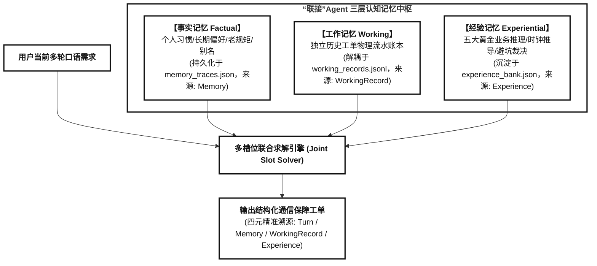
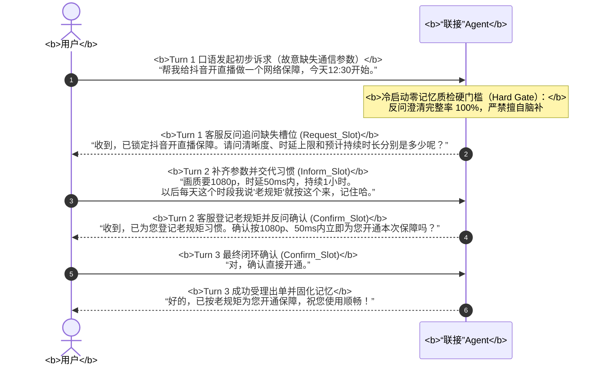
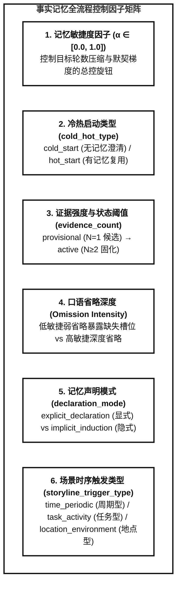
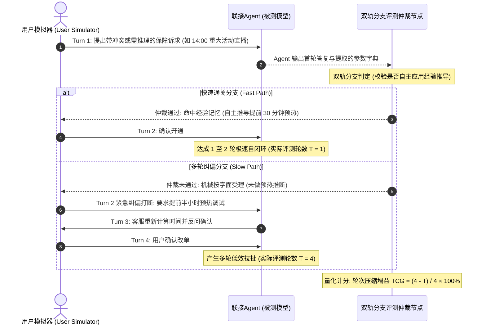

# “联接”Agent 跨会话三层认知记忆数据集与双轨评测引擎技术规范

> **文档状态**：新特性开发与技术设计规范（Approved）  
> **面向场景**：“联接”Agent 通信保障意图参数提取（提参数）与长程记忆演进  
> **会话规模**：单用户生命周期规划为 **16 ~ 20 轮动态会话**（支持弹性扩展至 22 轮）  
> **核心演进**：事实记忆、工作记忆与五大黄金经验记忆全景贯通，内嵌双轨成败分支模拟评测  

---

## 目录大纲
- [一、 智能体定位与核心原则](#一-智能体定位与核心原则)
- [二、 三层认知记忆中枢架构与分水岭](#二-三层认知记忆中枢架构与分水岭)
- [三、 16~20 轮动态生命周期时间线拓扑](#三-1620-轮动态生命周期时间线拓扑)
- [四、 五大黄金经验记忆场景深度规范](#四-五大黄金经验记忆场景深度规范)
  - [场景1：多意图局部突发延误隔离](#场景1多意图局部突发延误隔离)
  - [场景2：重大活动提前预热试机时间推算](#场景2重大活动提前预热试机时间推算)
  - [场景3：节假日调休周期排期避坑顺延](#场景3节假日调休周期排期避坑顺延)
  - [场景4：模糊多候选历史工单质量特征消歧](#场景4模糊多候选历史工单质量特征消歧)
  - [场景5：新旧工单时段撞车无缝让路接管](#场景5新旧工单时段撞车无缝让路接管)
- [五、 双轨成败分支模拟评测引擎与量化指标](#五-双轨成败分支模拟评测引擎与量化指标)
- [六、 物理文件组织与四元精准溯源 Schema](#六-物理文件组织与四元精准溯源-schema)

---

## 一、 智能体定位与核心原则

1. **“联接”Agent 业务定位**：
   - 正式命名：**“联接”Agent**；
   - 核心职责：专精于通信网络保障的**意图参数提取（提参数）**与精准闭环受理，严禁生成拖沓的客服推销式拉扯对话。
2. **语言口语化与去黑话铁律**：
   - 坚决杜绝生僻硬核的通信网管黑话（如“空口切片”、“相控阵天线”、“对星握手”、“微波回传链路”、“专网监控探针”）；
   - 全量采用真实用户与客服沟通的大白话（如“提前把网络通道占上试机”、“免得互相抢网速”、“节假日放假公司没人避免白扣费”、“两笔单子时间撞车了自动提前让路”）。
3. **模版意图约束**：
   - 严格恪守官方 T 模版规约：单个会话内为单意图或**最多 2 个意图**（如 T2-4，严禁捏造 3 意图以上的膨胀结构）。
4. **评测专业称谓规范**：
   - 架构与文档严禁使用戏谑词汇，统一命名为**“双轨成败分支模拟评测”**或**“动态多分支评测”**。

---

## 二、 三层认知记忆中枢架构与分水岭

数据集严格保证三层认知记忆的本体论纯洁性，杜绝概念混淆：

* **事实记忆 (Factual Memory)**：管“用户是谁、个人老规矩是啥”。负责冷启动（3轮澄清, $\alpha=0.0$）与热启动（稳健2轮 $\alpha=0.5$，极致1轮 $\alpha=1.0$）。严禁将个人口语别名（如“晚饭后=19:30”）虚假包装成经验。
* **工作记忆 (Working Memory)**：管真实发生的历史工单记录。通过独立的 `working_records.jsonl` 账本解耦，支撑跨期单据检索（“上周在奥体开的那单”）、变更改期（延后/提前）与多单消歧。
* **经验记忆 (Experiential Memory)**：管无需用户交代、由智能体基于通信最佳实践主动推断的参数先验，专用于实现**快速闭环（Fast Path）**与**复杂业务冲突解决**。

### 2.1 事实记忆冷启动多轮澄清机制（$T=3$ 轮）

为杜绝智能体在冷启动初期“擅自脑补通信参数”或“产生参数幻觉”，系统设置了前置质检硬门槛（Hard Gate）：在用户未建立老规矩时，智能体必须发起 3 轮严格的参数反问澄清收敛流：

#### 双轨固化机制（显式声明 vs 隐式归纳）：
1. **显式声明路径 (`explicit_declaration`)**：用户在交互中主动声明规则指令（如“*以后按老规矩办*”），会话办结后触发 `form_memory_explicit`，记忆状态直接置为 **`active`**（`evidence_count = 1`）。
2. **隐式归纳路径 (`implicit_induction`)**：用户未显式交代长期偏好，首轮澄清办结后触发 `log_task_history`，记忆仅作为单次历史行为记录为 **`provisional`（候选/暂定状态）**；直到后续会话出现第 2 次相同特征行为（$N \ge 2$），经反问确认后才触发 `crystallize_implicit_memory` 固化为 **`active`**。

### 2.2 事实记忆全周期 6 大核心控制因子

1. **记忆敏捷度因子（`agility_factor`, $\alpha \in [0.0, 1.0]$）**：
   - 目标轮数调制公式：$$T_{\text{target}} = \text{round}\big(T_{\text{cold}} \cdot (1 - \alpha)\big)$$
   - $\alpha = 0.0$（极端保守 / 冷启动澄清）：逐项追问缺失槽位，保持 $T = 3$ 轮；
   - $\alpha = 0.5$（常规稳健热启动）：调取记忆反问确认，收敛至 $T = 2$ 轮；
   - $\alpha = 1.0$（极致敏捷热启动）：秒级命中并默认直接受理出单，达成 $T = 1$ 轮极速闭环。
2. **冷热启动类型标识（`cold_hot_type`）**：
   - `cold_start`：冷启动，硬性约束反问澄清完整率 100%，脑补率 0%；
   - `hot_start`：热启动，基于记忆快速复用槽位。
3. **证据强度与状态机计数（`evidence_count`）**：
   - 记录该事实记忆被使用/验证的累计次数；
   - 状态转移：`provisional` ($N=1$) $\to$ `active` ($N \ge 2$) $\to$ `reinforced` ($N > 2$)。
4. **台词口语省略深度（`Omission Intensity`）**：
   - 低敏捷（$\alpha \le 0.3$）：保留部分辅助信息，暴露关键参数缺失；
   - 高敏捷（$\alpha \ge 0.7$）：深度省略通信参数，倒逼模型必须依赖记忆补全。
5. **记忆声明模式分流因子（`declaration_mode`）**：
   - 按用户 ID 奇偶 50/50 分流：奇数用户显式声明，偶数用户隐式归纳。
6. **场景时序触发因子（`storyline_trigger_type`）**：
   - `time_periodic`（周期时间型）/ `task_activity`（任务活动型）/ `location_environment`（特定地点型）。

---

## 三、 16~20 轮动态生命周期时间线拓扑

为适应更深度的认知演进，会话总量规划为 **16 ~ 20 轮动态浮动**（算术均值 18 轮），公式为：
$$\text{target\_count} = 16 + (\text{uid\_num} \pmod 5)$$
支持根据用户 ID 均匀离散分布在 `16, 17, 18, 19, 20` 轮之间。

### 全景 20 候选生命周期槽位分布表

| 序号 | 模版 | 主导记忆类型 | 角色与业务情境 | 轮数要求 | 关键机制与参数溯源 |
| :---: | :---: | :---: | :--- | :---: | :--- |
| **S01** | **T2-1** | 事实记忆 | **主线冷启动建联**：用户显式立规矩，建立基线记忆 `MF_001` | 3 轮 | 冷启动严密澄清（$\alpha=0.0$） |
| **S02** | **T3-1** | 事实记忆 | **支线1冷启动建联**：大巴弱网转场，建立独立支线 `SUB_001` | 3 轮 | 支线代称消歧 |
| **S03** | **T2-1** | 事实记忆 | **主线常规稳健热启动**：呼出老规矩，Agent 反问确认 | 2 轮 | 热启动稳健复用（$\alpha=0.5$） |
| **S04** | **T2-6** | 工作记忆 | **历史工单跨期复用**：“按上周在奥体开的规格来” | 2 轮 | 检索命中 `REC_01` 单据继承 |
| **S05** | **T2-7** | 工作记忆 | **历史工单延期变更**：“把昨天预约的单子往后推迟一小时” | 2 轮 | 时间戳后移，时长继承 |
| **S06** | **T2-1** | **经验记忆** | **场景3：节假日避坑顺延**：预约下周一早会，遇国庆长假顺延 | 2 轮 | `EXP_CALENDAR_HOLIDAY_EXCEPTION_01` |
| **S07** | **T2-5** | 事实记忆 | **主线局部时长修改**：老规矩不变，现场活动延长至 180min | 2 轮 | 基础参数复用，时长单次覆盖 |
| **S08** | **T2-9** | **经验记忆** | **场景2：重大活动提前预热**：开幕直播，自动前置30分试机 | 1~2 轮 | `EXP_PREWARM_BUFFER_01`（数学推导） |
| **S09** | **T2-3** | 事实记忆 | **恶劣天气临时纠偏**：突发暴雨临时降级（仅当次生效） | 2 轮 | 临时单次覆盖，不污染全局主线 |
| **S10** | **T2-4** | **经验记忆** | **场景1：双意图延误隔离**：上午会议拖堂，下午直播锁定不动 | 3 轮 | `EXP_MULTI_INTENT_PARTITION_01` |
| **S11** | **T2-1** | 事实记忆 | **事件失效基线恢复**：暴雨过去，自动无缝恢复 1080p 基线 | 2 轮 | 记忆状态机闭环 |
| **S12** | **T2-6** | **经验记忆** | **场景4：模糊多单质量消歧**：“按效果好的那次办”，排查日志 | 2 轮 | `EXP_ORDER_QUALITY_DISAMBIGUATION_01` |
| **S13** | **T2-10**| **经验记忆** | **场景5：新旧工单撞车让路**：新直播与旧单重叠，前单提前结单 | 2 轮 | `EXP_OVERLAPPING_ORDER_RESOLUTION_01` |
| **S14** | **T2-7** | 工作记忆 | **历史工单提前变更**：“把昨天预约的单子提前一小时开始” | 2 轮 | 时间戳前移重算 |
| **S15** | **T1-2** | 事实隔离 | **域外诉求拒识**：宽带光纤装维报修，拒绝受理，隔离干扰 | 1 轮 | 意图拒识不改变记忆状态 |
| **S16** | **T2-6** | 工作记忆 | **双工单时态消歧**：“按之前的单子开”，候选不唯一追问消歧 | 3 轮 | 深度消歧交互 |
| **S17** | **T2-1** | 事实记忆 | **支线2独立建联**：酒店晚间复盘建立独立记忆 `SUB_002` | 3 轮 | 多故事线穿插隔离 |
| **S18** | **T2-1** | 事实记忆 | **支线2常规复用**：酒店复盘记忆复用 | 2 轮 | 支线复用强化 |
| **S19** | **T1-1** | 事实隔离 | **单轮单次业务干扰**：单次常规业务办结，不更新长期画像 | 1 轮 | 零记忆副作用 |
| **S20** | **T2-1** | 事实记忆 | **终态极致敏捷终检**：用户呼出老规矩，Agent 1 轮极速直达出单 | 1 轮 | 极致敏捷热启动（$\alpha=1.0$） |

---

## 四、 五大黄金经验记忆场景深度规范

### 场景1：多意图局部突发延误隔离
* **卡片标识**：`EXP_MULTI_INTENT_PARTITION_01`
* **冲突定义**：用户同时托付双意图（如上午内部会议 $I_1$ + 下午发布直播 $I_2$）。$I_1$ 突发超时严重拖堂，用户紧急修改，但要求 $I_2$ 绝不能改错。
* **无经验 Slow Path (5轮)**：Agent 发生意图混淆，把延误时间误当成下午直播开始时间；且漏算时长，泛泛追问，被用户严厉纠偏，拉扯 5 轮才办妥。
* **“联接”Agent Fast Path (3轮)**：
  * 仅重算 $I_1$ 的 `end_timestamp` 与 `duration`；
  * $I_2$ 的起止时间严格冻结锁定，仅响应用户对 $I_2$ 提出的局部时延收紧（≤30ms）；
  * 3 轮极速双闭环，绝不全盘推倒重来。

### 场景2：重大活动提前预热试机时间推算
* **卡片标识**：`EXP_PREWARM_BUFFER_01`
* **冲突定义**：用户给出的只是活动开幕时间（14:00-16:00），未提及试机预热。
* **无经验 Slow Path (4轮)**：机械按 14:00 开通，用户在第 2 轮发现没有预留推流调试时间，急眼打断并要求提前改单，拉扯 4 轮。
* **“联接”Agent Fast Path (1~2轮)**：
  * 自主识别重大活动并执行时间差推算：
    $$S_{\text{start}} = 14:00 - 30\text{min} = 13:30, \quad D_{\text{duration}} = 120\text{min} + 30\text{min} = 150\text{min}$$
  * 首轮直接为用户配置就绪或 2 轮确认闭环，省去 2 轮纠偏成本。

### 场景3：节假日调休周期排期避坑顺延
* **卡片标识**：`EXP_CALENDAR_HOLIDAY_EXCEPTION_01`
* **冲突定义**：用户预约下周一早会保障，但该日恰逢国庆节法定长假第一天。
* **无经验 Slow Path (4轮)**：机械开通，放假当天白白扣费，用户发现后投诉退单，经历取消、重算、改期的 4 轮拉扯。
* **“联接”Agent Fast Path (2轮)**：
  * 日历引擎识别假期冲突，主动在大白话回复中提醒放假背景；
  * 自动将日期顺延至节后首个工作日（10月8日周四）对应时段，2 轮优雅避坑出单。

### 场景4：模糊多候选历史工单质量特征消歧
* **卡片标识**：`EXP_ORDER_QUALITY_DISAMBIGUATION_01`
* **冲突定义**：用户提出“按上周效果好/没卡顿的那次办”。后台查到上周有周二（顺畅会议）和周四（网络波动直播）两张单据。
* **无经验 Slow Path (4~5轮)**：盲猜选错单据挨骂，或者像报菜名一样把所有单据全盘向用户盘问。
* **“联接”Agent Fast Path (2轮)**：
  * 调取工单质量运行日志，过滤掉曾有网络波动的单据，精准锁定周二零卡顿优质工单并直接调取规格；
  * 2 轮高效完成参数继承并闭环。

### 场景5：新旧工单时段撞车无缝让路接管
* **卡片标识**：`EXP_OVERLAPPING_ORDER_RESOLUTION_01`
* **冲突定义**：新申请的 15:00-17:00 直播，与之前预约的一笔日常保障（生效至 16:00）在 15:00-16:00 重叠撞车 1 小时。
* **无经验 Slow Path (4轮)**：系统报错“时段重叠冲突”，客服直接把错误甩给用户，让用户自己去退单重申，拉扯 4 轮。
* **“联接”Agent Fast Path (2轮)**：
  * 自动时钟裁决：协调前单在 15:00 提前交割结单，新直播单在 15:00 准时无缝激活接管通道；
  * 2 轮化解底层通信系统工单冲突。

---

## 五、 双轨成败分支模拟评测引擎与量化指标

评测系统采用动态分支模拟器（Branching Simulator），根据被测模型的首轮推理质量，自动走入不同剧情线：

### 核心量化指标体系

1. **轮次压缩增益 (Turn Compression Gain, TCG)**：
   $$\text{TCG} = \frac{T_{\text{slow}} - T_{\text{actual}}}{T_{\text{slow}}} \times 100\%$$
   * 考核目标：五大经验场景全量综合 $\text{TCG} \ge 50\%$。
2. **经验槽位抽取召回率 (Experience Slot Recall)**：
   * 校验模型在不依赖用户口语明示的情况下，对隐式经验参数（如预热偏移量、顺延后日期、让路交割时间）的自动推断准确率（目标 $\ge 90\%$）。
3. **多意图隔离度 (Intent Partitioning Accuracy)**：
   * 突变扰动发生时，非目标意图参数的受污染率严格为 $0\%$。

---

## 六、 物理文件组织与四元精准溯源 Schema

每个画像产物（如 `data/cognitive_samples/mobile_persona_001/`）目录结构如下：
* `experience_bank.json`：存储五大黄金 ReasoningBank 经验卡片；
* `working_records.jsonl`：独立的已办工单流水物理账本；
* `sessions.jsonl`：包含 16~20 轮标准化会话的主文件，内嵌 Fast/Slow 双轨分支元数据；
* `memory_traces.json`：记录每个会话发生前后的记忆三元组演进快照。

### 四元精准溯源标注字典（Ground Truth Schema）

| 溯源类型 (`source_type`) | 语义解释 | 典型 `source_ref` 示例 |
| :--- | :--- | :--- |
| **`Turn`** | 用户当轮口语台词中明确提及的参数 | `"U1"`, `"U2"` |
| **`Memory`** | 来源于画像事实记忆库的长期老规矩与习惯 | `"MF_001"`, `"SUB_001"` |
| **`WorkingRecord`** | 继承自独立的已办保障工单物理账本 | `"REC_mobile_persona_001_20261010_01"` |
| **`Experience`** | 来源于五大黄金经验知识库的业务与时钟推断 | `"EXP_PREWARM_BUFFER_01"`, `"EXP_MULTI_INTENT_PARTITION_01"` 等 |
