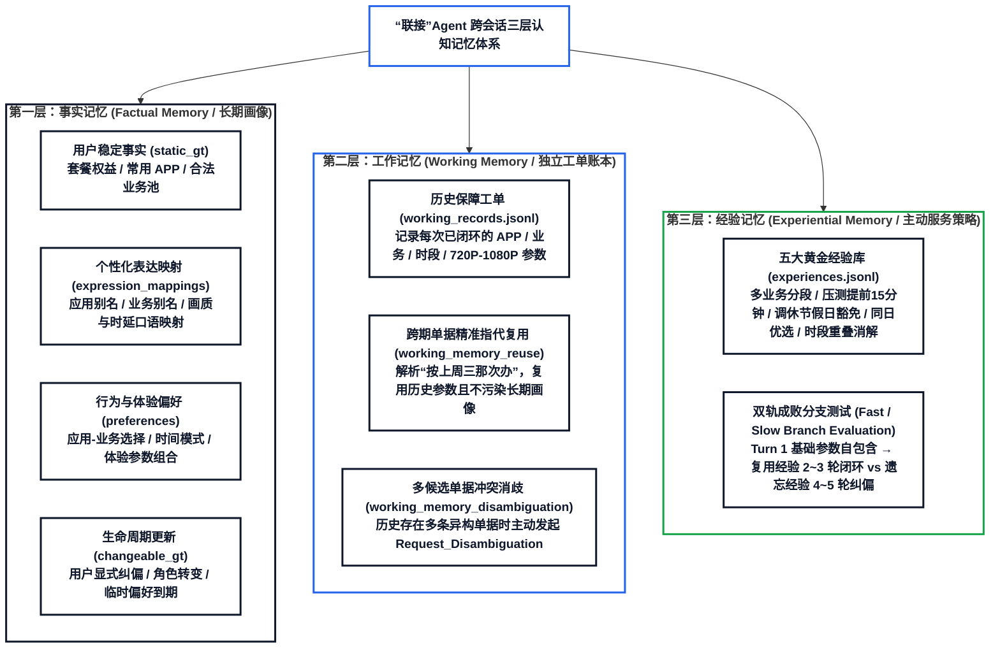
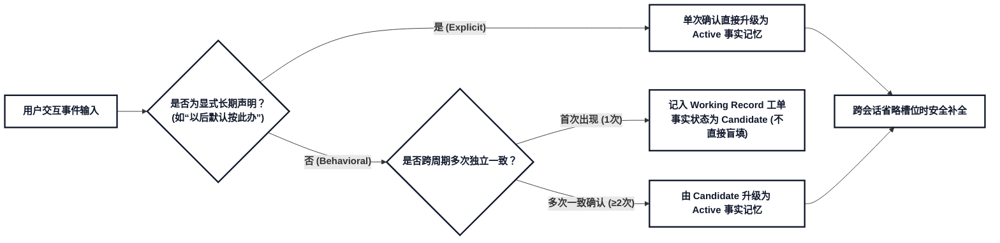
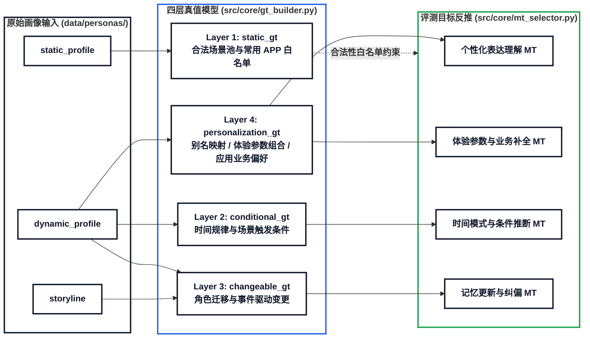

# 记忆建模与数据集生成要求

> **文档层级**：第一层 · 业务定义与记忆建模要求（Why & What）  
> **文档定位**：定义通信网络保障 **“联接”Agent** 在意图参数提取（提参数）场景下的三层认知记忆建模理论、事实记忆边界判定、四层 Ground Truth 映射关系及正负样本生成要求。  
> **关联阅读**：下一层核心架构详见 [**《三层认知记忆演进开发规范》**](specs/cognitive_memory_dev_spec.md) 与 [**《跨 Session 记忆数据集生成器思路》**](跨%20Session%20记忆数据集生成器思路.md)。

---

## 一、 记忆的核心作用与三层认知记忆全景

> **核心能力要求**：识别用户自定义表达；补全省略参数；识别应用和业务；处理时间表达；复用历史澄清结果与历史保障单据；内化跨会话排障与提参经验；判断何时必须向用户追问。

记忆不是检索到就机械套用，而是需要结合**当前轮明确输入**、**用户事实记忆**、**工作记忆（历史工单账本）**与**经验记忆（主动服务策略）**进行联合决策：
* **证据充分且作用域匹配时**：精准补全省略槽位，或主动提供经验策略建议（2 轮高效闭环）；
* **证据不足、候选冲突或跨作用域时**：主动向用户发起结构化澄清或消歧追问，严禁脑补盲猜。

---

## 二、 用户事实记忆体系

### 1. 核心定义
关于某个特定用户，经过明确确认或有足够历史证据，可以在适用条件和有效时间内继续使用的声明性知识。

* **单次建立**：用户明确声明的事实、表达映射或偏好，可以通过单次明确表达建立；
* **多次归纳**：根据历史行为归纳的偏好，需要多次相互独立且一致的历史证据支撑；
* **事件区别**：一次历史行为只表示某个事件曾经发生（记入工作记忆工单账本），不能直接视为用户的长期偏好；
* **确认隔离**：严格区分“仅对本次任务的确认（Working Record）”与“可以在未来复用的长期记忆确认（Factual Memory）”。

### 2. 主要存储对象
涵盖用户固有属性、个性化表达映射、默认值偏好及纠错记录。

* **用户稳定事实**：套餐权益、用户明确设置的默认值等；
* **个性化表达映射**：用户表达与标准应用、业务、时间或参数之间的映射；
* **行为偏好**：根据多次历史行为归纳得到的、具有条件性和概率性的偏好；
* **历史事件（工作记忆）**：某次任务中发生过的具体保障工单记录（本身不等于长期偏好，仅供显式跨期指代查询）。

---

### 3. 静态用户事实
存储于关系型数据库，仅当取值发生变化时更新：
* **用户 ID**；
* **套餐与权益信息**：已订购的业务权益、保障的业务和应用范围等。

> [!NOTE]
> 静态用户事实必须具备当前状态或生效时间，避免使用已经变更失效的旧套餐和业务权益。

---

### 4. 动态用户事实

保障单据、日志和意图交互历史记录是形成动态用户事实的原始证据来源。经过确认、归纳或纠正后，可沉淀为可复用的个性化表达、默认值和条件偏好。

#### (1) 用户个性化表达
* **时间表达习惯**：口语词汇（如“马上”、“稍后”等），以及开始时间、结束时间、持续时间表达习惯；
* **参数表达映射**：模糊词汇到具体通信参数的档位映射（如“清晰一点”、“时延不要太高” $\to$ 满足分辨率 $\ge 720\text{p}$ 且时延 $\le 80\text{ms}$ 等档位概念）；
* **应用别名与业务别名**。

> [!IMPORTANT]
> **证据来源严格分级**：
> 1. 用户明确声明（例如“以后我说老业务，就是指抖音直播”）；
> 2. 用户在澄清过程中明确确认表达的含义；
> 3. 用户纠正“联接”Agent 后得到最终含义；
> 4. 多次历史会话形成稳定、一致的表达映射；
> 5. “联接”Agent 根据任务结果推测（未经用户确认，不可作为全局稳定事实）。
> 
> *用户确认本次任务参数，不一定等于确认长期表达映射。例如，用户同意本次将“高清”处理为 1080p，不代表以后“高清”始终等于 1080p。同一个表达对应多个目标取值时，需结合当前条件消歧；条件不足时必须追问。*

#### (2) 应用—业务选择偏好
在用户表达不完整时（如口语说“开直播”，但未指明是抖音还是快手），系统依赖选择偏好进行辅助推断：
* 业务到应用的选择偏好；
* 应用到业务的选择偏好；
* 应用—业务组合偏好、候选排序与排斥组合。

> [!TIP]
> 必须区分用户明确指定的默认选择、根据多次历史行为归纳的常用选择、仅在特定场景下成立的条件偏好，以及仅在某次任务中出现的偶发历史选择。当多个候选证据接近时，必须向用户追问，严禁直接盲猜最高频候选。用户当前当轮明确给出的指令永远优先于历史偏好。

#### (3) 时间模式偏好
结合历史记录综合推断规律：
* 常用开始时间、结束时间、持续时间；
* 日内规律、星期规律、工作日/周末规律；
* 节假日、热点事件规律（仅在特定窗口期内成立）；
* 周期规律：每日、每周、每月、每季度、每年。

> [!WARNING]
> 时间模式偏好必须包含适用条件和有效时间。节假日、赛事和热点事件形成的规律属于临时偏好，事件结束后自动失效，严禁继续作为默认值使用。当当前输入与历史偏好冲突时，以当前明确表达为准。

#### (4) 体验参数偏好
针对特定业务或应用所绑定的参数集合：
* 首选值、备选值、排斥值、范围偏好、优先级偏好及多参数组合偏好。
* **整体性原则**：多参数组合偏好应作为整体使用，不能将其中的单个参数任意拆分后混用。所有偏好均不得突破用户当前套餐权益、应用能力与业务白名单的合法范围。

---

## 三、 数据集生成与评测要求

数据集构建必须兼顾**“利用记忆成功补全”的正样本**与**“不能直接使用记忆、必须追问”的负样本**。

### 1. 核心评测维度

| 评测维度 | 覆盖子类与关键场景 | 负样本与追问要求 |
| :--- | :--- | :--- |
| **个性化表达理解** | 应用别名、业务别名、时间表达、参数模糊表达、一对一/一对多映射、表达随时间更新与纠偏 | 未经确认的候选表达、条件不足时必须追问 |
| **参数缺失补全** | 业务补全应用、应用补全业务、联合补全、时间参数补全、体验参数补全、多参数组合补全 | 排除排斥组合、多个候选概率接近时不补全并追问 |
| **条件偏好推断** | 单条件/多条件联合、全局偏好、场景偏好、周期偏好、显式偏好与归纳偏好 | 条件不匹配、条件部分匹配但证据不足、多偏好冲突 |
| **工作记忆跨期复用** | 精确时空指代（“按上周三那次参数办”）、仅复用目标体验参数槽位、不篡改当前日期 | 历史存在多条异构工单候选时必须发起 `Request_Disambiguation` 追问 |
| **经验记忆主动闭环** | Turn 1 基础参数自包含输入下，主动触发提前 15 分钟预热、多业务分段、法定调休豁免等策略 | 遗忘或忽略历史教训进入 Slow Path，触发用户不满与多轮返工修正 |
| **记忆更新与冲突** | 记忆巩固、用户纠正、新偏好覆盖旧偏好、撤销偏好、全局偏好细化、临时规律到期 | 显式偏好与行为偏好冲突、用户事实与环境事实冲突、当前明确输入与历史记忆冲突 |
| **追问决策红线** | 无相关记忆、仅单次偶发行为、证据不足、关键参数必须确认 | 记忆已失效、推断结果违反业务规则或超出套餐权益时必须拒识追问 |

### 2. 基本判断原则 (Golden Invariants)

1. **当前明确表达绝对优先**：用户当轮明确表达 > 历史记忆与先验偏好；
2. **显式声明优先于归纳**：用户显式立规矩 > 历史多轮行为统计归纳；
3. **环境事实决定合法性**：环境事实决定推断结果当前是否真实、合法且在网络支持白名单内；
4. **单次事件不等于长期偏好**：历史偶发事件（Working Record）不能自动升级为长期画像（Factual Memory）；
5. **单次任务确认不等于长期确认**：单次工单参数确认不能自动升级为未来通用映射；
6. **充分必要条件约束**：只有在条件匹配、记忆有效、证据充分且无冲突时方可补全；
7. **无法唯一确定时必须反问**：存在多个接近候选时，正确决策必须是发起追问消歧，严禁脑补盲猜。

---

## 四、 记忆建模与四层 Ground Truth 映射矩阵

| data_design 类别 | 对应 Ground Truth 层 | 对应代码字段 | MT 选择路径 | 语义解释与约束 |
| :--- | :--- | :--- | :--- | :--- |
| **用户个性化表达** | `personalization_gt.expression_mappings` | `expression_type: app_alias / service_alias / quality_expression / speed_expression / time_expression` | $\to$ `app_alias_mapping` / `service_alias_mapping` / `quality_grade_mapping` / `speed_expression_mapping` / `time_expression_mapping` | 用户口语表达与标准应用、业务、时间或参数之间的映射关系 |
| **应用—业务选择偏好** | `personalization_gt.app_business_preferences` | `direction: business_to_app / app_to_service` | $\to$ `service_to_app` / `app_to_service` / `app_service_combo` | 用户表达不完整时在某类业务下通常选择哪个应用或具体业务 |
| **时间模式偏好** | `conditional_gt` | `fact_type: conditional_time_preference` | $\to$ `daily_time_preference` / `weekly_preference` / `weekday_weekend_preference` / `temporary_preference` / `periodic_preference` | 结合历史记录判断的日内/星期/工作日周末/节假日周期规律 |
| **体验参数偏好** | `personalization_gt.experience_param_preferences` | `preferred_bundle / fallback_bundle / rejected_values` | $\to$ `preferred_value` / `fallback_value` / `rejected_value` / `multi_param_bundle` / `scope_restriction` | 针对特定应用或业务的首选值、备选值、排斥值、多参数组合 |
| **记忆更新与冲突处理** | `changeable_gt` | `fact_type: role_change / event_driven_change` | $\to$ `memory_correction` / `preference_change` | 纠正、新偏好覆盖旧偏好、临时规律到期、显式偏好与行为偏好冲突 |

### `static_gt` 的作用与流转路径

`static_gt` 不直接参与 Memory Targets 选择，其字段通过以下路径在全流水线中流转生效：

| 字段名 | 流水线使用路径 | 核心业务说明 |
| :--- | :--- | :--- |
| `static_gt.identity` | `src/generation/dialogue_generator.py` $\to$ LLM Prompt | 用户画像静态身份描述，作为对话生成的背景上下文 |
| `static_gt.allowed_scenarios` | `src/core/timeline_planner.py` $\to$ 场景选择池 | 约束 APP × 业务 × 支持分辨率的合法场景组合 |
| `static_gt.frequent_apps` | 全流程白名单间接校验 (`src/core/gt_builder.py`) | 常用 APP 标准名列表，用于校验和场景推导合法性 |
