# 跨 Session 记忆数据集生成器思路

> **文档层级**：第二层 · 端到端生成流水线与规则引擎详设（Pipeline & Engine Design）  
> **文档定位**：详细阐述“联接”Agent 跨会话数据集从 **原始 Persona 画像 $\to$ 四层 Ground Truth 真值（GT）$\to$ 评测目标反推（MT/MF）$\to$ 时间线因果编排（Timeline Planner）$\to$ 16 种骨架约束对话生成 $\to$ 双层一致性校验** 的底层实现机制。  
> **架构衔接说明**：本文档重点拆解基础事实记忆（Factual Memory）与规则引擎的底层算法逻辑；关于 16~20 Session 三层认知记忆（事实 + 工作工单账本 + 五大黄金经验）及 **双轨成败分支测试（Fast/Slow Branch Evaluation）** 的顶层设计，请结合 [**《三层认知记忆演进开发规范》**](specs/cognitive_memory_dev_spec.md) 阅读。

---

## 1 概述

生成面向通信网络保障 **“联接”Agent** 的跨 Session 认知记忆数据集，全面评测并提升智能体的**记忆形成、跨期复用、动态更新、经验内化和追问消歧决策**能力。

每个输出样本 = 一个用户的完整跨会话生命周期（标准配置为 16~20 个 Session 的时间线），包含从“冷启动零记忆澄清”到“事实/工作/经验记忆成熟复用与冲突裁决”的全过程。

---

### 1.1 参考资源与代码模块映射

| 资源 / 模块名称 | 角色定位 | 具体使用方式与代码落点 |
| ------------------------------------------- | -------------------- | ------------------------------------------------------------------------------------- |
| 记忆建模规范 ([`docs/记忆建模与数据集生成要求.md`](记忆建模与数据集生成要求.md)) | 记忆建模规范 & 正负样本 | 5大用户事实记忆类别（用户个性化表达、应用-业务选择偏好、时间模式偏好、体验参数偏好、记忆更新与冲突处理）、追问决策红线与 Golden Invariants |
| 三层认知总纲 ([`docs/specs/cognitive_memory_dev_spec.md`](specs/cognitive_memory_dev_spec.md)) | 三层认知拓扑 & 双轨评测 | 16~20 Session 动态拓扑、独立工单账本 (`working_records_ledger.py`)、五大黄金经验库 (`experience_bank.py`)、Fast/Slow 双轨分支 |
| 业务配置 (`config/`, 3个JSON) | 参数值域白名单 | `app_config.json`: 合法的 resolution/latency 档位; `app_map.json`: 别名映射; `support_matrix.json`: 场景白名单校验 |
| 核心流水线 (`src/core/` & `src/generation/`) | 规则骨架 + 受控生成 | `gt_builder.py` (四层GT) $\to$ `mt_selector.py` (MT反推) $\to$ `timeline_planner.py` (时间线) $\to$ `dialogue_generator.py` (对话渲染) $\to$ `qc_validator.py` (R1~R14质检) |

---

## 2 整体流水线

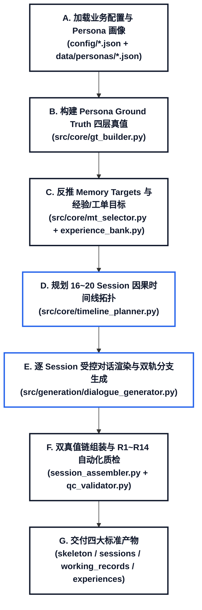

### 2.1 Session 角色 × 模板 × 轮数 硬约束（v4 优化点）

下表规定每个 `memory_role`（由 `session_role` 映射而来）允许使用的模板与最少轮数，
**这是数据质量的红线，验证器 `validators/consistency_validator.py` 的 Rule 23 会逐条检查**：

| 记忆角色 (memory_role) | 会话角色 (session_role) | 允许模板 | 最少轮数 | 关键要求 |
| --------------------------------------- | ----------------------- | ------------------ | ------ | ------------------------------------------------------------- |
| `evidence`                              | `evidence_session`      | T1-\*/T2-\*/T3-\*  | 1      | **单轮时所有参数必须显式说清**，Agent 不得追问（无第 2 轮机会）；多轮时 Agent 可追问模糊参数      |
| `distractor`                            | `distractor_session`    | T1-2/X-1/T2-6      | 1      | 独立业务，**所有参数必须说具体值**，不得模糊、不得引用记忆                               |
| `reinforcement`                         | `reinforcement_session` | T2-\*/T3-\*（禁止 T1） | **≥2** | 第 1 轮可省略/模糊目标槽位靠记忆补全；**第 2 轮用户必须对 Agent 补全的模糊参数值确认一次**（或就地修改） |
| `reuse`                                 | `reuse_session`         | T2-\*/T3-\*（禁止 T1） | **≥2** | Agent 用记忆补全省略槽位，**用户第 2 轮确认**补全值正确；验证"记忆被正确复用"                |
| `correction`                            | `correction_session`    | T2-3/T2-5/T3-2     | **≥2** | 用户先看到 Agent 用旧值，第 2 轮明确纠正并声明长期生效，第 3 轮可再确认范围                  |

**v4 相对 v3 的关键变更**：

1. **单轮 evidence/distractor 禁止"模糊参数 + Agent 追问"**。单轮对话用户只说一次，
   Agent 没有第 2 轮澄清机会，因此凡用 T1-\* 模板，用户首句必须把时间/画质/时延
   等所有参数说清（具体值）。只有 evidence 的多轮模板（T2-1/T2-4/T3-1）才允许
   用户说模糊词（如"高清""别卡"），由 Agent 追问、第 2 轮补全——这正是 p034 的
   S001（T2-4，用户先说"高清一点"，第 2 轮确认"就是 720P"）。
   实现落点：`session_generator.py` 的 `_build_slot_expression_plan` 对单轮模板强制
   全部 slot=explicit，`_build_session_prompt` 注入"单轮参数显式化"硬约束段。
2. **reinforcement / reuse 一律 ≥2 轮，且第 2 轮必须是"用户确认模糊参数"**。
   榜样样本（p034/p113）里所有 reinforcement/reuse 会话都是 2 轮：第 1 轮用户用
   个性化表达或省略参数（模糊/omitted），Agent 结合记忆给出待确认的完整意图
   （Confirm_Hypothesis/Confirm_Slot，如"按您之前的约定高清画面是 720P…对吗？"），
   第 2 轮用户明确确认（"对，一直按 720P"）或就地修改某字段。
   实现落点：`_get_role_instruction` 对 reinforcement/reuse 追加"多轮硬约束"段，
   明确第 1 轮模糊/省略、第 2 轮确认的对话骨架。
3. **reuse_session 重新作为独立 Session 角色被生成**。v3 里 reuse 被合并进
   reinforcement（`timeline_planner.py` 注释"No more explicit reuse_session"），
   导致最终数据里没有 `memory_role=reuse` 的会话。v4 在 `_build_session_chain` 的
   每条主 MT 链尾部追加一个 `reuse_session`（排在 reinforcement 之后），专测
   "记忆被正确复用/不跨 scope 迁移"，其 slot 计划用 omitted（完全靠记忆）。
4. **对话措辞贴合用户画像**。v3 的 `_build_session_prompt` 只把 `static_gt.identity`
   喂给 LLM，画像里的个性化表达词（别名、"高清=1080P"这类映射、口头禅）并没有
   进入 prompt，导致生成对话的口头语是 LLM 随机发挥、与 persona 脱节。v4 在
   prompt 的"用户画像"段新增 `personalization_gt` 注入：
   - 别名表（app_alias/service_alias）：要求用户在本会话对应 slot 上**优先使用这些
     专属别名**（如该用户把"腾讯会议"叫"会议通"，对话里就说"会议通"）；
   - 表达映射（quality/speed/time_expression）：模糊表达时**必须用该用户自己的
     措辞**（如该用户说"高清"指 1080P，就照他的词说）；
   - 口头禅/语气词（persona 的 `dynamic_profile.speech_style`，v4 新增字段）：
     让 LLM 在自然度允许下融入 1-2 处，不改变参数语义。
     实现落点：`_build_session_prompt` 读取 `persona_gt["personalization_gt"]` 拼出
     `=== 用户专属表达词表 ===` 段；`persona_generator.py` 的 system prompt 新增
     `speech_style` 字段。
5. **榜样格式转换**：最终交付的 `pXXX.json`（形如 p034/p113）是
   `[{session_id, user_id, reference_time, session_meta, conversation:[{turn,
   user_utterance, agent_utterance}]}]` 的**纯对话**格式，不含 action_types/
   intents/slot_updates 等内部字段。v3 里这种文件是手工脚本（`_gen_p034_dialog.py`）
   造出来的，没有自动转换。v4 提供 `scripts/convert_to_example_format.py`，把
   `data/.../sessions/PXXX_sessions.jsonl` 的 `event_sequence` 拍平成榜样格式，
   一条命令产出与 p034/p113 同构的样本。

---

## 3 数据源与配置

### 3.1 业务配置文件

| 配置文件 | 核心内容 | 业务用途 |
| --------------------- | ------------------------------------------- | ------------------------- |
| `app_config.json`     | 40个APP × 业务类型 × 画质档位(resolution+latency上下界) | Ground Truth参数采样来源、精准意图校验 |
| `app_map.json`        | 40个APP的标准名→别名列表                             | 个性化表达真值的数据源               |
| `support_matrix.json` | 40个APP × 业务类型 × 支持的分辨率枚举                    | 可用场景池校验                   |

### 3.3 Persona模板

详见 [`docs/specs/persona_spec.md`](specs/persona_spec.md)。

---

## 4 Persona Ground Truth

### 4.1 四层结构

| GT 层级 | 核心内容 | 数据来源 | 典型示例 |
| ---------------------- | ------------------ | --------------------------------------- | ----------------------------------- |
| **static_gt**          | 稳定事实：常用APP列表、合法场景池 | persona描述 + app_config + support_matrix | 抖音+开直播/看直播/短视频, 各业务good档=1080p+80ms |
| **conditional_gt**     | 条件化事实：仅在特定条件下成立    | persona的time_based/scene_switch         | 工作日晚上→抖音开直播                         |
| **changeable_gt**      | 可变化事实：有效时间有限       | persona的role_change/event_driven        | 赛事期间改为游戏保障                          |
| **personalization_gt** | 个性化真值：表达映射+偏好      | app_map + app_config                    | "微信号"→微信; 抖音+看直播→1080p+80ms         |

### 4.2 从 Persona 到 Ground Truth 的转换

`data/personas/` 中的每一条原始 persona 包含 `static_profile`（稳定属性）、`dynamic_profile`（动态偏好）与 `storyline`（阶段故事线）。转换过程（`src/core/gt_builder.py`）按步骤逐层抽取、解析、映射，生成 4 层 ground truth：

- **Step A（static_gt）**：从 `static_profile.apps` 的中文 APP 名通过 `_resolve_app_name` 映射为标准英文名，再结合 `app_config` 和 `support_matrix` 合成每个 APP 在哪些业务场景下合法，以及各场景下的 `good` 档位参数。
- **Step B（conditional_gt）**：从 `dynamic_profile` 中提取 `time_based`（时间条件偏好）、`scene_switch`（场景切换偏好）和 `conditional_preferences`（结构化条件偏好），分别解析为结构化条件描述，并通过 LLM 语义匹配到具体 app+service 场景。
- **Step C（changeable_gt）**：直接提取 `role_change`（角色变化）和 `event_driven`（事件驱动变化）中的 from/to/trigger/impact 字段，生成可变化事实记录。
- **Step D（personalization_gt）**：将 `dynamic_profile` 中的别名（`aliases`）、参数映射（`param_mappings`）、体验偏好（`experience_preferences`）、业务偏好（`app_service_preferences`）逐项转化为对应的结构化 GT 字段，包括表达映射、多参数组合偏好和跨应用/业务关系映射。

整个流程中仅 3 处涉及 LLM（中文→标准名映射、条件描述解析、条件→场景匹配），其余均为纯规则转换，保证可复现性。

#### 4.2.1 处理流程

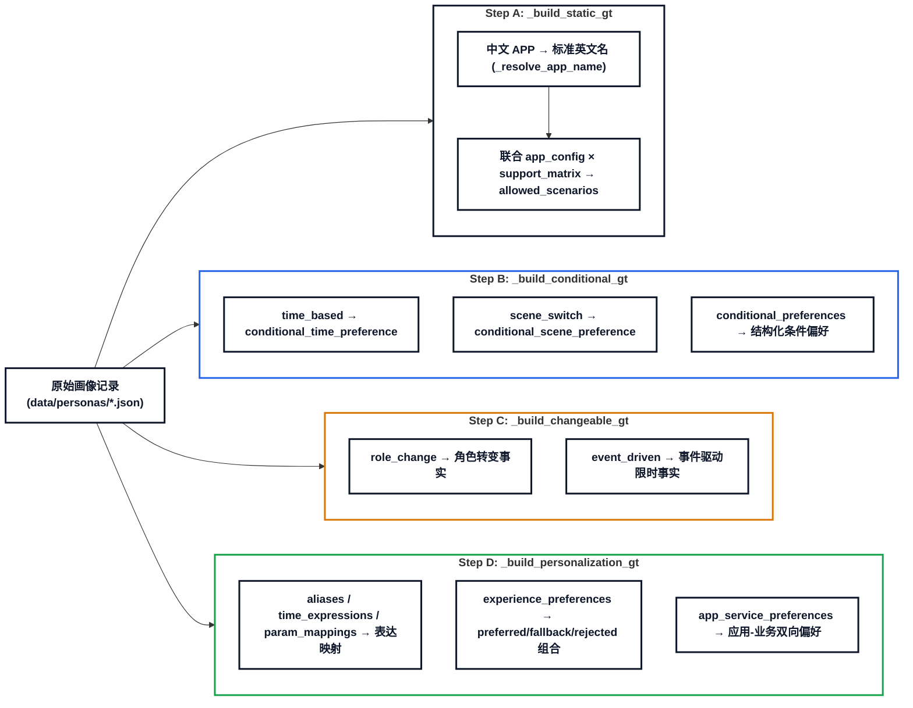

**LLM 使用边界**：

- `_resolve_app_name`: fallback 时（规则匹配失败）用 LLM 做中文名→标准名映射
- `_parse_condition_str`: 将中文时间/场景条件描述解析为结构化 dict
- `_llm_choose_scenario`: 将条件语义匹配到具体的 app+service 场景
- 其余全部纯规则，不涉及 LLM

#### 4.2.2 字段映射

| Persona 字段 | Ground Truth 字段 | 映射说明 |
| ---------------------------------------- | ----------------------------------------------------------- | ----------------------------------------------------------------- |
| static_profile.\*                        | static_gt.\*                                                | identity/devices/subscription 直接复制；apps 通过 \_resolve_app_name 转英文 |
| dynamic_profile.time_based/scene_switch  | conditional_gt                                              | 条件+场景 → \_llm_choose_scenario 匹配 app+service                      |
| dynamic_profile.conditional_preferences  | conditional_gt                                              | 结构化提取 conditions+preference+scope                                 |
| dynamic_profile.role_change/event_driven | changeable_gt                                               | 直接提取 from/to/trigger/event/impact                                 |
| dynamic_profile.aliases.\*               | personalization_gt.expression_mappings                      | 提取 alias 映射（app/service alias + time + quality/speed）             |
| dynamic_profile.param_mappings           | personalization_gt.expression_mappings (quality_expression) | 模糊表达→参数值，带 app+service scope                                      |
| dynamic_profile.experience_preferences   | personalization_gt.experience_param_preferences             | → {preferred/fallback/rejected} 多参数组合                             |
| dynamic_profile.app_service_preferences  | personalization_gt.app_business_preferences                 | 按 type 分类为 service_to_app / app_to_service                        |

#### 4.2.3 GT 层到 MT 的构造流程（两级结构）

> **核心认识**：GT 四层不是互斥事实类别，而是从不同角度描述同一用户事实。

| GT 层 | 主要作用 | 在 MT/MF 中的位置 |
| --- | --- | --- |
| `static_gt` | 用户背景、常用 APP、套餐与合法业务场景 | 候选过滤、合法性校验、场景约束 |
| `personalization_gt` | 表达映射、应用—业务选择、体验参数偏好 | 记忆核心内容 |
| `conditional_gt` | 时间、地点、场景、事件等成立条件 | `memory_fact.conditions` |
| `changeable_gt` | 角色变化、事件驱动变化、阶段切换 | `memory_fact.lifecycle_pattern`、`validity` |

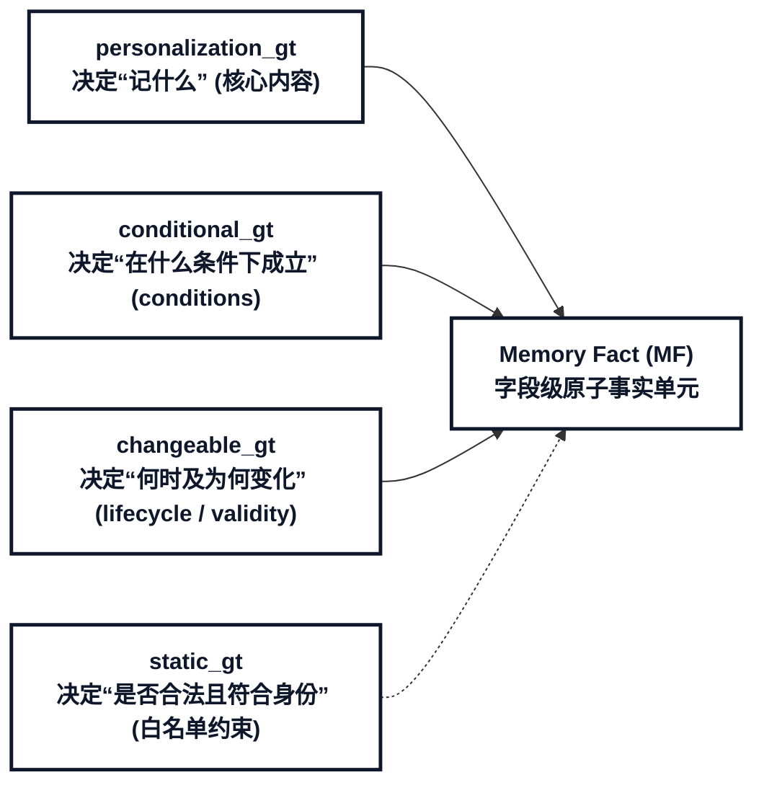

---

### 4.3 MT 两级结构

原有设计采用扁平枚举（24 种 MT 类型），新设计将其升级为 **意图容器（Memory Target）+ 字段级事实（Memory Fact）** 的两级结构：

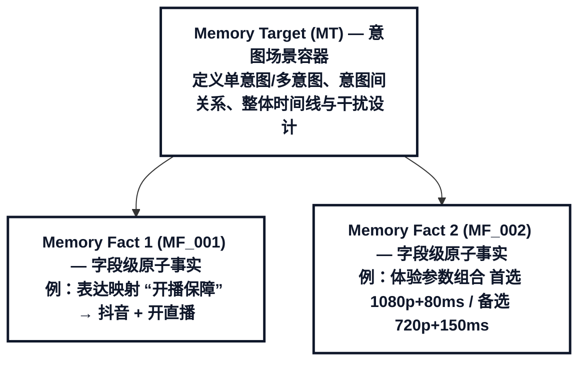

#### 4.3.1 MT 负责描述

- 单意图还是多意图；
- 包含哪些意图（application_name + business_type）；
- 多意图之间的关系；
- 整体的时间线与干扰设计；
- 哪些 Memory Fact 需要在生命周期中形成。

#### 4.3.2 Memory Fact 负责描述

- 具体记忆内容；
- 对应哪个意图、哪个字段；
- 答案是否明确；
- 在什么条件、Scope 和有效期内成立；
- 如何随时间形成、变化或失效；
- 需要怎样的跨 Session 证据。

#### 4.3.3 单意图 MT

单意图仍以现有意图结构为基础（`一个应用 + 一个业务 + 相关参数`），示例：

```json
{
  "memory_target_id": "MT_001",
  "intent_mode": "single_intent",
  "intents": [
    { "intent_id": "I1", "application_name": "Douyin", "business_type": "live" }
  ],
  "memory_facts": [
    {
      "memory_fact_id": "MF_001",
      "intent_refs": ["I1"],
      "target_fields": ["application_name", "business_type"],
      "content_type": "expression_mapping",
      "content_subtype": "app_service_expression",
      "content": { "expression": "开播保障", "target": { "application_name": "Douyin", "business_type": "live" } }
    },
    {
      "memory_fact_id": "MF_002",
      "intent_refs": ["I1"],
      "target_fields": ["resolution", "latency_ms"],
      "content_type": "experience_param_preference",
      "content": { "preferred": { "resolution": "1080p", "latency_ms": 80 }, "fallback": { "resolution": "720p", "latency_ms": 150 } },
      "value_structure": "preferred_fallback_bundle"
    }
  ]
}
```

#### 4.3.4 多意图 MT

多意图 MT 不是简单把多个单意图放在一起，还需要描述意图间关系：
| 关系类型 | 含义 | 示例 |
| --- | --- | --- |
| `independent` | 多个意图相互独立 | 同时保障会议和游戏 |
| `shared_params` | 多个意图共享部分参数 | 两个业务共享相同保障时段 |
| `partial_override` | 共享默认值，但某个意图局部覆盖 | 两个业务同一时段，其中直播用 1080p |
| `sequential` | 意图按时间或任务顺序发生 | 先短视频上传，再开直播 |
| `conditional_branch` | 条件不同选择不同意图 | 在公司开会，路上视频通话 |
| `mutually_exclusive` | 多个候选互斥，不能同时成立 | 腾讯会议或钉钉会议二选一 |

#### 4.3.5 多意图下的原子化原则

一条 Memory Fact 应满足：

> 能够独立形成、独立引用、独立纠正或独立失效。

因此：

- 只适用于 I1 的事实单独保存；
- 只适用于 I2 的事实单独保存；
- 真正跨意图共享的规律才同时引用 I1 和 I2；
- 不要因为多个意图出现在同一 Session，就将所有字段合并成一条大记忆。

---

### 4.4 MT 资格判定

MT 资格从 GT 层组合判定，而非简单枚举：

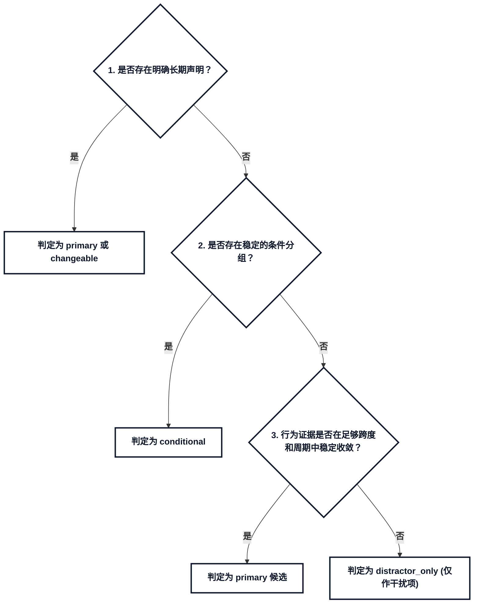

资格级别：
| 资格 | 含义 |
| --- | --- |
| `primary` | 存在稳定且明确的目标答案 |
| `conditional` | 在不同条件下分别存在明确答案 |
| `changeable` | 答案随时间阶段发生变化 |
| `distractor_only` | 无明确答案或候选过多，不应形成唯一记忆 |
| `excluded` | 业务不合法、人物不合理或无法生成可靠证据 |

> **注意**：`static_gt` 不直接参与 MT 选择，仅作为场景白名单、LLM prompt 上下文等参考信息使用。

**MT 类型从 GT 各层抽取素材的映射**（实际构造是组合式的，以下作为参考）：

| GT 层数据内容 | 对应偏好类别 | 对应 MT 类型（示例） |
| --- | --- | --- |
| `personalization_gt.expression_mappings` | 用户个性化表达 | `app_alias_mapping` / `quality_grade_mapping` |
| `personalization_gt.app_business_preferences` | 应用—业务选择偏好 | `service_to_app` / `app_to_service` / `app_service_combo` |
| `conditional_gt` | 时间模式偏好 | `weekly_preference` / `daily_time_preference` |
| `personalization_gt.experience_param_preferences` | 体验参数偏好 | `multi_param_bundle` / `scope_restriction` |
| `changeable_gt` | 记忆更新与冲突处理 | `memory_correction` / `preference_change` |

---

### 4.5 Memory Fact 正交属性

每个 Memory Fact 携带一组正交属性，独立描述事实的不同维度：
| 维度 | 字段 | 作用 | 示例 |
| --- | --- | --- | --- |
| 记忆内容 | `content_type` | 说明记什么 | `expression_mapping`、`app_business_preference`、`time_pattern`、`experience_param_preference` |
| 内容子类型 | `content_subtype` | 细分内容 | `app_alias`、`service_to_app`、`periodic_time` |
| 意图引用 | `intent_refs` | 事实适用于哪些意图 | `["I1"]`、`["I1","I2"]` |
| 目标字段 | `target_fields` | 事实对应的意图槽位 | `application_name`、`start_time`、`resolution` |
| 条件 | `conditions` | 何时、何地、何场景成立 | 工作日、晚上、户外、赛事期间 |
| 适用范围 | `scope` | 适用于哪些 APP、业务和场景 | 抖音+开直播+户外 |
| 答案确定性 | `answer_determinacy` | 是否存在稳定答案 | `unique`、`conditional`、`ambiguous`、`none` |
| 值结构 | `value_structure` | 单值、组合或优先级结构 | `single`、`atomic_bundle`、`preferred_fallback_rejected` |
| 有效性 | `validity` | 事实的有效时间 | 长期、临时、起止时间 |
| 生命周期 | `lifecycle_pattern` | 稳定、纠正、变化、失效 | `stable`、`correction`、`change`、`expiration` |
| 时序证据 | `temporal_evidence_profile` | 跨 Session 出现方式 | 频次、跨度、周期、中断、干扰占比 |

#### 4.5.1 顶层内容类型

只保留真正回答"记什么"的类别：
| `content_type` | 含义 | 常见目标字段 |
| --- | --- | --- |
| `expression_mapping` | 用户个性化表达与标准值的映射 | APP、业务、时间、体验参数 |
| `app_business_preference` | APP 与业务的选择倾向 | `application_name`、`business_type` |
| `time_pattern` | 用户行为的时间规律 | 开始时间、结束时间、星期、周期 |
| `experience_param_preference` | 分辨率、时延等体验参数偏好 | `resolution`、`latency_ms` 等 |
| `cross_intent_pattern` | 多意图之间稳定的共享、顺序或条件规律 | 多个意图及其关系字段 |

`scope_restriction`、`temporary_preference`、`memory_correction` 不再作为顶层内容类型，分别归入 `scope`、`validity` 和 `lifecycle_pattern`。

#### 4.5.2 字段状态与答案确定性
| 状态 | 含义 | 处理方式 |
| --- | --- | --- |
| `known` | 已有明确稳定答案 | 可进入目标记忆内容 |
| `conditional` | 不同条件下答案不同 | 进入目标内容，并绑定条件 |
| `changing` | 不同时间阶段答案不同 | 进入生命周期规划 |
| `ambiguous` | 存在多个候选，但不能确定唯一答案 | 不进入唯一 Gold 事实，可作为相关干扰 |
| `unknown` | 字段适用，但没有足够信息 | 不形成事实，可按合法值生成背景变化 |
| `not_applicable` | 对当前意图或事实不适用 | 不参与生成 |

建议将答案确定性做到字段级。例如"每周一上午开会"中，业务和时间明确，但会议 APP 不明确：

```
{
  "answer_determinacy": {
    "overall": "partial",
    "fields": {
      "business_type": { "status": "known", "value": "meeting" },
      "weekday": { "status": "known", "value": "Monday" },
      "time_range": { "status": "known", "value": "09:00-11:00" },
      "application_name": {
        "status": "ambiguous",
        "candidate_values": ["TencentMeeting", "DingTalk", "Feishu"],
        "usage": "distractor_only"
      }
    }
  }
}
```

#### 4.5.3 一条 Session 可支持多条 Memory Fact

同一 Session 中，用户可能同时明确多条事实：

```
以后工作日晚上的开播保障就是抖音直播，优先 1080p 并保证稳定。
```

它可以同时为以下事实提供证据：

- "开播保障"→抖音+开直播；
- 工作日晚间的直播时间模式；
- 抖音直播的 1080p 与低时延偏好。

数据中应分别记录 `evidence_ref`，而不是为了每条 Memory Fact 重复生成一个 Session。

---

### 4.6 Temporal Evidence Profile（时序证据画像）

每条 Memory Fact 应包含完整的时序证据画像，用于精确描述跨 Session 证据的生成规律：

```
{
  "temporal_evidence_profile": {
    "pattern_type": "periodic",
    "observation_span_days": 84,
    "evidence_span_days": 77,
    "occurrence_count": 7,
    "relevant_session_count": 10,
    "occurrence_ratio": 0.7,
    "distinct_period_count": 7,
    "period_unit": "week",
    "period_interval": 1,
    "interruption_pattern": {
      "type": "temporary_gap",
      "gap_length": 2,
      "resume_after_gap": true
    }
  }
}
```

#### 4.6.1 时间设计的五个层级
| 时间层级 | 含义 | 示例 |
| --- | --- | --- |
| `session_interval` | 相邻 Session 之间的时间间隔 | 3天、7天、20天 |
| `evidence_span` | 第一条到最后一条目标证据的跨度 | 35天 |
| `observation_window` | 整个用户生命周期的观察范围 | 12周 |
| `period_unit` | 周期行为的基本粒度 | 天、周、月 |
| `lifecycle_phase` | 变化前、变化中、变化后的阶段 | 学生阶段、实习阶段、全职阶段 |

#### 4.6.2 证据强度

证据强度至少同时考虑：

- 出现次数；
- 在相关 Session 中的占比；
- 跨越的时间长度；
- 覆盖多少独立周期；
- 是明确声明还是行为归纳；
- 是否存在反例或临时例外。

证据类型区分：
| 证据类型 | 形成方式 |
| --- | --- |
| `explicit_long_term_declaration` | 一次明确声明即可形成强证据 |
| `confirmed_agent_summary` | Agent 总结长期规律，用户明确确认 |
| `repeated_behavior` | 需要多次、跨周期、一致行为 |
| `single_task_choice` | 仅本次有效，不直接形成长期记忆 |
| `agent_hypothesis_unconfirmed` | 不形成正式记忆 |

#### 4.6.3 周期与非周期模式
| 模式 | 含义 | 示例 |
| --- | --- | --- |
| `calendar_periodic` | 按日、周、月重复 | 每周一上午开会 |
| `time_conditioned` | 在特定时间条件下成立 | 工作日晚间直播 |
| `event_triggered` | 由事件或场景触发 | 外出探店时开直播 |
| `sporadic_stable` | 时间不固定，但选择倾向稳定 | 游戏时通常选择王者荣耀 |
| `temporary_window` | 只在明确时间窗成立 | 赛事期间低时延优先 |
| `evolving_pattern` | 规律随阶段变化 | 实习前后会议时间变化 |

#### 4.6.4 周期中断与恢复
| 中断类型 | 示例 | Gold 处理 |
| --- | --- | --- |
| `single_gap` | 偶尔一周未发生 | 不改变长期事实 |
| `temporary_gap` | 连续两周中断后恢复 | 不判定失效 |
| `explained_gap` | 节假日或请假期间中断 | 不改变长期事实 |
| `schedule_shift` | 从周一改到周三 | 形成时间规律变化 |
| `permanent_stop` | 用户明确取消周期行为 | 标记失效或停用 |
| `unknown_long_gap` | 长期未观察到 | 可降低证据强度，不自动生成新答案 |

核心原则：

> 行为暂时没有发生，不等于用户明确否定了该规律。

---

### 4.7 干扰项精细化设计

#### 4.7.1 干扰类型
| 类型 | 示例 | 难度 |
| --- | --- | --- |
| `unrelated` | 直播历史中插入视频会议 | 低 |
| `same_app_different_service` | 抖音开直播与抖音看短视频 | 中 |
| `same_field_different_scope` | 抖音直播 1080p、快手直播 720p | 高 |
| `ambiguous_candidates` | 会议 APP 在腾讯会议、钉钉、飞书间变化 | 高 |
| `temporary_exception` | 平时 1080p，某次明确临时使用 720p | 高 |
| `near_pattern` | 通常周一开会，偶尔周二临时开会 | 高 |
| `cross_intent_interference` | 多意图 Session 中将 I1 参数误归到 I2 | 高 |
| `stale_value` | 变化后旧值再次作为历史背景出现 | 高 |

#### 4.7.2 干扰占比

```
distractor_ratio = 干扰 Session 数 / 全部历史 Session 数
hard_distractor_ratio = 高相关干扰数 / 全部干扰数
```

建议分档：
| 难度 | 干扰占比 | 使用场景 |
| --- | ---: | --- |
| 低 | 10%～20% | 基础证据链验证 |
| 中 | 30%～50% | 常规跨 Session 数据 |
| 高 | 60%～75% | 长历史、高干扰数据 |

配置示例：

```
{
  "distractor_design": {
    "target_ratio": 0.4,
    "hard_distractor_ratio": 0.4,
    "difficulty_distribution": { "low": 0.25, "medium": 0.35, "high": 0.40 },
    "type_distribution": {
      "unrelated": 0.20,
      "same_field_different_scope": 0.25,
      "ambiguous_candidates": 0.20,
      "temporary_exception": 0.20,
      "near_pattern": 0.15
    },
    "distractor_session_count": 3
  }
}
```

#### 4.7.3 干扰项不得意外改变目标记忆

每个干扰 Session 应显式标注：

```
{
  "memory_role": "distractor",
  "distractor_type": "temporary_exception",
  "related_memory_fact_ids": ["MF_001"],
  "must_not_update_memory_fact_ids": ["MF_001"],
  "reason": "current_session_only"
}
```

对于多意图 Session，还要记录参数归属，防止 I1 的字段误更新 I2 的记忆：

```
{
  "slot": "resolution",
  "value": "1080p",
  "intent_ref": "I2",
  "must_not_apply_to": ["I1"]
}
```

#### 4.7.4 无明确答案字段转化为干扰

例如用户每周一上午开会，但 APP 在腾讯会议、钉钉和飞书之间变化：

```
{
  "target_memory": {
    "content_type": "time_pattern",
    "content": {
      "business_type": "meeting",
      "weekday": "Monday",
      "time_range": "09:00-11:00"
    }
  },
  "non_target_fields": {
    "application_name": {
      "status": "ambiguous",
      "candidate_values": ["TencentMeeting", "DingTalk", "Feishu"],
      "usage": "distractor_only"
    }
  }
}
```

生成结果应支持形成"用户通常每周一上午开会"，但不能形成"用户开会默认使用腾讯会议"。

### 4.8 示例：Persona 0 的 GT→MT 转换

**persona 原始输入**（`corenet_personas.jsonl` 第1条）：

```
{
  "static_profile": {
    "identity": "抖音签约的全职户外主播，主要进行城市探店、夜市和商场直播...",
    "apps": ["抖音", "剪映", "微信", "高德地图"]
  },
  "dynamic_profile": {
    "time_based": {
      "工作日晚间（18:00-22:00）": "在夜市、商业街或餐饮门店进行户外直播"
    },
    "param_mappings": {
      "高清": { "resolution": "1080p" }
    },
    "experience_preferences": [{
      "app": "Douyin", "service": "live",
      "preferred": { "resolution": "1080p", "latency_ms": 60 },
      "fallback": { "resolution": "720p", "latency_ms": 120 },
      "rejected": { "resolution": "360p", "latency_ms": 200 },
      "evidence": "explicit", "scope": "long_term",
      "applicable_conditions": "户外直播场景"
    }]
  }
}
```

**→ 生成的 ground truth**：

```
static_gt:
  identity: "抖音签约的全职户外主播，主要进行城市探店、夜市和商场直播..."
  frequent_apps: [Douyin, Weixin, GaoDeDitu]       ← 剪映不在app_config中，跳过
  allowed_scenarios: [
    {app_cn: "抖音", service_cn: "看直播",  good: {resolution:1080p, latency_upper:80ms}},
    {app_cn: "抖音", service_cn: "开直播",  good: {resolution:1080p, latency_upper:80ms}},
    {app_cn: "抖音", service_cn: "短视频",  good: {resolution:1080p, latency_upper:80ms}},
    ... 共7个合法场景
  ]

conditional_gt:
  [0] {
    fact_type: "conditional_time_preference",
    condition: {time_range: "工作日晚间（18:00-22:00）"},
    related_scenario: {app_cn: "抖音", service_cn: "开直播"},  ← LLM语义匹配
    ground_truth_strength: "conditional"
  }

changeable_gt:
  [0] { fact_type: "role_change", description: "业余探店博主 → 全职户外主播", trigger: "..." }
  [1] { fact_type: "event_driven_change", description: "双11商场促销...", valid_from: "2026-06-01", valid_to: "2026-11-12" }

personalization_gt:
  expression_mappings: [
    {expression_type: "app_alias", expression: "抖", target: {slot: application_name, value: "抖音"}},
    {expression_type: "service_alias", expression: "直播", target: {slot: service_name, value: "开直播"}},
    {expression_type: "quality_expression", expression: "高清", target: {slot: resolution, value: "1080p"},
     condition: {app_name: "抖音", service_name: "开直播"}}
  ]
  experience_param_preferences: [
    {scope: {app: "Douyin", service: "live"},
     preferred: {resolution: 1080p, latency_ms: 60},
     fallback: {resolution: 720p, latency_ms: 120},
     rejected: {resolution: 360p, latency_ms: 200},
     ground_truth_strength: "explicit"}
  ]
  app_business_preferences: [
    {direction: "service_to_app", service: "live", preferred_candidates: ["Douyin", "Kuaishou"]},
    {direction: "app_to_service", app: "Douyin", preferred_candidates: ["live", "openlive", "shortvideo"]}
  ]
```

---

## 5 Memory Targets

### 5.1 核心设计原则

**MT类型不从GT顺推，而是从偏好类别反推。**

错误做法：

```
GT有6个expression_mapping → 全部变成MT → 6个MT都是app_alias → 只测了同一种能力
```

正确做法：

```
4大偏好类别+2补充类别必须覆盖 → 每个类别至少1个MT → 从GT中挑最匹配的素材 → 强制子类型多样性
```

### 5.2 MT类型汇总

MT类型按data_design的5大用户事实记忆类别+2个补充类别组织，全部定义在`config/mt_type_catalog.json`：

| 偏好类别 | 对应 GT 字段 | MT 类型 | 用途说明 |
| ------------------------ | ------------------------------------------------- | -------------------------- | ------------------- |
| **用户个性化表达**              | `personalization_gt.expression_mappings`          | app_alias_mapping          | "王者"→王者荣耀           |
|                          |                                                   | service_alias_mapping      | "开会"→会议             |
|                          |                                                   | time_expression_mapping    | "晚上"→19:00-22:00    |
|                          |                                                   | quality_grade_mapping      | "高清"→1080p(按app+业务) |
|                          |                                                   | speed_expression_mapping   | "别卡"→时延≤80ms        |
| **应用-业务选择偏好**            | `personalization_gt.app_business_preferences`     | service_to_app             | 只说"开会"→首选腾讯会议       |
|                          |                                                   | app_to_service             | 只说"抖音"→首选开直播        |
|                          |                                                   | app_service_combo          | "保障"→推断抖音+开直播       |
|                          |                                                   | candidate_disambiguation   | 多候选接近时Agent追问       |
|                          |                                                   | rejection_combo            | 不支持的组合→拒绝说明         |
| **时间模式偏好**               | `conditional_gt`                                  | daily_time_preference      | 省略时间→补全19:00开始      |
|                          |                                                   | weekly_preference          | "每周三晚上"→固定模式        |
|                          |                                                   | weekday_weekend_preference | 工作日/周末不同偏好          |
|                          |                                                   | temporary_preference       | 春节假期→临时偏好(有有效期)     |
|                          |                                                   | periodic_preference        | "每月1号"→周期模式(有有效期)   |
| **体验参数偏好**               | `personalization_gt.experience_param_preferences` | preferred_value            | 省略时延→补全80ms(首选)     |
|                          |                                                   | fallback_value             | 1080p不支持→提供720p(备选) |
|                          |                                                   | rejected_value             | 排斥360p→不提供360p      |
|                          |                                                   | multi_param_bundle         | 分辨率+时延一起补全          |
|                          |                                                   | scope_restriction          | 抖音偏好不能迁移到微信         |
| **记忆更新**                 | `changeable_gt`                                   | memory_correction          | "不是抖音，是快手"          |
|                          |                                                   | preference_change          | 从高清改为省流             |
| **追问决策**                 | —                                                 | single_action_no_upgrade   | 单次行为≠长期偏好           |
|                          |                                                   | out_of_scope_rejection     | 不支持的APP→拒绝          |

### 5.3 评测能力标签 (eval_tags)

每个MT类型标注了`eval_tags`，定义该MT测的是什么能力。标签是两层结构：**主标签**描述评测维度，**子标签**描述具体方面。

| 主标签 | 含义 | 正样本（应该做到） | 负样本（不应该做） | 关联类别 |
| ------------------------------- | ------- | ------------- | -------------- | --------------------- |
| **personal_expression_mapping** | 个性化表达理解 | 别名/模糊表达→正确识别  | 一对多映射时需追问，不能猜  | 用户个性化表达               |
| **parameter_completion**        | 参数缺失补全  | 省略参数→靠记忆/偏好补全 | 多候选接近时需追问，不能盲选 | 应用-业务选择偏好、体验参数偏好      |
| **follow_up_decision**          | 追问决策    | 该追问时追问，该拒绝时拒绝 | 不该自作主张时不能自行决定  | 应用-业务选择偏好、体验参数偏好、追问决策 |
| **time_preference**             | 时间偏好推断  | 省略时间→靠行为模式补全  | 无历史证据时不能硬填     | 时间模式偏好                |
| **conditional_preference**      | 条件偏好推断  | 条件匹配时提供候选     | 条件不匹配/过期时不复用   | 时间模式偏好                |
| **memory_update**               | 记忆更新    | 纠正后用新值        | 纠正前不用新值，旧值不可混用 | 记忆更新                  |

子标签进一步区分同一主标签下的不同方面：

| 主标签 | 子标签 | 含义 | 对应 MT 类型 |
| --------------------------- | ------------------------ | ------------- | --------------------------------------- |
| personal_expression_mapping | one_to_one_mapping       | 一对一别名映射       | app_alias_mapping                       |
|                             | service_alias            | 业务别名          | service_alias_mapping                   |
|                             | time_expression          | 时间表达解析        | time_expression_mapping                 |
|                             | quality_expression       | 画质表达解析        | quality_grade_mapping                   |
|                             | speed_expression         | 速度表达解析        | speed_expression_mapping                |
| parameter_completion        | service_completes_app    | 业务→应用补全       | service_to_app                          |
|                             | app_completes_service    | 应用→业务补全       | app_to_service                          |
|                             | app_service_combo        | 应用-业务组合补全     | app_service_combo                       |
|                             | experience_param         | 体验参数首选值补全     | preferred_value                         |
|                             | fallback                 | 首选不可用→提供备选    | fallback_value                          |
|                             | multi_param_bundle       | 多参数组合整体补全     | multi_param_bundle                      |
| follow_up_decision          | candidate_disambiguation | 候选接近→追问消歧     | candidate_disambiguation                |
|                             | out_of_scope             | 不支持→拒绝或说明     | rejection_combo, out_of_scope_rejection |
|                             | rejected_value           | 用户排斥值→不使用     | rejected_value                          |
|                             | scope_mismatch           | 跨scope→不迁移    | scope_restriction                       |
|                             | insufficient_evidence    | 证据不足→不升级为长期偏好 | single_action_no_upgrade                |
| time_preference             | daily_pattern            | 日内时间模式        | daily_time_preference                   |
|                             | weekly_pattern           | 星期规律模式        | weekly_preference                       |
| conditional_preference      | weekday_weekend          | 工作日/周末区分      | weekday_weekend_preference              |
|                             | temporary                | 临时偏好(带有效期)    | temporary_preference                    |
|                             | periodic                 | 周期偏好(带有效期)    | periodic_preference                     |
| memory_update               | user_correction          | 用户纠正→更新       | memory_correction                       |
|                             | preference_change        | 偏好变化→更新       | preference_change                       |

主标签与偏好类别的对应关系：一个类别可能测多种能力，一种能力也可能跨多个类别。例如`parameter_completion`横跨"应用-业务选择偏好"和"体验参数偏好"两个类别，`follow_up_decision`横跨三个类别。

### 5.4 选择优先级

选择顺序是**按 5 大用户事实记忆类别优先级逐层展开**，先保证核心类别覆盖，容量允许时扩展更多类别和 extending 类型：

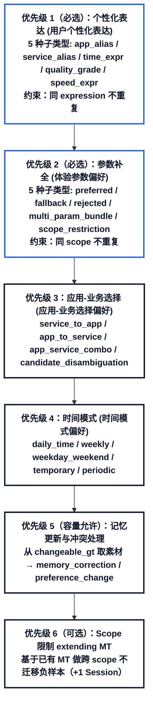

优先级 1-2 是必选（`max_mts ≥ 2` 即可满足），优先级 3-4 按时间线容量依次追加，优先级 5 从 `changeable_gt` 取素材作为非 extending MT，优先级 6 是 extending MT。`NON_EXTENDABLE_TYPES` 从 catalog 自动推导：`category="追问决策"` 或 `eval_tags` 含 `"follow_up_decision"` 的类型不可被 extend。

容量与类别覆盖的关系：

| 时间线容量 ($N$) | 最大主 MT 数 | 覆盖优先级组合 |
| :---: | :---: | :--- |
| $N=6$ | $\max 2$ MT | 覆盖优先级 $1+2$ |
| $N=8$ | $\max 3$ MT | 覆盖优先级 $1+2+3$ 或 $1+2+5$（记忆更新） |
| $N=10$ | $\max 4$ MT | 覆盖优先级 $1+2+3+4$ 或 $1+2+3+5$ |
| $N=16\sim 20$（三层认知全量版） | 全覆盖 + 工作/经验记忆 | 完整覆盖事实记忆 + 独立工单复用/消歧 + 五大黄金经验双轨评测 |

### 5.5 选择策略

同一个偏好类别下可能有多个候选 MT（比如"用户个性化表达"下有 5 种子类型）。由于配置 JSON 是固定的，每个子类型的候选 GT 事实通常只有 1-2 条，得分计算结果是确定性的（始终是同一两条最高），所以**不需要得分排序，改为随机选取即可**。

核心约束只在**去重**：

- 同一 expression 不重复出现在不同 MT 中
- 同一 scope 不重复出现在不同 MT 中

其余无区分度的规则（如"多参数组合加分"、"非子串别名加分"）已移除。

### 5.6 容量约束

```
时间线Session总数 = N
扣除distractor_session = 1
可用Session = N - 1

每个primary MT最少需要2个Session(evidence + reinforcement)
每个extending MT最少需要1-2个Session

所以 max_MTs = (available_sessions - 1) // 2

N=6 → max 2 MT
N=8 → max 3 MT
N=10 → max 4 MT   ← 本例
```

### 5.7 本例的3个MT

```
MT_001: quality_grade_mapping (画质档位映射)
  真值: 用户说"高清" → 抖音+看直播 → 1080p
  类别: 用户个性化表达
  评测标签: personal_expression_mapping + quality_expression
  选择原因: 优先级1(用户个性化表达)中随机选中（去重约束：expression与同组其他子类型不重复）
            - Knowledge映射需结合app+service，测"同一表达在不同APP下对应不同分辨率"的能力

MT_002: multi_param_bundle (多参数组合偏好)
  真值: 抖音+看直播省略体验参数 → 整体补全1080p+80ms
  类别: 体验参数偏好
  评测标签: parameter_completion + multi_param_bundle
  选择原因: 优先级2(体验参数偏好)中随机选中（去重约束：scope与同组其他子类型不重复）
            - 覆盖data_design要求的"多参数组合偏好应作为整体使用"

MT_003: memory_correction (记忆纠正)
  真值: 纠正MT_001 → "不是高清，改成标清"
  来源: changeable_gt (role_change 或 event_driven_change 类型)
  类别: 记忆更新与冲突处理
  评测标签: memory_update + user_correction
  选择原因: 优先级5(记忆更新)，从 `changeable_gt` 中选取素材
            - 纠正后Agent应使用新值720p
            - 纠正前Session不应包含纠正后的记忆
            - 同时仍保留 extending MT 路径（基于MT_001做纠正，只需+1个Session(correction_session)，后续reinforcement_session自然验证）
```

负样本类型（scope_restriction、rejected_value、out_of_scope_rejection等）当前阶段暂不生成，后续迭代补充。

---

## 6 时间线规划

### 6.1 每个MT展开成Session链

| MT | 时间线模板 | Session 链 |
| ------------------- | -------------- | ------------------------ |
| MT_001              | template_5(表达) | evidence → reinforcement |
| MT_002              | template_7(参数) | evidence → reinforcement |
| MT_003              | template_3(纠正) | correction               |

记忆复用不是独立Session角色，而是**嵌入reinforcement_session中自然体现**：用户再次请求时不重复提供完整参数，Agent应从已形成的记忆中补全。

当前阶段仅生成正样本（Agent该做的事），负样本（Agent不该做的事，如跨scope迁移、排斥值拒绝等）后续迭代补充。

### 6.2 交错排列

按角色类型因果排序：`evidence` $\to$ `reinforcement` $\to$ `distractor` $\to$ `correction`：

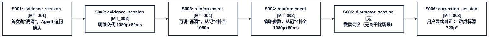

`correction` 后不再需要单独验证 Session：后续如有 `reinforcement_session` / `reuse_session`，自然会检验“联接”Agent 是否使用了纠正后的新值。

### 6.3 时间间隔规则

| 前后 Session 角色 | 间隔 (天) | 原因 |
| -------------------------- | ----- | ------------- |
| evidence → reinforcement   | 3-15  | 记忆需经时间间隔验证稳定性 |
| reinforcement → correction | 15-30 | 长期使用后纠正更有意义   |
| any → distractor           | 3-15  | 短间隔插入干扰       |
| evidence → evidence(不同MT)  | 1-7   | 同期暴露多个事实      |

### 6.4 Session角色定义

| 角色 | 功能 | 用户表达方式 | Agent 行为期望 |
| ----------------------- | ------------- | -------------- | ------------------------ |
| evidence_session        | 首次暴露用户事实      | 自然表达，可能用别名/模糊词 | 通过Confirm/Request发现并确认事实 |
| reinforcement_session   | 再次提供一致证据+检验复用 | 省略部分参数，让记忆补全   | 利用已形成记忆高效补全，避免重复追问       |
| distractor_session      | 干扰场景（无关业务）    | 完整表达无关需求       | 正常处理，与目标记忆无关             |
| correction_session      | 用户纠正          | 明确说出纠正值        | 接受纠正，更新记忆                |

---

## 7 Session生成与记忆引擎

### 7.1 单个Session的生成流程

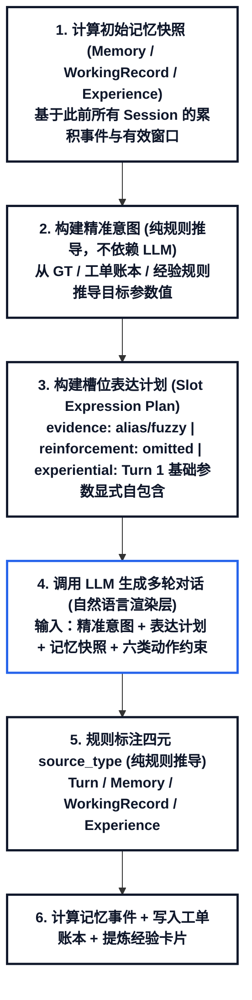

### 7.2 偏好映射表

代码位置：`src/core/preference_maps.py`

用户不会说"1080p"和"80ms"，而是说"高清""不卡"。偏好映射表将模糊表达映射到精确参数值，同时正确标注source_type。对应data_design.md的7个偏好类别。

#### 7.2.1 七种映射

**① 画质表达 → 分辨率**

| 用户口语表达 | 映射档位 | 实际值 (以微信+看直播为例) |
| ------------------------- | ------------ | ----- |
| 高清 / 高画质 / 画面好 / 超清       | good         | 1080p |
| 标清 / 普通 / 一般就行            | average      | 720p  |
| 省流量 / 流畅就行 / 随便           | average(取最低) | 720p  |

**② 速度表达 → 时延上限**

| 用户口语表达 | 映射档位 | 实际值 (以微信+看直播为例) |
| ------------------------- | ------- | ----- |
| 不卡 / 流畅 / 别卡 / 快一点        | good    | 80ms  |
| 差不多就行 / 能忍                | average | 150ms |
| 无所谓 / 不限                  | —       | 无限制   |

**③ 时间表达 → 时段**

| 用户口语表达 | 映射结果 |
| ----------- | ----------------------------- |
| 晚上          | period=evening, hours=(18,22) |
| 马上          | period=now, delta_minutes=0   |
| 周末          | day_type=weekend              |
| 一会儿         | duration_minutes=60           |

**④ 应用-业务选择偏好**

用户说"开直播"不指定APP时，Agent应优先选择哪个APP：

| 业务场景 | 首选偏好 | 次选偏好 | 决策判断 |
| ------------ | --------- | -------- | ---------------------- |
| 开直播          | 抖音(0.6)   | 快手(0.25) | 首选明确，不需消歧              |
| 会议           | 腾讯会议(0.5) | 钉钉(0.3)  | 候选接近(gap<0.2)，**需要消歧** |

排斥组合（Agent不应自动填充）：

| 不合法组合 | 原因说明 |
| ----------- | --------- |
| 微信+开直播      | 微信没有开直播功能 |
| 钉钉+开直播      | 钉钉没有开直播功能 |
| 抖音+云游戏      | 抖音没有云游戏功能 |

**⑤ 时间模式偏好**

| 模式 ID | 触发条件 | 典型时段 |
| --------------- | ------ | ----------- |
| weekday_evening | 工作日+晚上 | 19:00-22:00 |
| weekday_morning | 工作日+上午 | 09:00-12:00 |
| weekend_all_day | 周末     | 09:00-22:00 |
| lunch_break     | 午间     | 12:00-14:00 |
| late_night      | 深夜     | 22:00-02:00 |

周期规律：每日/每周/每月/每季度/每年。临时偏好(节假日/赛事)带有效时间，过期后不能当作默认值。

**⑥ 体验参数偏好结构**

完整偏好不是单一值，是preferred/fallback/rejected三层：

| 偏好类型 | 分辨率档位 | 时延上限 | 适用时段/场景 |
| ------------ | ----- | ------ | ---------- |
| preferred    | 1080p | ≤80ms  | 首选：高清+低时延  |
| fallback     | 720p  | ≤150ms | 备选：标清+一般时延 |
| rejected     | —     | —      | 排斥值        |

**多参数组合必须整体使用**：首选1080p+80ms是一个bundle，不能拆开只取其中一个用到别的场景。

**⑦ 表达映射证据来源**

区分5种证据来源，记忆强度不同：

| 证据来源 | 典型示例 |
| ---------- | --------------------------- |
| 用户明确声明     | "以后我说老业务就是指抖音直播"            |
| 澄清时确认      | Agent问"您说的开会是指腾讯会议吗?" 用户"对" |
| 纠正后确认      | Agent用了钉钉，用户纠正"我是说飞书"       |
| 多次历史归纳     | 用户3次说开会都选了飞书                |
| Agent推测未确认 | Agent推测高清=1080p，用户只是默认接受    |

关键原则：**用户确认本次任务参数，不一定等于确认长期表达映射。** 用户同意本次将"高清"处理为1080p，不代表以后"高清"始终等于1080p。

#### 7.2.2 映射如何产生 `source_type` 标注

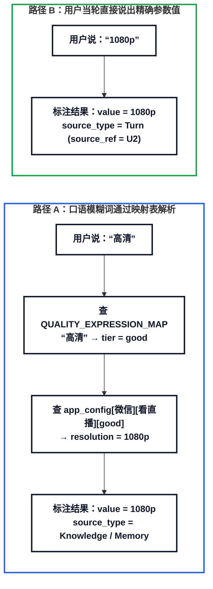

**同一个值 `1080p`，因为表达方式与信息来源不同，`source_type` 完全不同**。

#### 7.2.3 与session链的关系

偏好映射让evidence_session里的偏好证据更真实：

```
evidence_session (偏好通过选择体现):
  User: "帮我开直播"
  Agent: "请问清晰度有要求吗？"
  User: "高清，别卡"             ← 模糊表达
  Agent: "好的，为您设置1080p，时延80ms以内"   ← Knowledge映射
  → 参数: resolution=1080p(Knowledge), rtt_max=80ms(Knowledge)

reinforcement_session (再次做相同选择):
  User: "再开一次"
  Agent: "清晰度和时延跟上次一样吗？"
  User: "嗯"                  ← 确认上次选择
  → 记忆: candidate→active
```

偏好不是用户"告诉"Agent的，是Agent通过交互中的证据（我们的agent主要是追问）观察到的选择。映射表将自然语言选择翻译成精确参数值和正确的source_type标注。

### 7.3 `ref_data` 模板骨架编码规范

从 `ref_data` 的 session 数据中提取 16 种 `skeleton_signature` 格式，用于 Session 生成时的交互模式约束。`skeleton_signature` 是每个 session 的交互骨架编码，格式为：

`模板 | 轮数 | 意图数 | 意图路径 | 意图关系 | 每轮 source_type 序列 | 特殊标签`

以 `T1-4` 为例：`T1-4|1|1|I1:芒果TV/视频/3/memory/resolved|none|Record,Record,Record,Record,Turn,Turn,Turn|none`

| 签名段位 | 示例取值 | 字段语义解释 |
| :--- | :--- | :--- |
| **1. 模板 ID** | `T1-4` | 1 轮交互模板（记忆/历史记录复用） |
| **2. 交互轮数** | `1` | 共 1 轮 User-Agent 对话 |
| **3. 意图数量** | `1` | 单意图会话 |
| **4. 意图路径** | `I1:芒果TV/视频/3/memory/resolved` | 芒果TV / 视频业务 / 历史第 3 次交互 / memory 补全模式 / 已闭环 |
| **5. 意图间关系** | `none` | 单意图无跨意图关系 |
| **6. 参数溯源序列** | `Record,Record,Record,Record,Turn,Turn,Turn` | 4 个槽位来自历史记录/记忆补全，3 个槽位来自当轮输入 |
| **7. 特殊标签** | `none` | 无特殊拒识或互斥消歧标签 |

在生成 Session 时，不能让 LLM 自由发挥对话结构，而是用这个 signature 约束生成。**对话的骨架是规则定的，对话的自然语言内容是 LLM 填的。**

#### 7.3.1 骨架与自然语言的关系：X-2实例

以ref_data中的S-000049（X-2模板）为例，说明"骨架规则定、语言LLM填"具体是什么意思。

**skeleton_signature**:

```
X-2|3|3|I1:网易云游戏/云游戏/3/clarify/resolved;I2:互斥候选26/0/rejected/rejected;I3:网易云游戏/云游戏/1/direct/resolved|二选一|Turn,Turn,Knowledge,Turn,Turn,Turn,Turn;none;Turn,Turn,Turn,Turn,Turn,Turn,Turn|xor_disambiguation
```

拆解：

| 字段段位 | 具体取值 | 语义含义 |
| -------- | ---------------------------------------- | --------------------------------------- |
| 模板       | X-2                                      | 混合/特殊模板                                 |
| 轮数       | 3                                        | 3轮User-Agent对话                          |
| 意图数      | 3                                        | 3个意图                                    |
| 意图路径     | I1:网易云游戏/云游戏/3/clarify/resolved          | I1需3轮交互，走消解路径，最终resolved                |
|          | I2:互斥候选26/0/rejected/rejected            | I2不需交互(0轮)，直接rejected                   |
|          | I3:网易云游戏/云游戏/1/direct/resolved           | I3需1轮，直接resolved                        |
| 意图关系     | 二选一                                      | I1和I2互斥，只能选一个                           |
| source序列 | Turn,Turn,Knowledge,Turn...;none;Turn... | I1第3个参数来自Knowledge，其余Turn；I2无参数；I3全Turn |
| 特殊标签     | xor_disambiguation                       | 互斥消歧场景                                  |

**对话过程**:

```
Turn 1:
  User: "我想了解一下网易云游戏的云游戏保障，具体是怎么回事？"
        action_types: [Create_Intent_Request]      ← 新建意图
  Agent: "请问您是想了解...还是有其他方面想咨询呢？"
        action_types: [Request_Disambiguation]     ← 消歧追问

Turn 2:
  User: "7月13号10点到13点时延80ms高清画质，
          以及明天6点到7点1080p时延50ms"
        action_types: [Add_Sub_Intent, Inform_Slot]  ← 补充子意图+填参数
  Agent: "无法同时确认这两段需求，请确认具体信息"
        action_types: [Reject_Request, Confirm_Slot]  ← 拒绝部分+确认参数

Turn 3:
  User: "好的，我会先把这些具体信息确认清楚"
        action_types: [Affirm]              ← 确认
  Agent: "好的，您先确认好后我再为您详细核实"
        action_types: [Acknowledge]            ← 收尾
```

**intent结果**中I1的resolution参数：

```json
"resolution": {
  "min_value": {
    "value": "1080p",
    "source_type": "Knowledge",
    "source_ref": "resolution_quality_map:网易云游戏:云游戏:高清"
  }
}
```

用户说"**高清**"，Agent查知识库映射：`resolution_quality_map[网易云游戏][云游戏]["高清"]` → 1080p。所以source_type=Knowledge。

对比I3的resolution：用户直接说了"1080p"，source_type=Turn。**同一个值1080p，来源不同**。

**骨架 vs 自然语言的分工**:

| 控制维度 | 规则定死 (骨架层) | LLM 发挥 (自然语言层) |
| ----------------------- | ------------------------------------------ | ------------------------- |
| 轮数                      | 3轮                                         | —                         |
| 意图数                     | 3个                                         | —                         |
| 每轮action_type           | Turn1=Create_Intent+Request_Disambiguation | —                         |
| 参数值                     | resolution=1080p, rtt=80ms/50ms            | —                         |
| source_type             | I1的resolution=Knowledge, 其他=Turn           | —                         |
| 用户怎么表达resolution        | 必须说"高清"(因为是Knowledge来源)                    | "高清"还是"高画质"还是"清楚点" → LLM选 |
| Agent追问方式               | 必须做消歧                                      | 具体追问话术 → LLM生成            |
| 用户具体措辞                  | 必须包含APP名、时间、画质模糊词                          | 怎么串成自然句子 → LLM生成          |
| Agent回复措辞               | 必须拒绝部分+确认                                  | 怎么组织语言 → LLM生成            |

**规则决定了"谁在什么时候说什么类的话、参数从哪来"，LLM决定"具体用哪些字"。**

#### 7.3.2 16种多轮对话数据库

| 模板 ID | 交互轮数 / 意图数 | 意图关系 | 特性标签 | 业务场景说明 |
| ----------------------- | ----- | ------ | --------------------- | ---------------------------------------- |
| **T1-1**                | 1轮1意图 | —      | —                     | 直接受理：用户说明APP+业务，Agent直接办理                |
| **T1-2**                | 1轮1意图 | —      | out_of_domain         | 域外拒绝：用户提了Agent不支持的需求                     |
| **T1-3**                | 1轮2意图 | 共享参数   | —                     | 双意图：用户一次要两个业务（如视频+视频通话），共享APP参数          |
| **T1-4**                | 1轮1意图 | —      | —                     | 记忆/记录复用：用户说"按上次"，Agent从Record/Memory补全参数 |
| **T2-1**                | 2轮1意图 | —      | —                     | 参数补全：用户没说全，Agent追问一轮后办理                  |
| **T2-2**                | 2轮1意图 | —      | ambiguous: app        | 歧义消解：用户说的APP名有歧义，Agent追问消歧               |
| **T2-3**                | 2轮1意图 | —      | unsupported_service   | 不支持纠正：用户要求的业务该APP不支持，Agent纠正             |
| **T2-4**                | 2轮2意图 | 并行执行   | —                     | 双意图并行：两个独立需求同时办理                         |
| **T2-5**                | 2轮1意图 | —      | extend_end_time       | 修改时长：用户要求延长/缩短保障时长                       |
| **T2-6**                | 2轮2意图 | 局部参数覆盖 | —                     | 双意图一成一取消：一个办理一个取消                        |
| **T3-1**                | 3轮1意图 | —      | confirm_after_fill    | 补全后确认：Agent补全参数后需用户确认                    |
| **T3-2**                | 3轮1意图 | —      | incompatible_pair     | 不兼容纠正：APP和业务不匹配，3轮纠正                     |
| **T3-3**                | 3轮1意图 | —      | same_service_same_day | 同日重复保障：从Record取历史记录，检查时间冲突               |
| **T3-4**                | 3轮1意图 | —      | end_dialogue          | 补全+结束：Agent补参数后用户确认，对话结束                 |
| **X-1**                 | 1轮2意图 | —      | mixed_reject          | 域内+域外混合：一个能办一个不能办                        |
| **X-2**                 | 3轮3意图 | 二选一    | xor_disambiguation    | 互斥消歧：两个候选冲突，必须二选一                        |

编号意义：T1=1轮、T2=2轮、T3=3轮、X=混合/特殊。

#### 7.3.3 Session角色与ref_data模板映射

映射的判断标准是"Agent需要从哪里取参数"和"对话需要几轮解决"。

| 会话角色 (session_role) | 映射模板 | 映射原则与说明 |
| ------------------------- | ---------------------------- | ---------------------------------------------------------------------------------------------------- |
| **evidence_session**      | T1-1, T1-3, T2-1, T2-4, T3-1 | 用户首次暴露事实，需说出APP+业务+参数。单意图选T1-1/T2-1/T3-1（轮数1/2/3对应参数完整/不完整/需确认）；双意图选T1-3（共享参数）或T2-4（并行执行），用户一次暴露两个事实 |
| **reinforcement_session** | T1-1, T1-3, T2-1             | 再次提供一致证据，交互模式与evidence类似但内容不同。无需3轮（不需要再次确认），所以不映射T3-1；双意图选T1-3                                       |
| **distractor_session**    | T1-2, X-1, T2-6              | 干扰需求，与目标记忆无关。T1-2=域外拒绝，X-1=域内+域外混合，T2-6=一成一取消                                                        |
| **correction_session**    | T2-3, T2-5, T3-2             | 纠正更新模式。T2-3=业务不支持需纠正；T2-5=修改已有参数（如时长）；T3-2=APP和业务不兼容需多轮纠正                                            |

当前基础事实层使用 4 种 session 角色：`evidence_session`、`reinforcement_session`、`distractor_session`、`correction_session`；在三层认知架构中进一步扩展了 `working_memory_reuse_session`、`working_memory_disambiguation_session` 与五大经验记忆 `experiential_*_session`。

### 7.4 Agent 动作类型（严格限定六类）

每轮 Agent 回复必须标注 `action_types`（1-2 个），**只能从以下六类中选，禁止发明其他动作名**。

| 动作类别 | 动作名称 | 动作语义 | 典型话术示例 |
| --------------------------- | ------------------------ | ------------------ | --------------------------------------- |
| **信息询问类**（Agent 主动追问用户）     | `Request_Slot`           | 询问一个或多个明确缺失的字段     | "请问时延要求是多少？""时间是几点到几点？"                 |
|                             | `Request_Clarification`  | 当前表达整体模糊，要求用户进一步说明 | "您说的'高清'具体指720P还是1080P？"                |
|                             | `Request_Disambiguation` | 当前存在多个合理理解，要求用户消歧  | "您说的是'虎牙'游戏直播平台，还是'胡雅'这个其他应用？"          |
| **确认与复述类**（Agent 确认/受理，不追问） | `Confirm_Hypothesis`     | 提出推测性理解并请求用户确认     | "按您之前的约定，高清画面是720P，时延≤80ms，这次也按这个办，对吗？" |
|                             | `Confirm_Slot`           | 对某个参数值或完整意图进行确认/受理 | "已受理今天14:00到16:00的钉钉会议保障，720P、时延≤80ms"  |
|                             | `Acknowledge`            | 表示已收到或接受用户信息       | "收到，已记录。""好的，明白。"                       |

**使用规则：**

1. **每轮必须标注**：Agent 每轮回复的 `action_types` 数组必须包含 1-2 个动作，从上述六类中选。
2. **可组合**：同一轮可以组合使用（如 `[Acknowledge, Confirm_Slot]`），表示先确认收到再受理。
3. **禁止越界**：不得使用六类以外的动作名（如 `Reject_Request`、`Inform_Slot` 等不属于 Agent 动作）。
4. **单轮模板约束**：T1-\* 模板（只有 1 轮）Agent **只允许使用确认与复述类**（`Confirm_Hypothesis` / `Confirm_Slot` / `Acknowledge`），**禁止使用信息询问类**（`Request_Slot` / `Request_Clarification` / `Request_Disambiguation`），因为没有第二轮追问机会，追问会导致对话结束时参数未澄清，与 GT 矛盾。
5. **多轮模板无额外限制**：T2-\*/T3-\*/X-\* 模板中 Agent 可以使用全部六类动作，视对话需要自由选择。

**与用户动作的关系：**

用户 `action_types`（如 `Create_Intent_Request`、`Inform_Slot`）是独立的标注体系，与 Agent 六类动作不重叠。转换脚本输出榜样格式时只保留 Agent 的 `agent_action_types`，不保留用户动作。

### 7.5 LLM的使用边界

| 步骤编号 | 是否使用 LLM | 判定原则 |
| -------------- | - | --------------------------------- |
| 精准意图构建         | ✗ | 从GT+app_config规则推导                |
| 槽位表达计划         | ✗ | 从session_role+memory_snapshot规则推导 |
| source_type标注  | ✗ | 从参数来源规则推导                         |
| 记忆事件计算         | ✗ | 从session_role+证据条件规则推导            |
| 记忆快照更新         | ✗ | 从事件累积规则推导                         |
| 用户对话生成         | ✓ | 口语化、模糊化、别名化需要LLM                  |
| Agent回复生成      | ✓ | 六类动作标注的自然语言实现需要LLM                |
| 纠正语句生成         | ✓ | 纠正表达的措辞需要LLM                      |

**每个Session约2次LLM调用**（用户表达+Agent回复在同一个prompt中），比PersonaMem-v2的5-6次降低约60%。

### 7.6 记忆状态转移机制

事实记忆包含 6 种生命周期状态与有效时间控制：

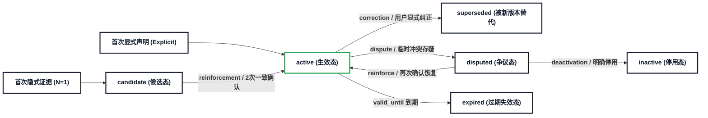

### 7.7 本例的记忆演进轨迹

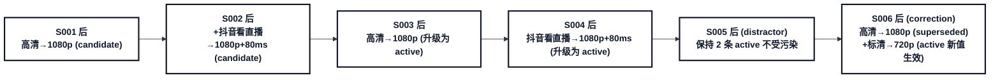

---

## 8 评测与校验

### 8.1 评测类别覆盖

5大用户事实记忆类别 × 正/负样本 + 2补充类别：

| 评测类别 | 来源 GT 层 | 评测主标签 | 正样本期望 | 本例覆盖情况 |
| ------------------------- | ------------------------------------------------- | ---------------------------------------- | --------- | ----------------------- |
| 用户个性化表达                   | `personalization_gt.expression_mappings`          | personal_expression_mapping              | 模糊表达正确映射  | ✓ quality_grade_mapping |
| 应用-业务选择偏好                 | `personalization_gt.app_business_preferences`     | parameter_completion                     | 省略信息靠记忆补全 | ✗ (无service_to_app候选)   |
| 时间模式偏好                    | `conditional_gt`                                  | time_preference + conditional_preference | 省略时间靠记忆补全 | ✗ (conditional_gt为空)    |
| 体验参数偏好                    | `personalization_gt.experience_param_preferences` | parameter_completion                     | 省略参数靠记忆补全 | ✓ multi_param_bundle    |
| 记忆更新                      | `changeable_gt`                                   | memory_update                            | 纠正后用新值    | ✓ memory_correction     |
| 追问决策                      | —                                                 | follow_up_decision                       | 证据不足追问    | ✗ (当前阶段暂不生成负样本)         |

### 8.2 一致性校验

校验分两层：**结构校验**（skeleton层面的规则检查）和**内容校验**（对话文本层面的关键断言检查）。

#### 8.2.1 结构校验

| 规则编号 | 校验规则 | 检查方法 | 本例结果 |
| -------------- | ----------------------------------- | ------------------------------------------------------------------ | ----------- |
| R1             | reinforcement必须在evidence之后          | 遍历timeline，检查每个MT的reinforcement_session_idx > evidence_session_idx | ✓           |
| R2             | 过期记忆不出现于失效后快照                       | 遍历memory_events，对has_validity的MT检查expired后的快照不含该记忆                 | ✓           |
| R3             | 纠正前Session不用纠正后记忆                   | 遍历correction_session前的所有快照，确认不含corrected值                          | ✓           |
| R4             | 至少1个跨Session复用节点                    | 检查reinforcement_session中memory_snapshot非空                          | ✓ S003/S004 |
| R5             | 至少1个干扰Session                       | 检查distractor_session存在                                             | ✓ S005      |
| R6             | 时间戳严格递增                             | 遍历sessions，检查reference_time单调递增                                    | ✓           |
| R7             | 每个primary MT有evidence+reinforcement | 检查每个非extending MT至少分配2个session                                     | ✓           |
| R8             | 个性化类型覆盖                             | 检查MANDATORY_GROUPS每组至少1个MT                                         | ✓           |

#### 8.2.2 内容校验

| 断言编号 | 断言内容 | 检查方法 | 失败处理策略 |
| ---------------- | ---------------------------------- | --------------------------------------------- | ------------------------- |
| C1               | reinforcement_session中Agent使用了记忆补全 | 从Agent回复中提取参数值，与memory_snapshot对比             | 标记为eval_fail，重新生成该session |
| C2               | evidence_session中Agent未使用尚未形成的记忆   | 检查Agent回复不含后续才出现的参数值                          | 标记为leak，重新生成              |
| C3               | correction_session后Agent使用纠正后的新值   | 对比纠正后的session中Agent使用的值与corrected值            | 标记为eval_fail，重新生成         |
| C4               | GT不泄漏到Agent可见层                     | 检查Agent回复不含ground_truth独有信息（如confidence、内部ID） | 标记为leak，截断处理              |
| C5               | distractor_session不影响目标记忆          | 检查distractor后的memory_snapshot与之前一致            | 标记为side_effect，人工审核       |

#### 8.2.3 实现方式

```
def validate_skeleton(skeleton: dict) -> dict:
    """结构校验：纯规则，不依赖LLM"""
    results = {}
    results["R1"] = _check_evidence_before_reinforcement(skeleton)
    results["R2"] = _check_expired_memory_not_in_snapshot(skeleton)
    results["R3"] = _check_no_future_memory_leak(skeleton)
    results["R4"] = _check_has_reuse_node(skeleton)
    results["R5"] = _check_has_distractor(skeleton)
    results["R6"] = _check_timestamps_monotonic(skeleton)
    results["R7"] = _check_mt_session_coverage(skeleton)
    results["R8"] = _check_mandatory_group_coverage(skeleton)
    return results

def validate_sessions(skeleton: dict, sessions: list[dict]) -> dict:
    """内容校验：需解析LLM生成的对话文本"""
    results = {}
    results["C1"] = _check_memory_used_in_reinforcement(skeleton, sessions)
    results["C2"] = _check_no_premature_memory_use(skeleton, sessions)
    results["C3"] = _check_correction_effective(skeleton, sessions)
    results["C4"] = _check_no_gt_leak(skeleton, sessions)
    results["C5"] = _check_distractor_no_side_effect(skeleton, sessions)
    return results
```

结构校验在skeleton生成后立即执行（生成阶段），内容校验在对话生成后执行（输出阶段）。两者都通过则输出，否则标记问题并重试。

---

## 9 输出格式

每个用户输出两个文件：

### 9.1 画像骨架文件

"应该发生什么" — 确定性设计文档，不包含对话文本

```
{
  "persona_id": "P000",
  "persona_ground_truth": {
    "static_gt": { ... },
    "conditional_gt": [ ... ],
    "changeable_gt": [ ... ],
    "personalization_gt": { ... }
  },
  "memory_targets": [ ... ],
  "timeline": { "sessions": [ ... ] },
  "evaluation_plan": { ... },
  "validation": { ... }
}
```

### 9.2 对话记录文件

"实际发生了什么" — 一行一个session，兼容ref_data格式

```
{
  "session_id": "S001",
  "user_id": "P000",
  "reference_time": "2026年05月03日16时30分",
  "session_meta": {
    "template_id": "T2-1",
    "round_count": 2,
    "intent_count": 1,
    "session_role": "evidence_session",
    "evaluation_tags": ["evidence_formation"],
    "target_memory_ids": ["MT_001"]
  },
  "event_sequence": [ ... ],
  "intents": [ ... ],
  "slot_updates": [ ... ],
  "memory_snapshot_before": { ... },
  "memory_events_after": [ ... ],
  "gold_memory_state_after": { ... }
}
```

**与ref_data的兼容性**：session_id/user_id/reference_time/session_meta/event_sequence/intents/slot_updates格式完全兼容。新增的memory_snapshot_before/memory_events_after/gold_memory_state_after在ref_data消费时忽略即可。

---

## 10 数据流图

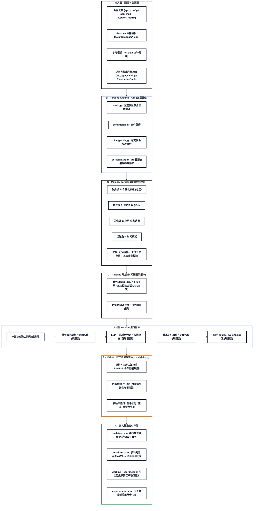

**依赖关系**：

| 流水线阶段 | 规则层 (不用 LLM) | LLM 层 (提示词驱动) |
| -------------------- | -------------------- | ---------- |
| B-GT构建               | persona模板+映射表推导      | —          |
| C-MT选择               | 评分函数+优先级+diversity排斥 | —          |
| D-Timeline           | 角色排列+间隔规则            | —          |
| E-快照/意图/表达/标注/事件     | 全部规则推算               | 仅E4对话生成    |
| F-校验                 | R1-R14 结构与认知闭环校验     | C1-C5需解析文本 |